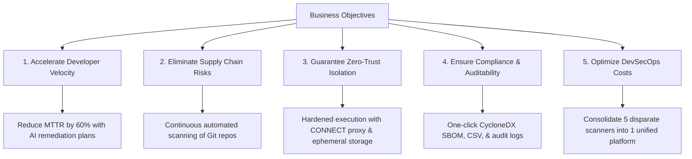

# Problem Statement & Business Objectives

> **Document ID:** VS-DOC-02  
> **Status:** Approved Baseline  
> **Version:** 1.0.0  
> **Date:** November 2026  
> **Target Audience:** Executive Leadership, CISO, Product Managers, Lead Architects  

---

## 1. Context and Problem Statement

### 1.1 The Modern DevSecOps Dilemma
Modern software development moves at unprecedented velocity, powered by open-source libraries, microservices, and Infrastructure-as-Code. However, this explosion of dependencies has introduced severe systemic risks into the enterprise software supply chain:

1. **Massive Transitive Dependency Attack Surface:** Up to 80-90% of code in modern applications originates from third-party packages. Vulnerabilities nested deep within transitive dependencies (e.g., Log4Shell, event-stream) are invisible without deep tree analysis.
2. **Tool Fragmentation & Security Fatigue:** Engineering teams are forced to juggle 4–6 disconnected security tools: one for open-source libraries (SCA), one for source code (SAST), one for secrets, and another for cloud configurations. Each tool emits distinct formats, conflicting severities, and high rates of false positives, causing developer alert fatigue.
3. **Execution Risks When Scanning Untrusted Code:** Traditional hosted scanners often run on shared workers or with high privileges. Cloned repositories can contain hostile build hooks, malicious symlinks targeting `/etc/passwd` or cloud metadata (`169.254.169.254`), and malicious packages that execute arbitrary code upon checkout or manifest resolution.
4. **Data Privacy & IP Exfiltration Fears:** Enterprises are hesitant to send proprietary codebases to cloud-hosted security platforms or third-party AI models due to fears of trade secret leaks, intellectual property loss, or unauthorized model training.
5. **Slow Remediation Cycles:** Traditional vulnerability reports provide cryptic vulnerability IDs (e.g., CVE-2023-XXXX) without context on whether the vulnerability is reachable, how to upgrade safely, or whether an upgrade introduces breaking changes.

---

## 2. Business Objectives

VulnSight AI was created to solve these challenges through a unified, secure, and developer-centric platform. The primary business objectives are defined across five key pillars:

### 2.1 Specific, Measurable Objectives (OKRs)

| Strategic Pillar | Target Metric (Objective) | Key Result / Verification |
| :--- | :--- | :--- |
| **Developer Velocity** | Reduce Mean Time to Remediate (MTTR) by 60%. | Automated AI fix recommendations, deterministic version jump risk analysis (major/minor/patch), and actionable dependency upgrade paths. |
| **Comprehensive Coverage** | 100% unified vulnerability discovery across code, libraries, secrets, and IaC. | Single orchestration run executing SCA, Semgrep, Gitleaks, Trivy, and Checkov in one pass. |
| **Infrastructure Security** | 0% host compromise or credential leakage from scanning untrusted repositories. | Ephemeral containerized workers, single-use credential grants, symlink destruction, and enforced CONNECT-only egress filtering. |
| **Supply Chain Compliance** | 100% compliance with Executive Order 14028 & software transparency standards. | Instant generation of CycloneDX v1.5 standard Software Bill of Materials (SBOM) with Package URLs (purl) and vulnerability hashes. |
| **Total Cost of Ownership (TCO)** | Reduce security tooling overhead by at least 40%. | Zero external runtime dependencies in core server; open-source scanner integration; low-cost serverless execution on Azure Container Apps. |

---

## 3. Stakeholder Value Analysis

### 3.1 Chief Information Security Officer (CISO) & Security Leadership
- **Centralized Posture Visibility:** Real-time organizational Security Posture Score (0–100, graded A to F) aggregated across all repositories and teams.
- **Strict Compliance Governance:** Complete audit logging (`audit_logs`) tracking every user login, role change, scan initiation, and finding state modification.
- **Guaranteed Isolation:** Peace of mind knowing customer or partner repositories cannot execute lateral movement or access cloud instance metadata.

### 3.2 Lead Developers & Engineering Teams
- **Zero Configuration Burden:** Support for standard Git providers and repositories without requiring complex agent installations or local database setups.
- **Contextual Triage:** Ability to assign findings, mark false positives, suppress accepted risks with documented rationale, and review complete finding history.
- **Safe AI Assistance:** Explanations and remediation diffs generated under strict developer consent without exposing proprietary secrets or sensitive logic.

### 3.3 Compliance Auditors & Procurement
- **Standardized SBOM Generation:** Machine-readable CycloneDX JSON exports detailing all direct and transitive dependencies with exact versions and ecosystem identifiers.
- **Tamper-Evident Historical Records:** Inviolable scan snapshots and immutable finding fingerprints that survive codebase branch deletions and package updates.

---

## 4. Scope and Success Criteria

### 4.1 In Scope
- Multi-tenant enterprise management: Organizations, Teams, RBAC (Owner, Admin, Developer, Viewer).
- Automated scanning triggered via Webhooks (GitHub, GitLab, Bitbucket), Cron-like Schedules, or Manual API calls.
- Integrated multi-vector scanning: SCA (OSV.dev), SAST (Semgrep), Secrets (Gitleaks), Container (Trivy), IaC (Checkov).
- Single-use credential grant system preventing persistent Git token distribution to scan jobs.
- Egress restriction engine blocking non-allowlisted network egress, IP literals, and metadata services.
- Multi-format compliance reporting (CycloneDX SBOM, Markdown, CSV with formula injection defense, JSON).
- Governed AI assistant with Claude 3.5 Sonnet and OpenAI GPT-4o integration, prompt injection protection, and code privacy controls.

### 4.2 Out of Scope (Deferred to Future Roadmap)
- Dynamic Application Security Testing (DAST) and live web crawler fuzzing.
- Automated Pull Request autofix bot pushing commits directly to Git providers.
- Real-time billing and payment gateway integration (Stripe/SaaS metering).
- Enterprise Single Sign-On (SAML 2.0 / OIDC) and hardware-token Multi-Factor Authentication (MFA).
- Clustered multi-replica PostgreSQL/Redis deployment (current release leverages single-node embedded SQLite with an architectural abstraction for seamless migration).

---

## 5. Risk Assessment & Mitigations

| Identified Risk | Severity | Mitigation Strategy |
| :--- | :---: | :--- |
| **Malicious Repository Attack (RCE / SSRF)** | High | Pre-clone URL and DNS validation, IP literal rejection, DNS pinning (`http.curloptResolve`), symlink purging, and sandboxed container execution. |
| **Worker Exfiltration to Adversary C2** | High | CONNECT-only egress proxy (`egress-proxy.js`) with strict domain allowlist; NSG denying direct outbound internet access. |
| **AI Prompt Injection via Code Comments** | Medium | Automated screening with `INJECTION_PATTERNS`, input length caps, untrusted XML delimiter tagging, and strict server-enforced ground truth invariance. |
| **Denial of Service via Heavy Workloads** | Medium | Asynchronous password hashing on bounded libuv worker pool (`MAX_HASHING = 2`), sliding window API rate limiting, and scan timeout limits. |
