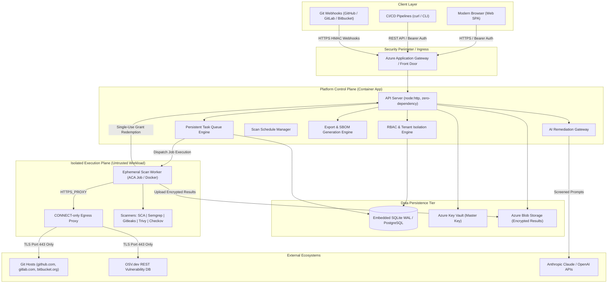

# High-Level Architecture (HLD)

> **Document ID:** VS-DOC-04  
> **Status:** Approved Baseline  
> **Version:** 1.0.0  
> **Date:** November 2026  
> **Target Audience:** Enterprise Architects, Security Officers, Cloud Engineers, Lead Developers  

---

## 1. System Context & Overview

VulnSight AI is designed as a cloud-native, multi-tier security scanning and vulnerability management platform. It decouples high-level user interaction, API routing, and state management from low-level, high-risk scanner executions on untrusted repositories.



---

## 2. Architectural Tiers

The system is structured into four primary logical tiers, each separated by strict security and communication boundaries:

### 2.1 Presentation & Ingress Tier
- **Single Page Application (SPA):** Lightweight vanilla JavaScript application constructed with zero frontend build dependencies. Implements DOM-safe element construction (`textContent` only), entirely eliminating Cross-Site Scripting (XSS) vectors.
- **Security Headers & Ingress Boundary:** Strict Content Security Policy (`script-src 'self'`), `X-Frame-Options: DENY`, `referrer-policy: no-referrer`, and explicit denial of browser cookie-based authentication, completely neutralizing Cross-Site Request Forgery (CSRF).

### 2.2 Platform Control Plane (API & Orchestrator)
- **Zero-Dependency Core:** Built exclusively on Node.js standard libraries (`node:http`, `node:crypto`, `node:net`, `node:dns`), drastically minimizing supply chain vulnerabilities.
- **Tenant Isolation & Security Engine:** Enforces multi-tenancy at the data access layer by validating organization membership and role permissions (`can(role, permission)`) prior to any query execution.
- **Asynchronous Task Queue:** In-memory and database-backed queue handling scan dispatching, exponential retry backoff, and automatic dead-job reaping.
- **Single-Use Credential Authority (`scan_grants`):** Issues short-lived, single-use cryptographically random tokens bound to specific scan runs, avoiding token dissemination to worker payloads.

### 2.3 Sandboxed Execution Plane (Workers)
- **Zero-Trust Compute:** Scan workers run within short-lived, unprivileged containers. They are deployed via Azure Container Apps Jobs (`aca` mode) or hardened local Docker engines (`docker` mode).
- **Hardened Container Configuration:** Linux containers execute with dropped capabilities (`--cap-drop ALL`), `no-new-privileges`, read-only root filesystems, unprivileged user ID (`10001`), strict CPU/memory limits, and hard execution timeouts.
- **Network Egress Confinement:** Worker containers reside in dedicated private subnets with Network Security Groups (NSGs) blocking all direct internet outbound access. Outbound traffic is forced through an explicit CONNECT-only forward proxy.

### 2.4 Data Persistence & Secrets Tier
- **Relational Storage:** Relational persistence utilizing SQLite in Write-Ahead Logging (WAL) mode with foreign key enforcement. Structured with an abstraction layer (`db.js`) designed for 1:1 migration to managed PostgreSQL.
- **Key Vault Encryption:** All persistent Git provider tokens and webhook secrets are encrypted at rest using AES-256-GCM. The 256-bit encryption key is managed securely in Azure Key Vault with purge protection enabled.
- **Blob Storage Staging:** Large scan result payloads are written directly by workers to Azure Blob Storage and retrieved via short-lived SAS tokens by the API orchestrator.

---

## 3. Trust Boundaries & Security Architecture

```mermaid
graph LR
    subgraph UntrustedZone ["Untrusted Zone"]
        Repo["Customer Git Repository"]
        Internet["External Internet"]
    end

    subgraph SandboxZone ["Hardened Sandbox (Zone 1)"]
        Worker["Scan Job Worker"]
        Workspace["Ephemeral /work mount"]
    end

    subgraph ControlZone ["Protected Control Plane (Zone 2)"]
        Proxy["Egress Proxy"]
        API["API Server"]
        DB[(Platform Database)]
        KV["Key Vault"]
    end

    Repo -.->|Cloned over HTTPS| Workspace
    Worker -->|Scans| Workspace
    Worker -->|Tunnel Request (CONNECT)| Proxy
    Proxy -->|Allowlisted FQDN Only| Internet
    Worker -->|Redeem Single-Use Secret| API
    API --> DB
    API --> KV
```

### 3.1 Trust Boundary 1: The Repository Boundary
Customer source code is treated as active, potentially malicious data:
- **No Build Scripts:** VulnSight AI never executes `npm install`, `pip install`, `make`, or arbitrary shell scripts.
- **Symlink Destruction:** Every symbolic link in a cloned workspace is deleted before scanner execution, preventing attackers from referencing host paths (`/etc/passwd`).
- **Workspace Cleanup:** Workspaces exist only in ephemeral temporary storage and are strictly deleted in a `finally` block upon scan termination.

### 3.2 Trust Boundary 2: The Worker-to-Control-Plane Boundary
- The worker is never granted write access to the core database.
- The worker receives no persistent API tokens or long-lived Git credentials.
- All interactions with the control plane are limited to single-use secret redemption and authenticated blob result upload.

---

## 4. Scalability & Availability Model

| Dimension | Architectural Approach | Scaling Limit / Target |
| :--- | :--- | :--- |
| **API Server Throughput** | Event-driven non-blocking I/O with asynchronous offloaded password hashing. | Sustains >1,000 req/s per single container instance. |
| **Worker Concurrency** | Ephemeral Azure Container Apps Jobs spinning up dynamically per queued scan. | Scales horizontally up to 100+ concurrent scan jobs. |
| **Database Concurrency** | SQLite WAL mode with concurrent readers and serialized writes. | Transition to Azure Database for PostgreSQL for multi-replica API deployments. |
| **Rate Limiting** | In-memory sliding-window limiter keyed by IP and account identifiers. | Modular interface designed for drop-in Redis cluster backend. |

---

## 5. Resilience & Fault Tolerance

1. **Scanner Fault Isolation:** Scanners execute independently via `runAdapters()`. If an individual scanner (e.g., Checkov) encounters a syntax error or missing binary, the adapter catches the exception, logs an informational error, and allows the remaining scanners (SCA, Semgrep, Gitleaks, Trivy) to complete successfully.
2. **Worker Crash & Reaping:** The queue daemon scans for scans trapped in `running` status exceeding maximum timeout thresholds. Stranded jobs are automatically flagged as failed and cleaned up.
3. **Database Integrity:** Database migrations are version-controlled, executed sequentially in single transactions, and supported by non-blocking online `VACUUM INTO` backups.
