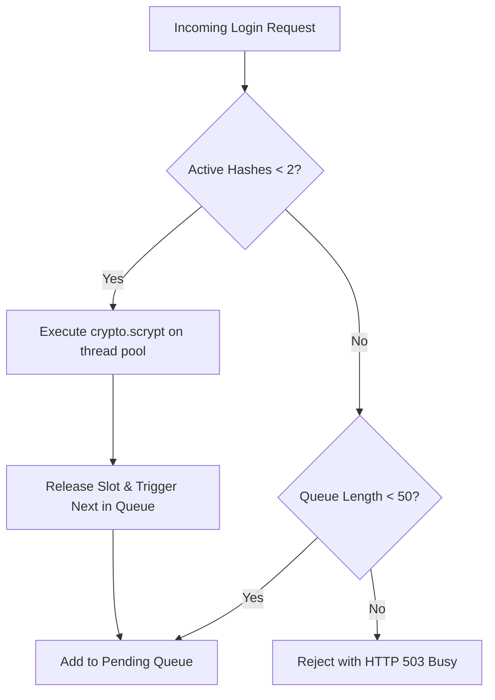
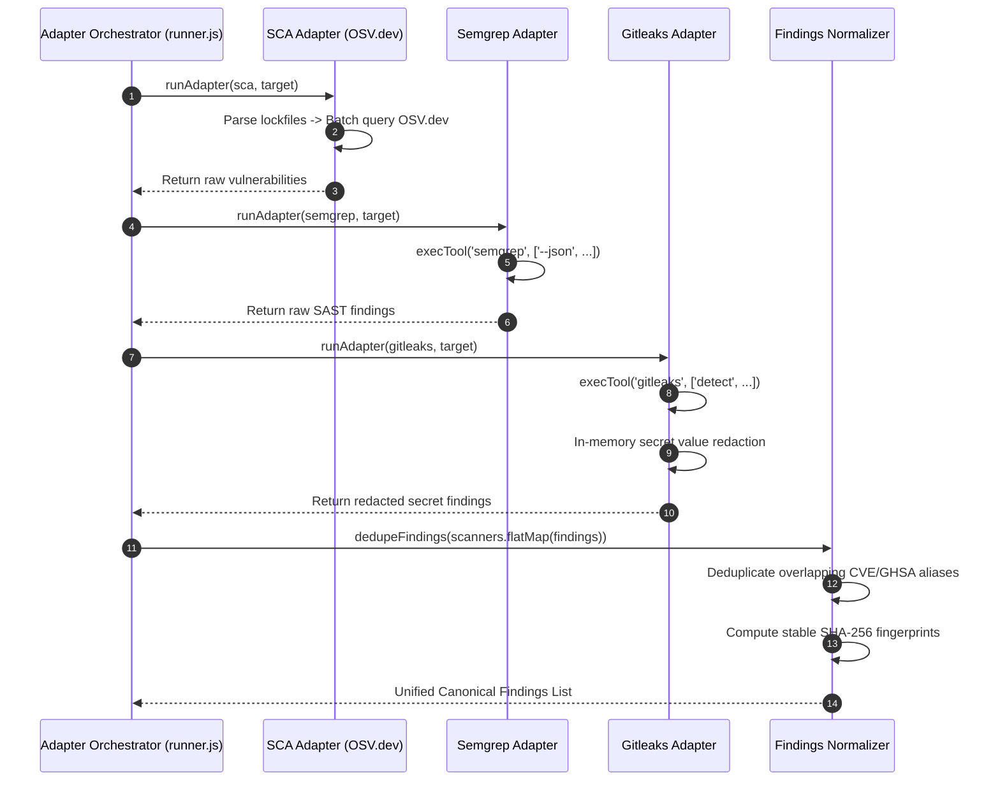
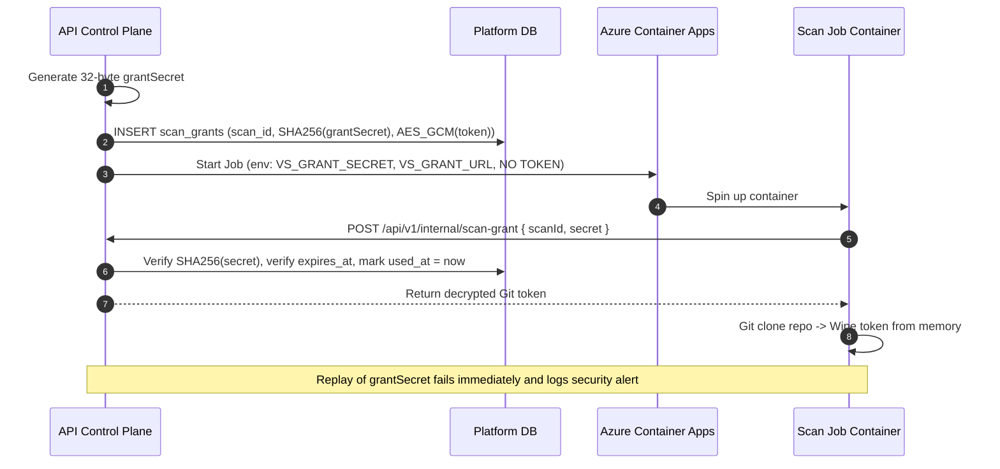

# Low-Level Architecture (LLD)

> **Document ID:** VS-DOC-05  
> **Status:** Approved Baseline  
> **Version:** 1.0.0  
> **Date:** November 2026  
> **Target Audience:** Core Software Engineers, Security Developers, Systems Architects  

---

## 1. Module Hierarchy & Directory Structure

VulnSight AI maintains a modular, decoupled codebase with strict separation between business logic, security infrastructure, scanning adapters, and API routing:

```
src/
├── index.js                     # Public API exports & programmatic entry point
├── cli.js                       # CLI parser for local scans and server bootstrapping
├── detect.js                    # Lockfile and manifest auto-detection engine
├── findings.js                  # Normalized Finding model, fingerprinting & deduplication
├── risk.js                      # Risk scoring & Security Posture Score calculation
├── severity.js                  # CVSS v3.1 base score computation & severity mapping
├── versions.js                  # SemVer & PEP 440 version comparison utilities
├── adapters/                    # Scanner execution and output transformation
│   ├── index.js                 # Unified scanTarget orchestration entry
│   ├── runner.js                # Shell-free process execution (execTool) & timeouts
│   ├── sca.js                   # Lockfile parsers -> OSV.dev batch API integration
│   ├── semgrep.js               # Semgrep CLI wrapper, ruleset mapping & parsing
│   ├── gitleaks.js              # Gitleaks CLI wrapper, rule parsing & secret redaction
│   ├── trivy.js                 # Trivy CLI wrapper (filesystem & container images)
│   └── checkov.js               # Checkov CLI wrapper for Infrastructure-as-Code
├── ai/                          # Governed AI assistant subsystem
│   ├── assistant.js             # Injection screening, consent gating, prompt builder
│   └── providers.js             # Anthropic Claude & OpenAI HTTP clients
├── parsers/                     # Native lockfile syntax parsers
│   ├── npm.js                   # package-lock.json (v1, v2, v3), npm-shrinkwrap.json
│   ├── python.js                # requirements.txt, poetry.lock, Pipfile.lock
│   ├── yarn.js                  # yarn.lock (v1 & Berry)
│   ├── pnpm.js                  # pnpm-lock.yaml (v9 snapshots & importers)
│   └── go.js                    # go.sum module dependency parsing
├── platform/                    # Multi-tenant enterprise platform engine
│   ├── api.js                   # HTTP router, rate limiter, security headers
│   ├── app.js                   # Platform lifecycle bootstrapping
│   ├── crypto.js                # AES-256-GCM, async scrypt queue, token hashing
│   ├── db.js                    # SQLite WAL engine, schema migrations, queries
│   ├── egress-proxy.js          # CONNECT-only allowlist forward proxy
│   ├── executors.js             # Executor factory (ACA, Docker, Process)
│   ├── aca.js                   # Azure Container Apps Job execution driver
│   ├── sandbox.js               # Docker worker runner with capability dropping
│   ├── git.js                   # SSRF defense, DNS pinning, workspace sanitization
│   ├── queue.js                 # Task queue, retry backoff, worker polling
│   ├── rbac.js                  # Role-to-permission mapping and assertion guards
│   ├── scan-job.js              # In-container scan entry point for ACA workers
│   └── service.js               # Core domain service layer (55 KB orchestration logic)
└── reports/
    └── export.js                # JSON, CSV, CycloneDX SBOM v1.5, Markdown generators
```

---

## 2. Core Subsystems Detail

### 2.1 Storage & Schema Subsystem (`src/platform/db.js`)
The storage layer encapsulates SQLite via Node’s native `node:sqlite.DatabaseSync` module:
- **Concurrency & Resilience:** Initialized with `PRAGMA foreign_keys = ON; PRAGMA journal_mode = WAL;`.
- **Migration Engine:** Sequential migration runner verifying `schema_version`. Migrations run within a single transaction to guarantee atomic database updates.
- **Tenant Partitioning:** Every domain entity (`repositories`, `scans`, `findings`, `audit_logs`, `teams`, etc.) maintains an `org_id` foreign key. The service layer strictly filters every query by `org_id`.

### 2.2 Security, Cryptography & Concurrency Protection (`src/platform/crypto.js`)



1. **Bounded Password Hashing Queue (`withHashSlot`):**
   - Synchronous `scrypt` blocks the event loop for ~35ms per call. To prevent DoS starvation of DNS resolution and HTTP handling, hashing is performed asynchronously via `crypto.scrypt` on libuv’s thread pool.
   - Hard concurrency cap: `MAX_HASHING = 2`.
   - Max queue size: `MAX_HASH_QUEUE = 50`. Excess requests immediately fail-fast with `HTTP 503 Service Unavailable`.
2. **Secrets Encryption at Rest (`createSecretBox`):**
   - Uses `aes-256-gcm` authenticated encryption.
   - Sourced from 32-byte base64-encoded `VULNSIGHT_MASTER_KEY`.
   - Generates a fresh 12-byte initialization vector (`iv`) per encryption.
   - Encapsulated into versioned envelope format: `v1.<iv_base64>.<authTag_base64>.<ciphertext_base64>`.

### 2.3 SSRF Defense & Git Workspace Sanitization (`src/platform/git.js`)

#### 2.3.1 Pre-Clone URL Validation (`validateRepoUrl`)
- Enforces `https://` protocol only; disallows user credentials in URL (`user:pass@host`).
- Enforces standard port (443 only); strips and rejects queries and fragments (`?`, `#`).
- Validates hostname syntax; disallows IP literals (IPv4 and IPv6) and local names (`localhost`, `*.internal`, `*.local`).
- Resolves all A and AAAA DNS records via `dns.lookup({ all: true })`.
- Iterates through every resolved address: if **any** address belongs to private IPv4 ranges (`10.0.0.0/8`, `172.16.0.0/12`, `192.168.0.0/16`, `127.0.0.0/8`, `169.254.0.0/16`) or private/link-local IPv6 ranges (`::1`, `fc00::/7`, `fe80::/10`), the URL is immediately rejected.
- Pins the validated IP for the clone using Git curl resolve config: `--config http.curloptResolve=<host>:443:<validated_ip>`, preventing Time-of-Check to Time-of-Use (TOCTOU) DNS rebinding attacks.

#### 2.3.2 Workspace Sanitization (`sanitizeWorkspace`)
Before scanners are invoked, the workspace directory undergoes recursive inspection:
- Destroys `.git` directory to disable hostile Git hooks (`core.hooksPath`, `fsmonitor`).
- Detects and deletes **every symbolic link** using `fs.lstatSync` and `fs.unlinkSync`, preventing scanners from reading target host files.
- Enforces strict quotas: rejects repositories exceeding 500 MB total size or 100,000 individual files.

### 2.4 Egress Allowlist Proxy (`src/platform/egress-proxy.js`)
The egress proxy acts as a security gateway between isolated scan workers and the external internet:
- **Protocol Enforcement:** Only accepts HTTP `CONNECT` tunnel requests. Plain HTTP methods (`GET`, `POST`) are immediately rejected with `HTTP 403 Forbidden`.
- **Port Enforcement:** Strictly permits outbound connections to port 443. All other ports (80, 22, 8080) are rejected.
- **DNS Verification & Rebinding Defense:** The proxy resolves hostnames internally. If any DNS answer resolves to an internal or metadata IP, the connection is aborted. The proxy connects directly to the validated IP.
- **Tunnel Limits & Abuse Prevention:**
  - Maximum concurrent tunnels: `maxTunnels = 200`.
  - Maximum upload volume per tunnel: `maxUploadBytes = 100 MB`.
  - Idle socket timeout: 60 seconds.
  - Denials logged with structured audit events (`egress.denied`).

---

## 3. Scanner Adapters & Execution Flow



### 3.1 Normalization & Deterministic Fingerprinting (`src/findings.js`)
Every finding is mapped into a canonical representation:
```json
{
  "id": "uuid-v4",
  "fingerprint": "sha256-hex",
  "category": "sca | sast | secret | container | iac",
  "severity": "critical | high | medium | low | info",
  "cvssScore": 8.5,
  "title": "Normalized vulnerability title",
  "description": "Sanitized advisory or rule summary",
  "identifiers": {
    "primary": "CVE-2023-XXXX",
    "aliases": ["GHSA-yyyy-zzzz"],
    "cwe": ["CWE-79"]
  },
  "location": {
    "file": "src/auth.js",
    "line": 42,
    "package": "lodash",
    "version": "4.17.15",
    "ecosystem": "npm",
    "direct": true
  },
  "remediation": {
    "fixedIn": "4.17.21",
    "recommendation": "Upgrade lodash to 4.17.21"
  },
  "scanner": {
    "name": "osv | semgrep | gitleaks | trivy | checkov",
    "ruleId": "javascript.lang.security.audit.sqli"
  }
}
```
**Fingerprint Formula:**
$$\text{Fingerprint} = \text{SHA256}\Big(\text{category} \parallel \text{package/file} \parallel \text{primary\_identifier/ruleId} \parallel \text{line\_number}\Big)$$

---

## 4. Single-Use Credential Grant Architecture (`scan_grants`)

To eliminate the critical risk of long-lived access tokens being captured inside scan worker containers:


