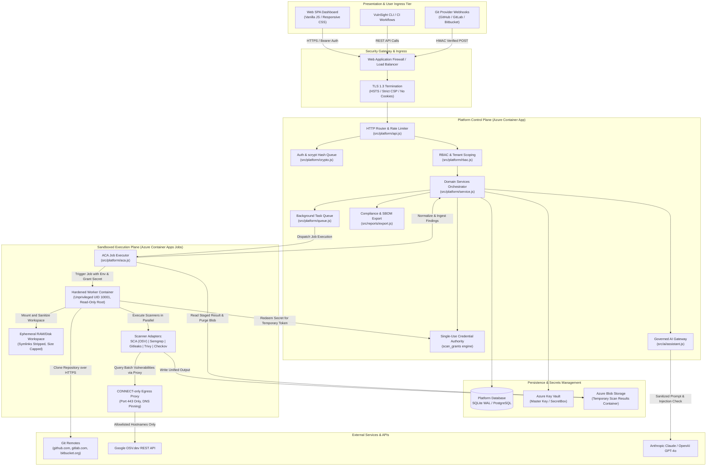
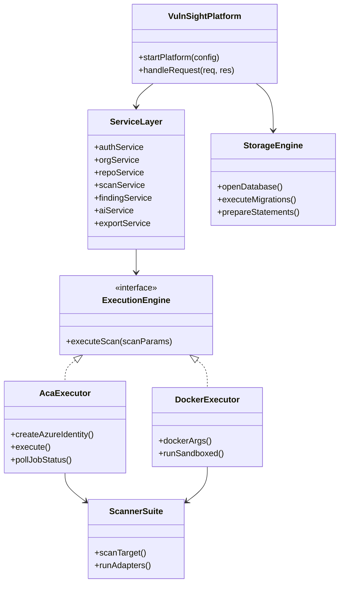

# Solution Architecture Diagram

> **Document ID:** VS-DOC-06  
> **Status:** Approved Baseline  
> **Version:** 1.0.0  
> **Date:** November 2026  
> **Target Audience:** Solution Architects, Technical Leads, DevOps Specialists, Security Auditors  

---

## 1. High-Level Solution Topology

VulnSight AI operates as an integrated software security solution connecting web users, automated CI/CD webhooks, isolated cloud compute, and external vulnerability intelligence services.

---

## 2. Communication Protocols & Boundaries

| Communication Link | Source Component | Destination Component | Protocol / Port | Security Mechanisms |
| :--- | :--- | :--- | :--- | :--- |
| **User Ingress** | Browser / Client | Ingress Gateway | HTTPS / 443 | TLS 1.3, Strict CSP, No-Cookie Bearer Tokens. |
| **API to DB** | Service Layer | Relational DB | Native IPC / TCP (5432) | WAL Mode, Parameterized Prepared Statements. |
| **API to Key Vault** | Service Layer | Azure Key Vault | HTTPS / 443 | User-Assigned Managed Identity, RBAC. |
| **Worker Dispatch** | Job Orchestrator | Azure ARM API | HTTPS / 443 | `Container Apps Jobs Operator` role identity. |
| **Grant Redemption** | Worker Pod | API Control Plane | HTTPS / 443 | One-time secret, SHA-256 match, 10-min TTL. |
| **Worker Egress** | Worker Container | Egress Proxy | HTTP CONNECT / 3128 | Internal VNet route, Hostname Allowlist, DNS Pinning. |
| **Proxy Outbound** | Egress Proxy | External APIs | TLS / 443 | Strict FQDN checking, private IP refusal. |
| **AI Query** | AI Gateway | Anthropic / OpenAI | HTTPS / 443 | Zero secret transmission, `<untrusted>` tagging. |

---

## 3. Structural Decomposition

---

## 4. Key Operational Characteristics

1. **Decoupled Job Lifecycle:** The API Control Plane never executes scanners inside its own Node.js runtime process. Scans are dispatched asynchronously to dedicated worker containers, ensuring that memory leaks, native crashes, or infinite loops caused by malicious codebases cannot destabilize the management server.
2. **Deterministic Data Flow:** Every scan produces an immutable, point-in-time snapshot of findings stored in `scans` and `findings` tables. Finding triage modifications are tracked separately in `finding_states` and `finding_reviews`, preserving historical integrity across subsequent scans.
3. **Resilient Network Confinement:** Workers operate inside a closed loop. If an adversary attempts to connect back to their command-and-control server or pivot laterally to instance metadata (`169.254.169.254`), the Network Security Group drops direct packets, and the egress proxy terminates unauthorized CONNECT tunnels immediately.
