# System Component Diagram

> **Document ID:** VS-DOC-07  
> **Status:** Approved Baseline  
> **Version:** 1.0.0  
> **Date:** November 2026  
> **Target Audience:** Systems Engineers, Integration Architects, Security Engineers  

---

## 1. System Component Overview

The VulnSight AI platform is built as a set of interacting components that enforce security boundaries, manage state, and coordinate vulnerability analysis across heterogeneous tools.

```mermaid
graph TD
    subgraph UI_Module ["Web Frontend Component (web/)"]
        App["app.js (Router & Shell)"]
        Lib["lib.js (DOM Builder & API Client)"]
        ViewsMain["views-main.js (Overview, Repos, Scans)"]
        ViewsMore["views-more.js (AI, Reports, Settings)"]
        Styles["styles.css (Design System & Theme)"]
    end

    subgraph API_Module ["API & Routing Component (src/platform/api.js)"]
        HttpServer["node:http Server"]
        RateLimiter["createRateLimiter() (Sliding Window)"]
        StaticServer["serveStatic() (Path Traversal Proof)"]
        RouteDispatcher["match() Route Dispatcher"]
        SecurityMiddleware["Security Headers (CSP, Frame, Sniff)"]
    end

    subgraph Platform_Core ["Platform Core Services (src/platform/service.js)"]
        AuthSvc["AuthService (Login, Signup, Sessions)"]
        OrgSvc["OrgService (Orgs, Memberships)"]
        TeamSvc["TeamService (Teams & Scoping)"]
        RepoSvc["RepoService (Repos, Schedules, Webhooks)"]
        ScanSvc["ScanService (Orchestrator & Ingestion)"]
        FindingSvc["FindingService (Triage & History)"]
        GrantSvc["GrantAuthority (Single-Use Token Exchange)"]
        AuditSvc["AuditLogger (Structured Audit Records)"]
        NotifSvc["NotificationService (Alerts & Badges)"]
    end

    subgraph Adapters_Module ["Scanner Adapters Component (src/adapters/)"]
        Runner["runner.js (execTool, Timeouts, Shell-Free)"]
        ScaAdapter["sca.js (Lockfiles -> OSV.dev Client)"]
        SemgrepAdapter["semgrep.js (AST SAST Analyzer)"]
        GitleaksAdapter["gitleaks.js (Secret Scanner & Redactor)"]
        TrivyAdapter["trivy.js (Container & Filesystem CVEs)"]
        CheckovAdapter["checkov.js (IaC Misconfiguration Analyzer)"]
    end

    subgraph AI_Module ["AI Assistant Component (src/ai/)"]
        Assistant["assistant.js (Injection Defense, Consent Gate)"]
        Providers["providers.js (Anthropic & OpenAI HTTP Clients)"]
        ImpactCalc["upgradeImpact() (Deterministic Semver Calculator)"]
    end

    subgraph Storage_Module ["Storage & Security Engine"]
        DBEngine["db.js (SQLiteSync, WAL, Migrations)"]
        CryptoEngine["crypto.js (AES-256-GCM, scrypt Async Pool)"]
        RBACEngine["rbac.js (Role & Permission Matrix)"]
        QueueEngine["queue.js (Task Queue & Auto-Reap)"]
        GitSecurity["git.js (SSRF Guard, DNS Pin, Sanitize)"]
        EgressEngine["egress-proxy.js (CONNECT Whitelist Proxy)"]
    end

    App --> Lib
    ViewsMain --> Lib
    ViewsMore --> Lib
    Lib -->|Fetch JSON / Bearer| HttpServer

    HttpServer --> SecurityMiddleware
    SecurityMiddleware --> RateLimiter
    RateLimiter --> RouteDispatcher
    RouteDispatcher --> StaticServer
    RouteDispatcher --> Platform_Core

    Platform_Core --> RBACEngine
    Platform_Core --> CryptoEngine
    Platform_Core --> DBEngine
    Platform_Core --> QueueEngine
    Platform_Core --> GrantSvc
    Platform_Core --> GitSecurity

    ScanSvc --> Adapters_Module
    ScanSvc --> AI_Module
    Adapters_Module --> Runner
    Adapters_Module --> EgressEngine
    AI_Module --> Providers
    AI_Module --> ImpactCalc
```



---

## 2. Component Specifications & Interfaces

### 2.1 Web Frontend Component (`web/`)
- **Responsibilities:** Renders dashboard interfaces, manages client session tokens in `localStorage`, and handles routing via URL hash changes (`#/overview`, `#/repos`, `#/scans`, `#/assistant`, `#/reports`, `#/settings`).
- **Design Philosophy:** Uses safe DOM construction via helper `h(tag, props, ...children)` and `document.createTextNode()`. Zero raw `innerHTML` or `dangerouslySetInnerHTML` assignments.
- **Interfaces:** Communicates exclusively with `/api/v1/*` via `fetch` utilizing the `Authorization: Bearer <token>` header.

### 2.2 API Server Component (`src/platform/api.js`)
- **Responsibilities:** Ingress HTTP handling, path pattern matching, JSON body parsing and validation, rate limit enforcement, and global error handling.
- **Security Boundaries:** Enforces maximum request body sizes (`MAX_BODY = 1MB`, `MAX_WEBHOOK_BODY = 5MB`), applies strict security headers, and blocks path traversal in static file serving using regex whitelist `^[\w.-]+$`.

### 2.3 Domain Services Orchestrator (`src/platform/service.js`)
- **Responsibilities:** Central hub executing core business logic, database transactions, finding deduplication, security posture calculation, and audit trail generation.
- **Tenant Isolation Enforcement:** Every service method begins with `const auth = await authorize(ctx, permission)`. It checks whether the user is an active member of `ctx.orgId` and possesses the required capability before initiating any query.

### 2.4 Scanner Adapters Subsystem (`src/adapters/`)
- **Responsibilities:** Encapsulates external security scanning engines into standardized interfaces.
- **Adapter Contract:** Every adapter exposes `async run(target, options)` returning:
  ```json
  {
    "scanner": "scanner_name",
    "version": "1.0.0",
    "status": "ok | skipped | error",
    "durationMs": 1420,
    "findings": [ /* array of canonical findings */ ],
    "raw": { /* raw scanner JSON payload */ }
  }
  ```
- **Process Safety (`runner.js`):** Child processes are spawned directly via `child_process.spawn()` with `shell: false`. Arguments are passed as sanitized arrays, eliminating shell injection vulnerabilities (`execTool`).

### 2.5 Storage & Cryptography Component (`src/platform/db.js` & `crypto.js`)
- **Database Engine:** Synchronous SQLite driver configured with WAL mode (`journal_mode = WAL`) and foreign key cascades.
- **Cryptographic Operations:**
  - Password hashing: `crypto.scrypt` with $N=16384, r=8, p=1$, capped at 2 concurrent threads.
  - Secret encryption: `aes-256-gcm` using 32-byte master key and 12-byte initialization vectors.
  - Token generation: Cryptographically random 32-byte URL-safe strings (`crypto.randomBytes(32).toString('base64url')`).
  - Hashing: SHA-256 for session tokens, grant secrets, and audit integrity chains.

### 2.6 Egress Proxy Component (`src/platform/egress-proxy.js`)
- **Responsibilities:** Enforces outbound network restrictions for scan workers.
- **Allowed Hosts:** Sourced from `DEFAULT_ALLOW` plus dynamic `VULNSIGHT_EGRESS_ALLOW` environment variables.
- **DNS Resolution:** Performs authoritative DNS resolution; verifies every IP address against private, loopback, and metadata CIDR blocks; establishes direct TCP tunnels to the verified IP on port 443 only.
