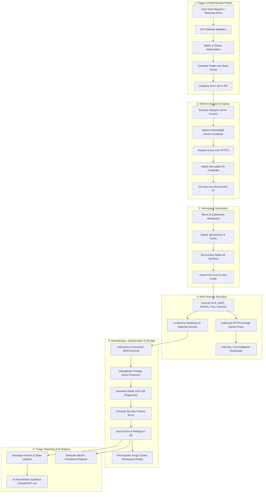

# End-to-End Data Flow Diagram

> **Document ID:** VS-DOC-08  
> **Status:** Approved Baseline  
> **Version:** 1.0.0  
> **Date:** November 2026  
> **Target Audience:** Data Architects, Security Engineers, Cloud Operations, Compliance Teams  

---

## 1. End-to-End Data Lifecycle

VulnSight AI manages data flow across distinct states: in-transit, ephemeral-in-memory, encrypted-at-rest, and permanently purged.



---

## 2. Detailed Data State Matrix

| Data Classification | Storage Location | Encryption Status | Retention Policy | Purge Mechanism |
| :--- | :--- | :--- | :--- | :--- |
| **Cloned Source Code** | Ephemeral worker mount (`/work` or temp dir) | Plaintext in ephemeral container volume | Minutes (scan duration only) | Guaranteed deletion in `finally` block; container destroyed. |
| **Git Provider Tokens** | Database `provider_connections.token_enc` | Encrypted at rest (AES-256-GCM) | User-managed lifespan | Overwritten or removed on connection deletion. |
| **Webhook Secrets** | Database `repositories.webhook_secret` | Encrypted at rest (AES-256-GCM) | Repository lifespan | Deleted when repository is deleted. |
| **Single-Use Grants** | Database `scan_grants` | Token encrypted (AES-256-GCM), secret hashed (SHA-256) | Max 10 minutes | Marked `used_at`; purged on scan completion. |
| **Raw Scanner Dumps** | Database `scan_raw.data` | Database storage (plaintext/encrypted volume) | Configurable retention (1–3650 days, default 90 days) | Automated background retention purge job. |
| **Normalized Findings** | Database `findings.data` | Redacted secrets, database storage | Configurable retention (default 90 days) | Cascading foreign key deletion on repository or scan purge. |
| **AI Prompt Data** | In-transit memory to AI APIs | TLS 1.3 in-transit; no disk storage | Ephemeral request lifecycle | Never stored by external model (zero data retention agreement). |
| **AI Responses** | Database `ai_history.answer` | Database storage | Scoped to organization retention | Purged on repository or organization deletion. |
| **Audit Trails** | Database `audit_logs` | Immutable database records | Permanent / Compliance retention | Scoped to organization lifecycle. |

---

## 3. Data Transformation Pipeline

### 3.1 Raw Output to Canonical Normalization
1. **SCA Parsing:**
   - Raw OSV.dev batch response $\rightarrow$ Extracted CVE/GHSA IDs, CVSS base scores, vulnerable version ranges, fixed versions.
   - Lockfile parser maps dependency chain: `[root -> package-a@1.0.0 -> vulnerable-pkg@0.5.2]`.
   - Classification: `location.direct = false`, `location.package = 'vulnerable-pkg'`, `location.version = '0.5.2'`.
2. **SAST (Semgrep) Parsing:**
   - Semgrep JSON output $\rightarrow$ Mapped to `category: 'sast'`.
   - Rule ID extracted: e.g., `javascript.express.security.injection.tainted-sql-call`.
   - CWE mapping: e.g., `CWE-89: SQL Injection`.
   - Code snippet extracted for evidence (capped at 1,000 characters).
3. **Secret (Gitleaks) Parsing & Redaction:**
   - Raw Gitleaks finding contains secret fragment.
   - **Crucial Security Filter:** The parser invokes `redactSecret(rawSecret)`. Only masked entropy strings (e.g., `ghp_****...****4a8f`) are placed in `finding.title` and `finding.evidence`. Raw secrets are **never** stored in the database.

### 3.2 Cross-Scanner Deduplication Logic
When multiple scanners identify the same underlying issue (e.g., Trivy and OSV both identifying CVE-2023-26136 in Tough-Cookie):
1. The deduplicator builds an alias graph linking primary IDs and secondary aliases (`CVE-2023-26136` $\leftrightarrow$ `GHSA-72xf-g2v4-qvf3`).
2. Identifiers matching the same package and file location are merged.
3. The finding retains the **highest severity** reported across the tools.
4. Scanner provenance tracks all contributing scanners: `sources: ['osv', 'trivy']`.

---

## 4. Zero-Source Retention Verification

VulnSight AI enforces a strict architectural guarantee: **Source code never persists beyond the lifetime of the scan.**

```javascript
// src/platform/service.js (Guaranteed Cleanup Flow)
let workspace = null;
try {
  workspace = await cloneWorkspace(repoUrl, branch, gitCredentials);
  sanitizeWorkspace(workspace);
  const scanResults = await runSandboxed(workspace, scanConfig);
  await persistResults(scanId, scanResults);
} finally {
  if (workspace && fs.existsSync(workspace)) {
    fs.rmSync(workspace, { recursive: true, force: true });
  }
}
```
Even in the event of an unhandled exception, syntax failure, or execution timeout, the `finally` block guarantees that the temporary workspace directory is purged from disk.
