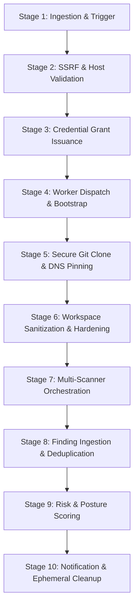

# Repository Scanning Workflow

> **Document ID:** VS-DOC-09  
> **Status:** Approved Baseline  
> **Version:** 1.0.0  
> **Date:** November 2026  
> **Target Audience:** DevOps Engineers, Security Analysts, Integration Engineers  

---

## 1. Workflow Architecture & Lifecycle

The VulnSight AI repository scanning workflow transforms a Git repository reference into actionable, triaged vulnerability findings through a ten-stage pipeline.



---

## 2. Comprehensive Stage-by-Stage Breakdown

### Stage 1: Ingestion & Trigger
Scans are initiated via three supported entry mechanisms:
- **Manual Trigger:** An authenticated user clicks "Scan now" in the web dashboard or issues a `POST /api/v1/orgs/:org/repos/:repo/scans` request.
- **Webhook Trigger:** A push event arrives from GitHub, GitLab, or Bitbucket. The payload HMAC signature or token is validated, and the branch is matched against the repository's configured monitored branches.
- **Scheduled Trigger:** The platform background scheduler checks repositories whose `next_scan_at <= now()`, enqueues a scan job, and recalculates the next scan window based on the cron schedule.

### Stage 2: SSRF & Host Validation
Before attempting any network operations:
1. The repository URL is checked against the URL length limit ($\le 300$ chars) and required `https://` protocol.
2. The hostname is extracted, stripped of trailing dots, and checked to ensure it is not an IP literal or internal domain.
3. The platform performs an authoritative DNS resolution (`dns.lookup`). If any resolved address belongs to private IPv4 (`10.0.0.0/8`, `172.16.0.0/12`, `192.168.0.0/16`, `169.254.0.0/16`) or private IPv6 spaces, the scan is rejected with `ValidationError: That host resolves to a non-public address`.

### Stage 3: Credential Grant Issuance
1. The platform generates a cryptographically secure 32-byte grant secret:
   ```javascript
   const grantSecret = crypto.randomBytes(32).toString('base64url');
   ```
2. The SHA-256 hash of `grantSecret` is recorded in `scan_grants`.
3. The provider Git access token is decrypted from `provider_connections` using the master key and re-encrypted specifically for the grant payload with a 10-minute time-to-live (TTL).

### Stage 4: Worker Dispatch & Bootstrap
- **Azure Container Apps Mode (`aca`):** The API orchestrator invokes ARM `Microsoft.App/jobs/<job-name>/start` using a scoped Azure Managed Identity (`Container Apps Jobs Operator`). The execution parameters pass `VS_SCAN_ID`, `VS_GRANT_SECRET`, and `VS_GRANT_URL`. Persistent tokens are omitted from this payload.
- **Docker Sandbox Mode (`docker`):** The orchestrator spawns an isolated container via `docker run` on an internal bridge network (`vulnsight-scan`) with no default gateway.

### Stage 5: Secure Git Clone & DNS Pinning
1. The worker container issues a POST request to `/api/v1/internal/scan-grant` with its scan ID and grant secret.
2. Upon successful one-time validation, the API returns the temporary Git credential.
3. The worker executes:
   ```bash
   git clone --depth 1 --branch <branch> \
     --config http.curloptResolve=<host>:443:<validated_ip> \
     --config core.hooksPath=/dev/null \
     --config fsmonitor.allowRemote=false \
     https://<host>/<repo>.git /work
   ```
4. The clone credential is immediately wiped from worker environment variables and memory.

### Stage 6: Workspace Sanitization & Hardening
The worker cleanses the mounted workspace prior to scanner execution:
1. Recursively removes the `.git` directory, eliminating any malicious hooks or embedded binaries.
2. Scans every file and folder: if `fs.lstatSync().isSymbolicLink()` is true, the symlink is immediately unlinked (`fs.unlinkSync()`).
3. Enforces safety quotas: if total bytes exceed 500 MB or file count exceeds 100,000, the scan is aborted to prevent decompression bomb attacks.

### Stage 7: Multi-Scanner Orchestration
The worker executes the configured scanner adapters sequentially or in parallel:

| Scanner | Execution Mode | Scope & Target Files |
| :--- | :--- | :--- |
| **SCA (OSV.dev)** | Native lockfile parser + Batch HTTP | `package-lock.json`, `yarn.lock`, `pnpm-lock.yaml`, `requirements.txt`, `poetry.lock`, `Pipfile.lock`, `go.sum`. |
| **Semgrep** | CLI (`semgrep --json --config=auto`) | Source files (`.js`, `.ts`, `.py`, `.go`, `.java`, etc.). |
| **Gitleaks** | CLI (`gitleaks detect --no-git --report-format json`) | Entire filesystem contents; masks matched values before reporting. |
| **Trivy** | CLI (`trivy fs --format json`) | Lockfiles, base OS definitions, and container configuration files. |
| **Checkov** | CLI (`checkov -d . --output json`) | Terraform (`.tf`), CloudFormation, Kubernetes YAML, Dockerfiles. |

### Stage 8: Finding Ingestion & Deduplication
1. Raw outputs are parsed by their respective adapter transformers.
2. The orchestrator invokes `dedupeFindings()`:
   - Matches CVE and GHSA aliases across SCA and Trivy results.
   - Merges identical findings into single canonical representations.
   - Retains the maximum severity and all contributing source scanner names.
3. Findings are assigned stable, deterministic fingerprints.

### Stage 9: Risk & Posture Scoring
1. Posture score is updated for the repository and parent organization:
   $$\text{PostureScore} = \max\Big(0, 100 - (15 \times N_{\text{crit}} + 8 \times N_{\text{high}} + 3 \times N_{\text{med}} + 1 \times N_{\text{low}})\Big)$$
2. Letter grade is assigned:
   - **A:** $90 - 100$
   - **B:** $80 - 89$
   - **C:** $70 - 79$
   - **D:** $60 - 69$
   - **F:** $< 60$

### Stage 10: Notification & Ephemeral Cleanup
1. Findings, raw scanner outputs, and summary metrics are committed to SQLite tables (`scans`, `findings`, `scan_raw`).
2. Notifications are pushed to organization members if new critical or high findings are discovered.
3. The temporary workspace folder is deleted. In ACA mode, the container pod terminates automatically.
