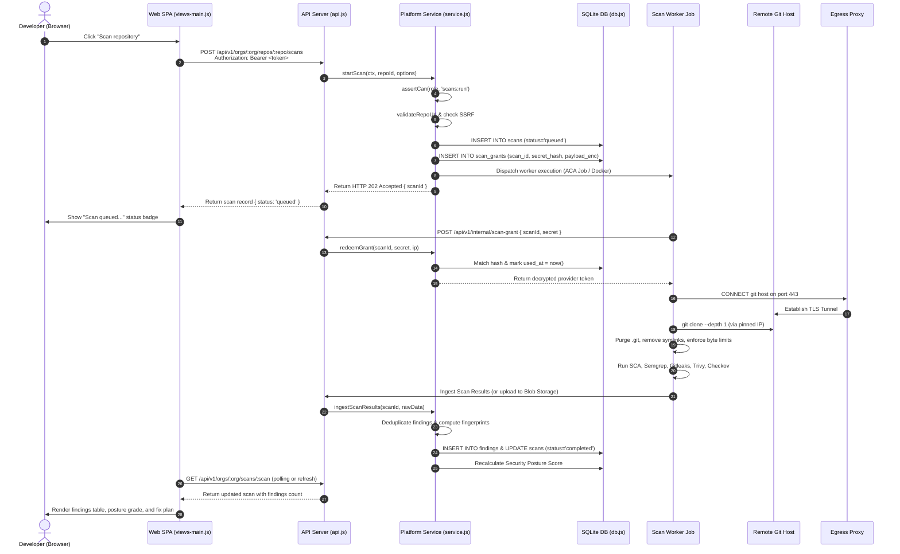
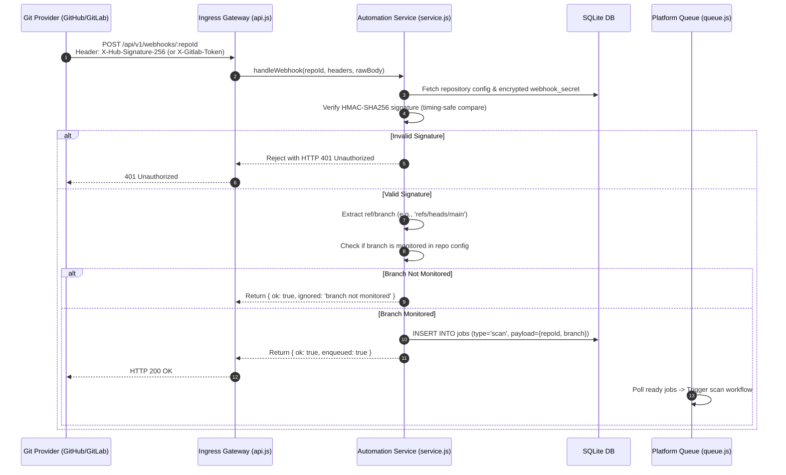
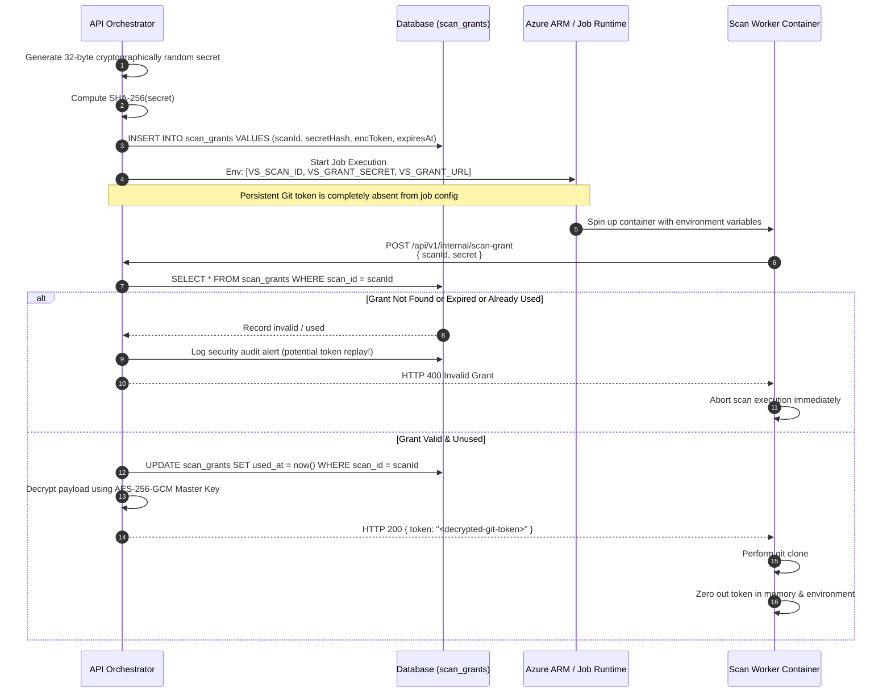
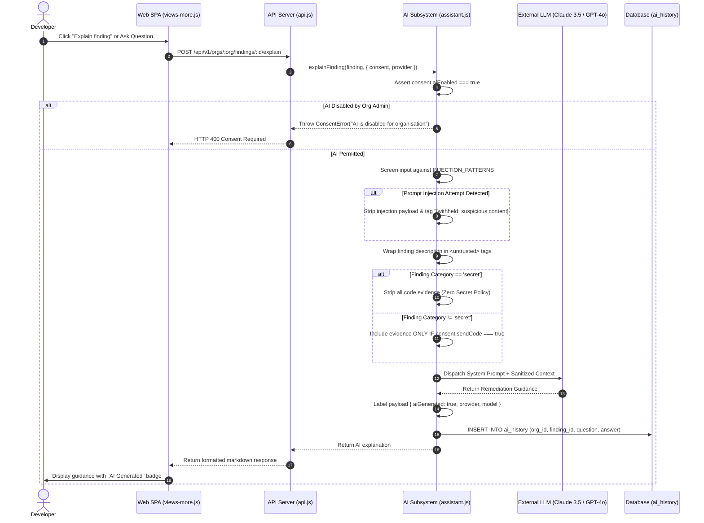
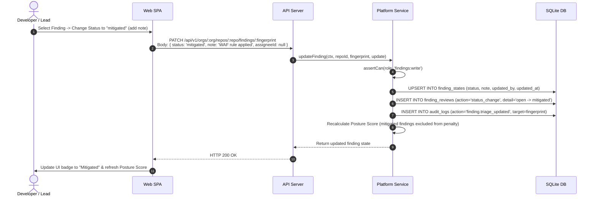

# Sequence Diagrams

> **Document ID:** VS-DOC-10  
> **Status:** Approved Baseline  
> **Version:** 1.0.0  
> **Date:** November 2026  
> **Target Audience:** Developers, System Architects, Quality Assurance Engineers  

---

## 1. User-Initiated Scan Execution Workflow

This sequence illustrates the end-to-end lifecycle when a logged-in developer triggers an on-demand scan from the Web UI.

---

## 2. Webhook-Triggered Automated Scanning

This sequence illustrates an automated push-triggered scan originating from GitHub, GitLab, or Bitbucket.

---

## 3. Secure Single-Use Credential Grant Exchange

This diagram details the protocol designed to eliminate long-lived Git credentials from worker startup configurations.

---

## 4. Governed AI Remediation & Q&A Workflow

This sequence illustrates developer interaction with the AI Security Assistant, showcasing prompt isolation and consent verification.

---

## 5. Finding Triage & Status Review Transition

This sequence illustrates the developer review workflow and state update lifecycle.

