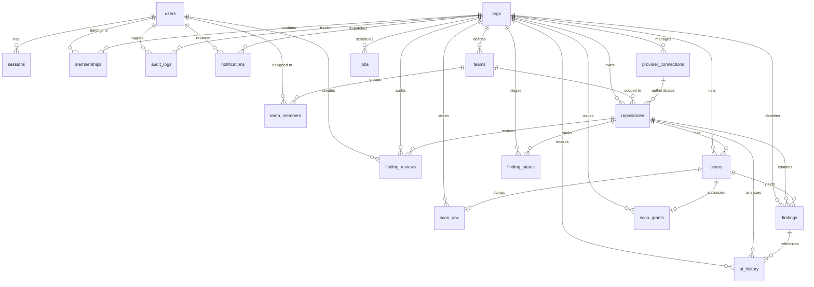

# Database Schema & ER Diagram

> **Document ID:** VS-DOC-12  
> **Status:** Approved Baseline  
> **Version:** 1.0.0  
> **Date:** November 2026  
> **Target Audience:** Database Administrators, Backend Engineers, Data Architects  

---

## 1. Entity-Relationship (ER) Diagram

The VulnSight AI relational schema is normalized into 18 tables designed around strict multi-tenant isolation (`org_id` partitioning) and transactional consistency.



---

## 2. Table Specifications & Data Dictionaries

### 2.1 Identity, Authentication & Multi-Tenancy

#### `users`
Stores user profile information, authentication credentials, and account statuses.
| Column | Type | Constraints | Description |
| :--- | :--- | :--- | :--- |
| `id` | `TEXT` | `PRIMARY KEY` | UUID v4 user identifier. |
| `email` | `TEXT` | `NOT NULL UNIQUE` | Unique email address (normalized to lowercase). |
| `name` | `TEXT` | `NULLABLE` | Display name of the user. |
| `password_hash`| `TEXT` | `NOT NULL` | Formatted `scrypt` hash string ($N=16384, r=8, p=1$). |
| `created_at` | `TEXT` | `NOT NULL` | ISO 8601 UTC timestamp. |
| `disabled` | `INTEGER`| `NOT NULL DEFAULT 0`| Boolean flag (0 = active, 1 = disabled by administrator). |

#### `sessions`
Tracks active bearer sessions.
| Column | Type | Constraints | Description |
| :--- | :--- | :--- | :--- |
| `token_hash` | `TEXT` | `PRIMARY KEY` | SHA-256 hash of the 32-byte random session token. |
| `user_id` | `TEXT` | `NOT NULL REFERENCES users(id) ON DELETE CASCADE` | Associated user identifier. |
| `created_at` | `TEXT` | `NOT NULL` | Timestamp when session was generated. |
| `expires_at` | `TEXT` | `NOT NULL` | Expiration timestamp (12-hour default TTL). |

#### `orgs`
Defines multi-tenant customer organizations and workspace settings.
| Column | Type | Constraints | Description |
| :--- | :--- | :--- | :--- |
| `id` | `TEXT` | `PRIMARY KEY` | UUID v4 organization identifier. |
| `name` | `TEXT` | `NOT NULL` | Organization name. |
| `created_at` | `TEXT` | `NOT NULL` | Creation timestamp. |
| `settings` | `TEXT` | `NOT NULL DEFAULT '{}'`| JSON object containing retention days, AI consent flags. |

#### `memberships`
Maps users to organizations with Role-Based Access Control (RBAC).
| Column | Type | Constraints | Description |
| :--- | :--- | :--- | :--- |
| `org_id` | `TEXT` | `NOT NULL REFERENCES orgs(id) ON DELETE CASCADE` | Scoped organization. |
| `user_id` | `TEXT` | `NOT NULL REFERENCES users(id) ON DELETE CASCADE` | Scoped user. |
| `role` | `TEXT` | `NOT NULL` | Role enum: `'owner'`, `'admin'`, `'developer'`, `'viewer'`. |
| `created_at` | `TEXT` | `NOT NULL` | Join timestamp. |
| **Composite PK**| — | `PRIMARY KEY (org_id, user_id)` | Enforces unique user per org. |

#### `teams` & `team_members`
Enables sub-organizational team boundaries and repository access scoping.
- **`teams`:** `(id PK, org_id FK, name, created_at, UNIQUE(org_id, name))`
- **`team_members`:** `(team_id FK, user_id FK, PRIMARY KEY(team_id, user_id))`

---

### 2.2 Repository Management & Provider Integrations

#### `provider_connections`
Manages authenticated connections to remote Git providers.
| Column | Type | Constraints | Description |
| :--- | :--- | :--- | :--- |
| `id` | `TEXT` | `PRIMARY KEY` | Connection identifier. |
| `org_id` | `TEXT` | `NOT NULL REFERENCES orgs(id) ON DELETE CASCADE` | Scoped organization. |
| `provider` | `TEXT` | `NOT NULL` | Enum: `'github'`, `'gitlab'`, `'bitbucket'`. |
| `label` | `TEXT` | `NULLABLE` | Human-readable connection label. |
| `token_enc` | `TEXT` | `NOT NULL` | AES-256-GCM encrypted Personal Access Token. |
| `account` | `TEXT` | `NULLABLE` | Remote username or organization name. |
| `created_by` | `TEXT` | `NULLABLE` | User ID who created the connection. |
| `created_at` | `TEXT` | `NOT NULL` | Timestamp. |

#### `repositories`
Configures repositories monitored by VulnSight AI.
| Column | Type | Constraints | Description |
| :--- | :--- | :--- | :--- |
| `id` | `TEXT` | `PRIMARY KEY` | Repository identifier. |
| `org_id` | `TEXT` | `NOT NULL REFERENCES orgs(id) ON DELETE CASCADE` | Scoped organization. |
| `team_id` | `TEXT` | `REFERENCES teams(id) ON DELETE SET NULL` | Scoped team. |
| `connection_id`| `TEXT` | `REFERENCES provider_connections(id) ON DELETE SET NULL` | Linked Git credentials. |
| `provider` | `TEXT` | `NOT NULL` | Enum: `'github'`, `'gitlab'`, `'bitbucket'`. |
| `full_name` | `TEXT` | `NOT NULL` | Remote repository slug (e.g., `'owner/repo'`). |
| `clone_url` | `TEXT` | `NOT NULL` | Validated HTTPS clone endpoint. |
| `default_branch`| `TEXT` | `NOT NULL DEFAULT 'main'`| Primary branch. |
| `config` | `TEXT` | `NOT NULL DEFAULT '{}'`| JSON: scanners to run, threshold, monitored branches. |
| `webhook_secret`| `TEXT` | `NULLABLE` | AES-256-GCM encrypted webhook HMAC secret. |
| `schedule` | `TEXT` | `NULLABLE` | Scan frequency enum: `'daily'`, `'weekly'`, `'monthly'`, or null. |
| `next_scan_at` | `TEXT` | `NULLABLE` | ISO timestamp for next scheduled scan. |
| `created_at` | `TEXT` | `NOT NULL` | Timestamp. |
| **Unique** | — | `UNIQUE (org_id, clone_url)` | Prevents duplicate repos per org. |

---

### 2.3 Scans, Findings & Triage Lifecycle

#### `scans`
Snapshot record of an individual security scan execution.
| Column | Type | Constraints | Description |
| :--- | :--- | :--- | :--- |
| `id` | `TEXT` | `PRIMARY KEY` | Scan UUID v4. |
| `org_id` | `TEXT` | `NOT NULL REFERENCES orgs(id) ON DELETE CASCADE` | Scoped organization. |
| `repo_id` | `TEXT` | `NOT NULL REFERENCES repositories(id) ON DELETE CASCADE` | Scoped repository. |
| `branch` | `TEXT` | `NOT NULL` | Target Git branch. |
| `commit_sha` | `TEXT` | `NULLABLE` | Evaluated Git commit SHA. |
| `trigger` | `TEXT` | `NOT NULL` | Enum: `'manual'`, `'webhook'`, `'schedule'`, `'ci'`. |
| `status` | `TEXT` | `NOT NULL` | Enum: `'queued'`, `'running'`, `'completed'`, `'failed'`, `'cancelled'`. |
| `scanners` | `TEXT` | `NULLABLE` | JSON array of scanners executed. |
| `summary` | `TEXT` | `NULLABLE` | JSON: total findings, severity counts, posture score. |
| `error` | `TEXT` | `NULLABLE` | Error diagnostics if scan failed. |
| `requested_by` | `TEXT` | `NULLABLE` | User ID or `'system'`. |
| `created_at` | `TEXT` | `NOT NULL` | Enqueued timestamp. |
| `started_at` | `TEXT` | `NULLABLE` | Execution start timestamp. |
| `finished_at` | `TEXT` | `NULLABLE` | Execution completion timestamp. |

#### `findings`
Stores normalized, deduplicated findings discovered during scans.
| Column | Type | Constraints | Description |
| :--- | :--- | :--- | :--- |
| `id` | `TEXT` | `PRIMARY KEY` | Finding UUID v4. |
| `scan_id` | `TEXT` | `NOT NULL REFERENCES scans(id) ON DELETE CASCADE` | Associated scan run. |
| `org_id` | `TEXT` | `NOT NULL` | Scoped organization. |
| `repo_id` | `TEXT` | `NOT NULL` | Scoped repository. |
| `fingerprint` | `TEXT` | `NOT NULL` | Stable SHA-256 fingerprint of the issue. |
| `severity` | `TEXT` | `NOT NULL` | Enum: `'critical'`, `'high'`, `'medium'`, `'low'`, `'info'`. |
| `category` | `TEXT` | `NOT NULL` | Enum: `'sca'`, `'sast'`, `'secret'`, `'container'`, `'iac'`. |
| `data` | `TEXT` | `NOT NULL` | Canonical Finding JSON payload. |

#### `finding_states`
Maintains persistent triage states across multiple scans for a repository.
| Column | Type | Constraints | Description |
| :--- | :--- | :--- | :--- |
| `org_id` | `TEXT` | `NOT NULL` | Scoped organization. |
| `repo_id` | `TEXT` | `NOT NULL` | Scoped repository. |
| `fingerprint` | `TEXT` | `NOT NULL` | Stable issue fingerprint. |
| `status` | `TEXT` | `NOT NULL DEFAULT 'open'` | Enum: `'open'`, `'in_review'`, `'confirmed'`, `'false_positive'`, `'mitigated'`, `'accepted'`. |
| `assignee_id` | `TEXT` | `NULLABLE` | Assigned user ID. |
| `note` | `TEXT` | `NULLABLE` | Triage justification or notes. |
| `updated_by` | `TEXT` | `NULLABLE` | User ID who last updated status. |
| `updated_at` | `TEXT` | `NOT NULL` | Timestamp. |
| **Composite PK**| — | `PRIMARY KEY (org_id, repo_id, fingerprint)` | Unique state per finding in repo. |

#### `finding_reviews`
Immutable audit history of triage transitions for individual findings.
`id PK, org_id, repo_id, fingerprint, user_id, action, detail, created_at`

---

### 2.4 Governance, Jobs & Ephemeral Grants

#### `scan_grants`
Single-use credential exchange store for isolated scan workers.
| Column | Type | Constraints | Description |
| :--- | :--- | :--- | :--- |
| `scan_id` | `TEXT` | `PRIMARY KEY REFERENCES scans(id) ON DELETE CASCADE` | Associated scan. |
| `org_id` | `TEXT` | `NOT NULL` | Scoped organization. |
| `secret_hash` | `TEXT` | `NOT NULL` | SHA-256 hash of single-use grant secret. |
| `payload_enc` | `TEXT` | `NOT NULL` | AES-256-GCM encrypted Git credential. |
| `expires_at` | `TEXT` | `NOT NULL` | Timestamp (10-minute expiration). |
| `used_at` | `TEXT` | `NULLABLE` | Timestamp when redeemed (prevents replay). |

#### `jobs`
Persistent background job queue with retry and backoff tracking.
`id PK, type, payload, org_id, status, attempts, max_attempts, run_at, locked_at, error, created_at`

#### `audit_logs`
Immutable compliance audit log.
`id PK, org_id, user_id, action, target, detail, ip, created_at`

#### `ai_history`
Records developer interactions with the AI Security Assistant.
`id PK, org_id, repo_id, finding_id, user_id, kind, provider, question, answer, created_at`

---

## 3. Database Indexes

To guarantee sub-millisecond query performance under heavy workloads:
```sql
CREATE INDEX scans_org_repo ON scans (org_id, repo_id, created_at);
CREATE INDEX findings_scan ON findings (org_id, scan_id);
CREATE INDEX findings_fp ON findings (org_id, repo_id, fingerprint);
CREATE INDEX audit_org ON audit_logs (org_id, created_at);
CREATE INDEX jobs_ready ON jobs (status, run_at);
```
