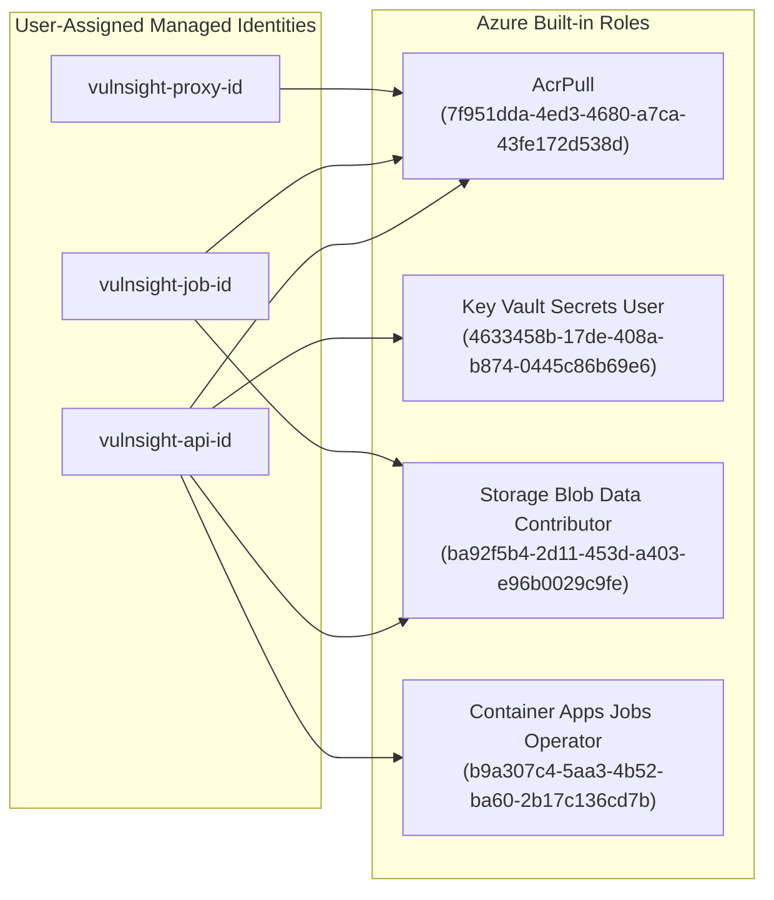

# Azure Cloud Architecture

> **Document ID:** VS-DOC-14  
> **Status:** Approved Baseline  
> **Version:** 1.0.0  
> **Date:** November 2026  
> **Target Audience:** Cloud Architects, Azure DevOps Engineers, Security Specialists  

---

## 1. Cloud Architecture Overview

VulnSight AI’s hosted architecture is deployed entirely on Microsoft Azure as a secure, containerized PaaS/Serverless solution. The architecture isolates user-facing management services from untrusted scanner executions using dedicated subnets, Private Endpoints, Network Security Groups, and discrete User-Assigned Managed Identities.

```mermaid
graph TB
    subgraph AzureRegion ["Azure Region (e.g., East US)"]
        subgraph VNet ["Virtual Network: 10.40.0.0/16"]
            subgraph SubnetAPI ["Subnet 'api': 10.40.1.0/24"]
                ACA_API["API Server Container App<br/>(Identity: vulnsight-api-id)"]
            end

            subgraph SubnetScan ["Subnet 'scan': 10.40.0.0/23 (NSG: Deny Direct Internet)"]
                ACA_Jobs["Scan Worker ACA Jobs<br/>(Identity: vulnsight-job-id)"]
            end

            subgraph SubnetProxy ["Subnet 'proxy': 10.40.2.0/23"]
                ACA_Proxy["Egress Proxy Container App<br/>(Identity: vulnsight-proxy-id)"]
            end

            subgraph SubnetEndpoints ["Subnet 'endpoint': 10.40.4.0/24"]
                PE_ACR["Private Endpoint: ACR Premium"]
                PE_Storage["Private Endpoint: Blob Storage"]
                PE_KV["Private Endpoint: Key Vault"]
            end
        end

        subgraph ManagedPaaS ["Azure PaaS Resources"]
            ACR["Azure Container Registry (Premium)<br/>adminUserEnabled: false"]
            KV["Azure Key Vault (Standard)<br/>SoftDelete / PurgeProtection"]
            Storage["Azure Storage Account<br/>scan-results container"]
            LogAnalytics["Log Analytics Workspace & App Insights"]
        end
    end

    InternetUsers["External Users & Webhooks"] -->|HTTPS / 443| ACA_API
    ACA_Jobs -->|HTTPS_PROXY (Port 3128)| ACA_Proxy
    ACA_Proxy -->|TLS Port 443 Only| InternetEgress["Allowlisted Git Hosts & OSV.dev"]

    ACA_API -->|Read Master Key| PE_KV
    PE_KV --> KV
    ACA_API -->|Trigger Job Execution| ACA_Jobs
    ACA_Jobs -->|Upload Encrypted Results| PE_Storage
    PE_Storage --> Storage
    ACA_API -->|Read Staged Results| PE_Storage

    ACA_Jobs -->|Pull Worker Image via Private Link| PE_ACR
    PE_ACR --> ACR

    ACA_API --> LogAnalytics
    ACA_Jobs --> LogAnalytics
    ACA_Proxy --> LogAnalytics
```

---

## 2. Resource Inventory & Configuration Details

The Azure infrastructure is defined declaratively using Azure Bicep (`deploy/azure/main.bicep` and `deploy/azure/subscription.bicep`):

| Resource Type | Resource Name Pattern | Configuration / Sizing | Security Settings |
| :--- | :--- | :--- | :--- |
| **Virtual Network** | `vulnsight-vnet` | Address space: `10.40.0.0/16` | Segmented into 4 subnets with dedicated NSGs. |
| **Scan Subnet** | `scan` | `10.40.0.0/23` (512 IPs) | NSG blocks direct outbound internet; routes via Proxy. |
| **Proxy Subnet** | `proxy` | `10.40.2.0/23` (512 IPs) | Internal ingress for port 3128; egress allowed to 443. |
| **API Subnet** | `api` | `10.40.1.0/24` (256 IPs) | Ingress on 443; access to Private Endpoints. |
| **Endpoints Subnet**| `endpoint` | `10.40.4.0/24` (256 IPs) | `privateEndpointNetworkPolicies: 'Disabled'`. |
| **Container Registry**| `vulnsightacr<suffix>` | Premium SKU (required for Private Endpoints) | Admin user disabled; image quarantine enabled. |
| **Container Apps Job**| `vulnsight-scan-job` | Consumption Job (`cpu: 1.0, memory: 2Gi`) | Zero persistent credentials in template; ephemeral run. |
| **API Container App**| `vulnsight-api` | Container App (`cpu: 0.5, memory: 1Gi`) | External HTTPS ingress, strict CSP headers. |
| **Key Vault** | `vulnsight-kv-<suffix>` | Standard SKU, RBAC Authorization | Soft delete, purge protection, TLS 1.3 enforced. |
| **Storage Account** | `vulnsightst<suffix>` | Standard_LRS, StorageV2 | Private container `scan-results`, blob encryption. |
| **Log Analytics** | `vulnsight-logs-<suffix>`| PerGB2018 SKU, 90 days retention | Structured JSON ingestion from all containers. |

---

## 3. Least-Privilege Identity Architecture (RBAC)

Rather than utilizing broad Contributor privileges, the platform creates three isolated User-Assigned Managed Identities with minimal role assignments:



1. **`vulnsight-api-id`:**
   - **Container Apps Jobs Operator:** Grants rights to start, stop, and read executions of the scan job specifically scoped to `Microsoft.App/jobs/vulnsight-scan-job`. Cannot modify job definitions or touch other cloud services.
   - **Key Vault Secrets User:** Reads the `master-key` secret used to decrypt stored provider tokens.
   - **Storage Blob Data Contributor:** Reads and purges scan result JSON files from the `scan-results` container.
2. **`vulnsight-job-id`:**
   - **AcrPull:** Allows the job worker to pull its hardened image through the ACR Private Endpoint.
   - **Storage Blob Data Contributor:** Allows the job to upload its result JSON to `scan-results`. The job **cannot** access Key Vault or manage other jobs.
3. **`vulnsight-proxy-id`:**
   - Possesses only **AcrPull** to launch the egress proxy container. Completely isolated from Key Vault, storage, and job orchestration.

---

## 4. Azure Deployment Lifecycle & Safety Controls

To prevent accidental resource creation and unexpected cloud billing:
1. **Subscription-Level Deployment:** The top-level template (`deploy/azure/subscription.bicep`) targets subscription scope, allowing it to create or configure the resource group and deploy resources atomically.
2. **Zero-Touch Preview Script (`deploy/azure/whatif.sh`):**
   ```bash
   ./deploy/azure/whatif.sh eastus
   ```
   Executes `az deployment sub what-if` against `subscription.bicep`, giving operators a complete, line-by-line preview of every planned Azure resource, role assignment, and subnet before anything is applied.
3. **Billable Resources Alert:** The documentation explicitly highlights billable components (ACR Premium, multiple Container Apps environments, Log Analytics) so engineering teams can model costs accurately before executing production deployments.
