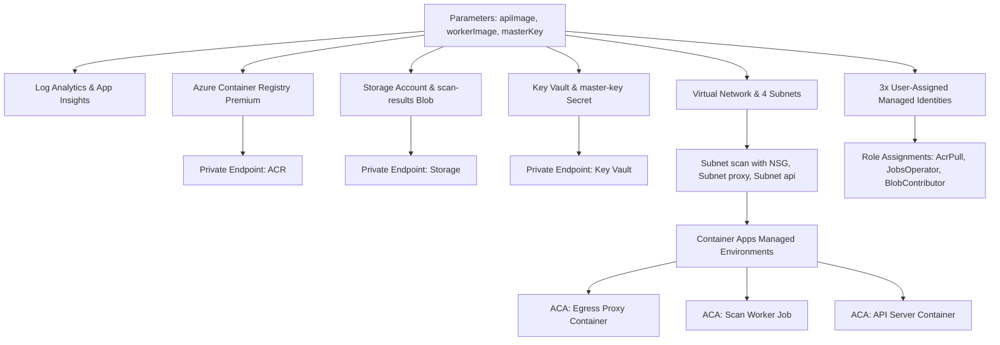

# Infrastructure Architecture

> **Document ID:** VS-DOC-15  
> **Status:** Approved Baseline  
> **Version:** 1.0.0  
> **Date:** November 2026  
> **Target Audience:** Site Reliability Engineers (SRE), Cloud Architects, Infrastructure Engineers  

---

## 1. Infrastructure as Code (IaC) Architecture

VulnSight AI defines 100% of its infrastructure declaratively using modern **Azure Bicep**, offering modularity, native Azure support, zero state-file locking vulnerabilities, and static compilation guarantees.

```
deploy/
├── Dockerfile.api               # Hardened Node.js API runtime image
├── Dockerfile.worker            # Hardened multi-scanner execution worker image
├── docker-compose.yml           # Local multi-container development environment
├── azure/
│   ├── subscription.bicep       # Subscription-scoped resource group & deployment wrapper
│   ├── main.bicep               # Complete regional infrastructure declaration (458 lines)
│   └── whatif.sh                # Interactive preview script using az deployment sub what-if
└── docker/
    └── setup-egress.sh          # Linux bridge network & allowlist proxy bootstrapper
```

---

## 2. Infrastructure Component Specifications

### 2.1 Bicep Module Breakdown (`deploy/azure/main.bicep`)

The `main.bicep` template coordinates 14 distinct Azure resource types structured into interdependent lifecycle stages:



---

## 3. Compute Specifications & Sizing

### 3.1 API Server Compute (`vulnsight-api`)
- **Hosting Model:** Azure Container Apps (Single revision mode).
- **vCPU Allocation:** $0.5\text{ vCPU}$ (Burstable to $1.0\text{ vCPU}$).
- **Memory Allocation:** $1.0\text{ GiB}$ RAM.
- **Autoscaling Rules:** HTTP concurrency scaling triggering at $> 50$ concurrent requests, scaling from 1 minimum replica to 10 maximum replicas (once migrated to clustered PostgreSQL).
- **Health Probes:** Liveness and readiness probes checking `GET /api/v1/health` every 10 seconds.

### 3.2 Scan Worker Compute (`vulnsight-scan-job`)
- **Hosting Model:** Azure Container Apps Jobs (Triggered execution type).
- **vCPU Allocation:** $1.0\text{ vCPU}$ (Dedicated per scan).
- **Memory Allocation:** $2.0\text{ GiB}$ RAM (Configurable up to $4.0\text{ GiB}$ for enterprise codebases).
- **Execution Limits:** Maximum execution timeout set to 15 minutes (`timeoutMs = 900000`), after which the executor forcibly stops the run to prevent resource hogging.
- **Concurrency Cap:** Up to 50 concurrent job runs per subscription quota.

### 3.3 Egress Proxy Compute (`vulnsight-proxy`)
- **Hosting Model:** Azure Container Apps (Internal ingress on port 3128).
- **vCPU Allocation:** $0.25\text{ vCPU}$.
- **Memory Allocation:** $0.5\text{ GiB}$ RAM.
- **Throughput:** Capable of handling $> 200$ simultaneous TLS tunnels with minimal CPU utilization.

---

## 4. Container Packaging & Image Hardening

Both production container images are defined with multi-stage builds and strict privilege dropping:

### 4.1 API Image (`deploy/Dockerfile.api`)
```dockerfile
FROM node:22-alpine
WORKDIR /app
COPY package*.json ./
# Zero npm install required in production (standard library only)
COPY src ./src
COPY web ./web
USER node
EXPOSE 4400
ENV NODE_ENV=production
CMD ["node", "src/platform/serve.js"]
```

### 4.2 Scan Worker Image (`deploy/Dockerfile.worker`)
```dockerfile
FROM alpine:3.20
RUN apk add --no-cache nodejs npm git python3 py3-pip curl jq
# Install pinned scanning binaries
RUN curl -sSfL https://raw.githubusercontent.com/trivy-security/trivy/main/contrib/install.sh | sh -s -- -b /usr/local/bin v0.50.0 \
 && curl -sSfL https://raw.githubusercontent.com/gitleaks/gitleaks/master/scripts/install.sh | sh -s -- -b /usr/local/bin v8.18.2 \
 && pip install --no-cache-dir semgrep==1.70.0 checkov==3.2.70
WORKDIR /app
COPY src ./src
# Create unprivileged scan user (UID 10001)
RUN adduser -D -u 10001 scanuser
USER 10001:10001
ENV HOME=/tmp
ENTRYPOINT ["node", "/app/src/platform/scan-job.js"]
```

---

## 5. Cost Optimization & Capacity Planning

| Tier / Component | Monthly Cost Driver | Optimization Mechanism |
| :--- | :--- | :--- |
| **Azure Container Apps Jobs** | Per-second execution billing ($\sim \$0.000024\text{ / vCPU-sec}$) | Workers spin down to 0 immediately upon scan completion; zero idle compute cost. |
| **Azure Key Vault** | Standard SKU ($\sim \$0.03\text{ / 10,000 ops}$) | Master key is cached in memory by the API server with periodic refresh. |
| **Azure Blob Storage** | Storage + egress ($\sim \$0.02\text{ / GB}$) | Scan results in Blob storage are deleted immediately after API ingestion. |
| **Azure Container Registry** | Premium SKU ($\sim \$1.67\text{ / day}$) | Required for Private Endpoints; shared across all platform environments. |
| **Log Analytics** | Ingestion volume ($\sim \$2.30\text{ / GB}$) | Structured JSON logging with debug logs suppressed in production. |
