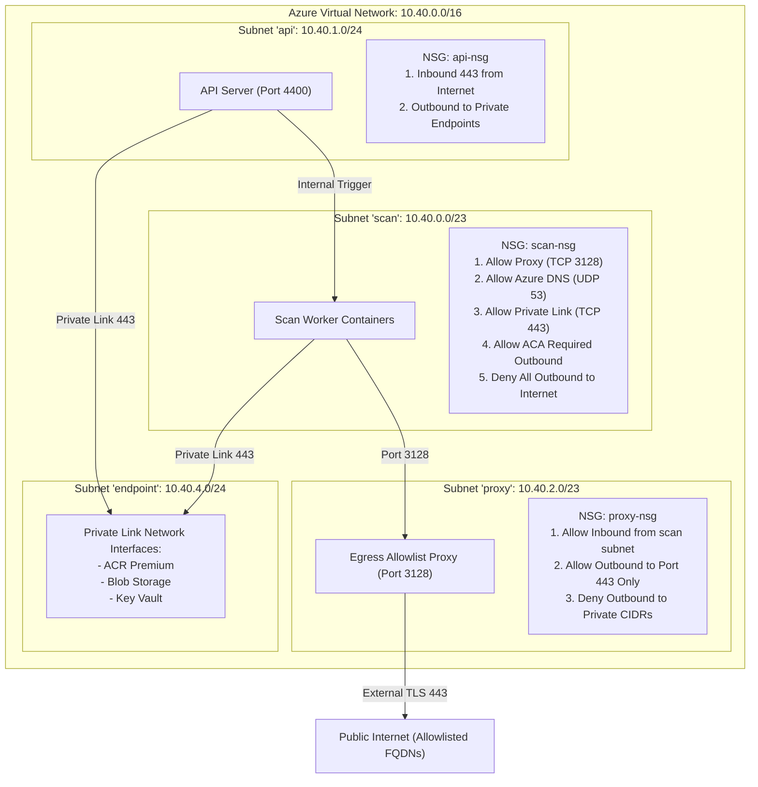

# Network Architecture

> **Document ID:** VS-DOC-16  
> **Status:** Approved Baseline  
> **Version:** 1.0.0  
> **Date:** November 2026  
> **Target Audience:** Network Engineers, Cloud Security Architects, SREs  

---

## 1. Network Topology & Virtual Network Design

VulnSight AI isolates network communication by enforcing strict micro-segmentation across a dedicated Azure Virtual Network (`10.40.0.0/16`), governed by Network Security Groups (NSGs) and a custom CONNECT-only proxy.



---

## 2. Address Space & Subnet Allocation Plan

The address plan accommodates horizontal worker scaling and dedicated private link adapters without IP overlapping:

| Subnet Name | CIDR Prefix | Usable IP Count | Primary Purpose & Hosted Workloads |
| :--- | :--- | :---: | :--- |
| **`scan`** | `10.40.0.0/23` | 507 IPs | Dedicated execution subnet for ephemeral Azure Container Apps Jobs. |
| **`api`** | `10.40.1.0/24` | 251 IPs | Public-facing API Server and Web Dashboard Container Apps. |
| **`proxy`** | `10.40.2.0/23` | 507 IPs | Egress proxy service mediating outbound worker connections. |
| **`endpoint`**| `10.40.4.0/24` | 251 IPs | Private Endpoints for Key Vault, Blob Storage, and Azure Container Registry. |

---

## 3. Network Security Group (NSG) Rules Matrix

### 3.1 Scan Worker Subnet Rules (`scan-nsg`)
The scan worker subnet is configured with an aggressive **default-deny outbound** posture to ensure that rogue code, malicious packages, or container escape exploits cannot reach external command-and-control servers or private networks:

| Priority | Direction | Action | Source | Port | Destination | Port | Protocol | Purpose / Rationale |
| :---: | :---: | :---: | :---: | :---: | :---: | :---: | :---: | :--- |
| **100** | Inbound | Deny | Any | Any | Any | Any | Any | Workers reject all unsolicited inbound traffic. |
| **110** | Outbound | Allow | VirtualNetwork | Any | `10.40.2.0/23` | 3128 | TCP | Outbound traffic to the Egress Proxy only. |
| **120** | Outbound | Allow | VirtualNetwork | Any | `10.40.4.0/24` | 443 | TCP | Access to Private Endpoints (ACR, Blob, KV). |
| **130** | Outbound | Allow | VirtualNetwork | Any | `AzureCloud` | 53 | UDP/TCP| Authoritative Azure DNS resolution. |
| **140** | Outbound | Allow | VirtualNetwork | Any | `MicrosoftContainerRegistry` | 443 | TCP | Required Azure ACA platform container pulls. |
| **999** | Outbound | **Deny** | Any | Any | `Internet` | Any | Any | **Default Deny: All direct outbound internet blocked.** |

---

## 4. Egress Proxy Architecture & Controls (`src/platform/egress-proxy.js`)

Because Network Security Groups operate primarily at Layer 3/4 and cannot filter by HTTP hostnames without costly enterprise firewalls, VulnSight AI integrates a custom, high-speed Layer 7 forward proxy:

```mermaid
flowchart TD
    ClientReq["Worker Client CONNECT request:<br/>CONNECT api.osv.dev:443 HTTP/1.1"] --> MethodCheck{Method == CONNECT?}
    MethodCheck -->|No (GET/POST)| DenyMethod["403 Forbidden: Plain HTTP denied"]
    MethodCheck -->|Yes| PortCheck{Port == 443?}
    PortCheck -->|No| DenyPort["403 Forbidden: Non-443 denied"]
    PortCheck -->|Yes| IPCheck{Host is IP Literal?}
    IPCheck -->|Yes| DenyIP["403 Forbidden: IP literals denied"]
    IPCheck -->|No| AllowlistCheck{FQDN on Allowlist?}
    AllowlistCheck -->|No| DenyAllow["403 Forbidden: Host not allowlisted"]
    AllowlistCheck -->|Yes| ResolveDNS["Resolve Host via DNS (dns.lookup)"]
    ResolveDNS --> PrivateCheck{Any Answer Private / Link-Local / Metadata?}
    PrivateCheck -->|Yes| DenyPrivate["403 Forbidden: Host resolves to private IP"]
    PrivateCheck -->|No| TunnelLimit{Active Tunnels < 200?}
    TunnelLimit -->|No| DenyLimit["503 Service Unavailable: Tunnel cap reached"]
    TunnelLimit -->|Yes| DialUpstream["Dial Verified Public IP on 443"]
    DialUpstream --> EstablishTunnel["Pipe Sockets with 100MB upload cap"]
```

### 4.1 Built-in Allowlist Specification
The proxy permits connections exclusively to endpoints required for security scanning:
```javascript
const DEFAULT_ALLOW = [
  'github.com', 'api.github.com',
  'gitlab.com',
  'bitbucket.org',
  'api.osv.dev', 'osv.dev',
  'semgrep.dev', '*.semgrep.dev',
  'ghcr.io', '*.pkg.github.com', 'pkg-containers.githubusercontent.com', 'objects.githubusercontent.com',
  'mirror.gcr.io', 'public.ecr.aws',
];
```

### 4.2 Anti-SSRF & DNS Rebinding Elimination
- The proxy strictly resolves hostnames itself.
- If **any** returned A or AAAA record matches private or link-local ranges (`127.0.0.1`, `10.0.0.0/8`, `169.254.169.254`, `::1`), the connection is terminated immediately.
- The outbound TCP socket connects directly to the IP address the proxy validated, guaranteeing that attackers cannot exploit DNS rebinding to pivot into internal networks.
