# Security Architecture

> **Document ID:** VS-DOC-17  
> **Status:** Approved Baseline  
> **Version:** 1.0.0  
> **Date:** November 2026  
> **Target Audience:** Chief Information Security Officer (CISO), Security Architects, Lead Auditors  

---

## 1. Security Architecture Principles

VulnSight AI adopts a zero-trust, defense-in-depth security model designed specifically to run untrusted third-party code safely while providing vulnerability intelligence.

```mermaid
graph TD
    subgraph Layer1 ["Layer 1: Perimeter & Transport Defense"]
        TLS["Strict TLS 1.3 Encryption"]
        CSP["Content Security Policy (script-src 'self')"]
        Headers["X-Frame-Options: DENY, nosniff, no-referrer"]
        NoCookies["Bearer-Token Auth (Zero CSRF Surface)"]
    end

    subgraph Layer2 ["Layer 2: Access Control & Tenant Boundary"]
        RBAC["Role-to-Permission Engine (Owner, Admin, Dev, Viewer)"]
        TenantFilter["Mandatory org_id Query Scoping"]
        RateLimiter["Adaptive Sliding-Window Rate Limiting"]
        HashQueue["libuv Thread Pool Capped scrypt (Max 2 Concurrency)"]
    end

    subgraph Layer3 ["Layer 3: Cryptographic Data Protection"]
        MasterKey["32-byte AES-256-GCM Master Key"]
        KeyVault["Azure Key Vault Purge Protection"]
        HashTokens["SHA-256 Token Storage"]
        SecretMasking["In-Memory Secret Redaction (Gitleaks)"]
    end

    subgraph Layer4 ["Layer 4: Sandboxing & Workload Isolation"]
        Grants["Single-Use Credential Grants (10-min TTL)"]
        Sanitization["Workspace Symlink Removal & Quotas"]
        Caps["Container: --cap-drop ALL, no-new-privileges"]
        UID["Unprivileged Execution (UID 10001:10001)"]
    end

    subgraph Layer5 ["Layer 5: Network Confinement & AI Defense"]
        NSG["NSG Deny Direct Outbound Internet"]
        Proxy["CONNECT-only Port 443 Allowlist Proxy"]
        DNS["Anti-SSRF DNS Pinning & Private IP Rejection"]
        AIGuards["Two-Tier Consent & Prompt Injection Regex Screening"]
    end

    Layer1 --> Layer2
    Layer2 --> Layer3
    Layer3 --> Layer4
    Layer4 --> Layer5
```



---

## 2. Comprehensive Security Controls Matrix

The platform's defensive posture is mapped across identified enterprise threats, technical controls, and test evidence:

| Threat Category | Specific Attack Vector | Platform Technical Control | Implementation File | Verification Test Suite |
| :--- | :--- | :--- | :--- | :--- |
| **Network & SSRF** | Attacker supplies repository pointing to AWS/Azure metadata (`169.254.169.254`). | Authoritative pre-clone DNS resolution rejects private/metadata IPs; pins IP for clone via `http.curloptResolve`. | `src/platform/git.js` | `test/git.test.js`, `test/api.test.js` |
| **Command Injection**| Malicious branch name (e.g., `main; rm -rf /`) or repo URL. | Strict branch regex validation (`^[A-Za-z0-9][\w./-]{0,199}$`); process spawning with `shell: false` (`execTool`). | `src/platform/git.js`, `src/adapters/runner.js` | `test/git.test.js`, `test/platform.test.js` |
| **Filesystem Traversal**| Cloned repository contains symlinks targeting host files (`/etc/shadow`, secrets). | Recursive workspace sanitization unlinks **every** symlink before analysis; `.git` directory deleted. | `src/platform/git.js` | `test/platform.test.js` |
| **Credential Leakage**| Worker container leaks customer Git provider token. | Single-use grant secrets (`scan_grants`); persistent tokens are never passed in worker startup payloads. | `src/platform/service.js`, `src/platform/aca.js` | `test/grants.test.js`, `test/aca.test.js` |
| **Worker Escape** | Malicious package attempts container escape or host privilege escalation. | Containers run with `--cap-drop ALL`, `--security-opt no-new-privileges`, read-only root, UID `10001:10001`. | `src/platform/sandbox.js`, `deploy/azure/main.bicep` | `test/docker-sandbox.test.js` |
| **Cross-Tenant Access**| User from Organization A accesses scans or findings belonging to Organization B. | Mandatory tenant authorization (`authorize(ctx)`); queries enforce `org_id`; nonexistent objects return 404. | `src/platform/service.js` | `test/platform.test.js`, `scripts/security-probe.js` |
| **Privilege Escalation**| Developer grants themselves Owner privileges or deletes organization. | RBAC assertion (`assertCan(role, perm)`) checked at service layer; last owner cannot be removed. | `src/platform/rbac.js`, `src/platform/service.js` | `test/platform.test.js` |
| **Denial of Service**| Login flood with compute-heavy `scrypt` hashing locks the Node.js event loop. | Asynchronous hashing executed on libuv worker pool; hard-capped at 2 concurrent hashes, queue max 50 (503 fast fail).| `src/platform/crypto.js` | `test/hashing.test.js`, `scripts/loadtest.js` |
| **Cross-Site Scripting**| Malicious finding title or dependency name executes script in dashboard. | Strict Content Security Policy (`script-src 'self'`); UI uses DOM element creation with `textContent` only; zero `innerHTML`. | `src/platform/api.js`, `web/lib.js` | `scripts/xss-probe.js` |
| **Prompt Injection** | Code comments contain hostile instructions targeting LLM remediation models. | Context tagged in `<untrusted>` tags, stripped of delimiter look-alikes; screened via `INJECTION_PATTERNS`. | `src/ai/assistant.js` | `test/ai.test.js` |

---

## 3. Cryptographic Subsystem Architecture

### 3.1 Data at Rest Encryption
- **Algorithm:** AES-256-GCM (Galois/Counter Mode) authenticated symmetric encryption.
- **Key Management:** Master 256-bit key sourced from Azure Key Vault or high-entropy environment variable (`VULNSIGHT_MASTER_KEY`).
- **Initialization Vector:** Unique cryptographically random 12-byte IV generated per encryption event.
- **Envelope Format:**
  $$\text{Payload} = \text{v1} \mathbin{\Vert} \text{Base64}(\text{IV}) \mathbin{\Vert} \text{Base64}(\text{AuthTag}) \mathbin{\Vert} \text{Base64}(\text{Ciphertext})$$
- **Atomic Key Rotation (`scripts/ops.js rotate-key`):** Reads `OLD_KEY` and `NEW_KEY`; iterates through every encrypted record in `provider_connections`, `repositories`, and `scan_grants`; re-encrypts all records within a single atomic database transaction.

### 3.2 Password Hashing & Key Derivation
- **Algorithm:** `scrypt` key derivation function with parameters:
  - $N = 16384$ (CPU/memory cost parameter)
  - $r = 8$ (Block size parameter)
  - $p = 1$ (Parallelization parameter)
  - $\text{Key Length} = 64\text{ bytes}$
- **Per-User Salt:** 16 cryptographically random bytes generated via `crypto.randomBytes(16)`.
- **Timing-Safe Comparison:** Password verification uses `crypto.timingSafeEqual` to completely eliminate side-channel timing attacks.

---

## 4. Web Application Security Profile

1. **Zero Cookie Architecture:** The web frontend does not use cookies for authentication or tracking. Tokens are passed exclusively in HTTP request authorization headers (`Authorization: Bearer <token>`). This eliminates Cross-Site Request Forgery (CSRF) vulnerabilities by construction.
2. **HTTP Security Headers:**
   ```http
   Content-Security-Policy: default-src 'self'; script-src 'self'; style-src 'self'; img-src 'self' data:; connect-src 'self'; frame-ancestors 'none'; base-uri 'none'; form-action 'self'
   X-Content-Type-Options: nosniff
   X-Frame-Options: DENY
   Referrer-Policy: no-referrer
   Cross-Origin-Opener-Policy: same-origin
   Cross-Origin-Resource-Policy: same-origin
   Permissions-Policy: camera=(), microphone=(), geolocation=()
   Strict-Transport-Security: max-age=31536000; includeSubDomains
   ```
3. **CSV Formula Injection Mitigation:** Exported spreadsheets neutralize cells beginning with `=`, `+`, `-`, or `@` by prepending a single quote (`'`), preventing formula execution in Microsoft Excel or Google Sheets.
