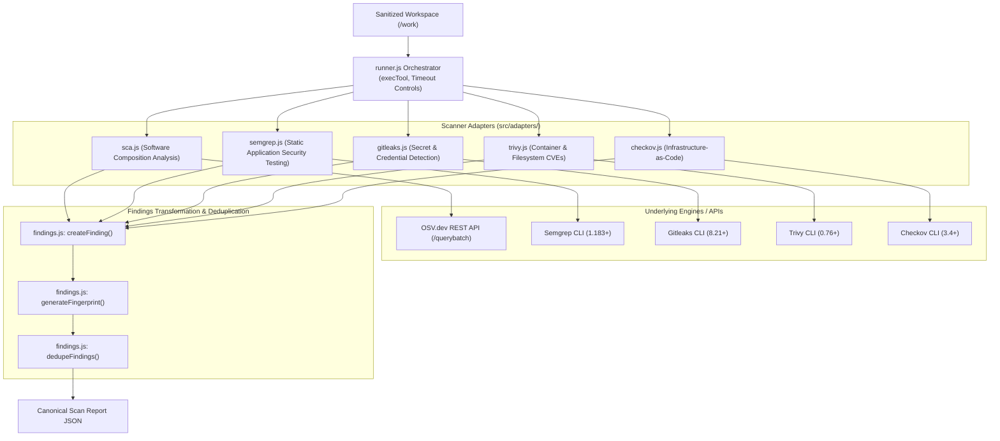

# Scanner Integration Architecture

> **Document ID:** VS-DOC-22  
> **Status:** Approved Baseline  
> **Version:** 1.0.0  
> **Date:** November 2026  
> **Target Audience:** Integration Engineers, Security Tooling Leads, Backend Developers  

---

## 1. Scanner Orchestration Architecture

VulnSight AI employs an adapter-based orchestration pattern (`src/adapters/index.js` and `runner.js`) that abstracts disparate security scanning binaries and REST APIs into a unified, fault-tolerant execution pipeline.



---

## 2. Scanner Adapter Specifications

### 2.1 Software Composition Analysis (SCA) Adapter (`src/adapters/sca.js`)
- **Ecosystems Supported:** npm (`package-lock.json`), Python (`requirements.txt`, `poetry.lock`, `Pipfile.lock`), Yarn (`yarn.lock` v1 & Berry), Pnpm (`pnpm-lock.yaml`), Go (`go.sum`).
- **Parsing Strategy:** Native lockfile parsers extract package names, installed version tuples, and direct/transitive dependency trees.
- **Vulnerability Source:** Executes batch queries against Google's live **OSV.dev REST API** (`https://api.osv.dev/v1/querybatch`).
- **Advisory Merging:** Drops withdrawn advisories; correlates aliases across CVE, GHSA, and PYSEC databases; extracts fixed version targets.

### 2.2 SAST Adapter: Semgrep (`src/adapters/semgrep.js`)
- **Execution Command:**
  ```bash
  semgrep --json --config=auto --quiet --no-git-ignore --disable-version-check
  ```
- **Detection Scope:** Insecure coding patterns, Cross-Site Scripting (XSS), SQL/NoSQL Injection, Remote Code Execution (RCE), Path Traversal, and Cryptographic weaknesses.
- **Transformation:**
  - Severity mapped: Semgrep `ERROR` $\rightarrow$ `high`, `WARNING` $\rightarrow$ `medium`, `INFO` $\rightarrow$ `low`.
  - CWE and OWASP classifications extracted from rule metadata.
  - Fix recommendations mapped from Semgrep `fix` or `fix_regex` fields.

### 2.3 Secret Scanner Adapter: Gitleaks (`src/adapters/gitleaks.js`)
- **Execution Command:**
  ```bash
  gitleaks detect --no-git --report-format json --report-path <temp_file>
  ```
- **Detection Scope:** Hardcoded API keys, JWT tokens, AWS/Azure access credentials, private SSH keys, and database connection strings.
- **Mandatory In-Memory Redaction:**
  The raw secret matched by Gitleaks is intercepted before saving:
  ```javascript
  function redactSecret(s) {
    if (!s || s.length <= 8) return '********';
    return `${s.slice(0, 4)}...${s.slice(-4)}`;
  }
  ```
  The raw plaintext secret is permanently erased from memory.

### 2.4 Container & Filesystem Adapter: Trivy (`src/adapters/trivy.js`)
- **Execution Command:**
  ```bash
  trivy fs --format json --security-checks vuln,config .
  ```
- **Detection Scope:** OS-level packages (Debian, Alpine, RHEL), base container image CVEs, and insecure Dockerfile directives.
- **Integration:** Maps both vulnerability records (`Vulnerabilities`) and configuration misconfigurations (`Misconfigurations`).

### 2.5 Infrastructure-as-Code Adapter: Checkov (`src/adapters/checkov.js`)
- **Execution Command:**
  ```bash
  checkov -d . --output json --compact --quiet
  ```
- **Detection Scope:** Terraform (`.tf`), Kubernetes manifests, CloudFormation, Helm charts, and ARM templates.
- **Framework Mapping:** Handles multi-framework JSON output structures, extracting failed checks, benchmark IDs, and file/line references.

---

## 3. Fault Isolation & Error Handling

VulnSight AI implements an essential operational safeguard: **One failing scanner must never break the scan.**

```javascript
// src/adapters/runner.js
async function runAdapter(adapter, target, opts) {
  try {
    return await adapter.run(target, opts);
  } catch (err) {
    return {
      scanner: adapter.name,
      status: 'error',
      error: err.message,
      findings: [],
      raw: null
    };
  }
}
```

If an optional scanner binary (e.g., Checkov or Trivy) is missing from the environment:
1. `execTool` catches `ENOENT` (executable not found).
2. The adapter returns `{ status: 'skipped', error: 'Scanner binary not found in PATH' }`.
3. The remaining installed scanners execute normally.
4. The scan completes with `status: 'completed'`, and the missing scanner is noted in the scan summary metadata.

---

## 4. Cross-Scanner Deduplication Engine (`src/findings.js`)

When multiple security analyzers run against the same repository, they frequently identify identical vulnerabilities (for example, Trivy and OSV both discovering CVE-2023-26136 in Tough-Cookie).

The deduplication algorithm guarantees clean, non-repetitive reports:
1. **Alias Indexing:** Builds a bidirectional graph of known vulnerability aliases (`primary` $\leftrightarrow$ `aliases`).
2. **Canonical Grouping:** Identifies findings sharing:
   - Same package name and ecosystem.
   - Overlapping vulnerability identifiers (e.g., matching CVE or GHSA).
   - Same file path and line location.
3. **Consolidation Rules:**
   - **Severity:** Retains the highest severity rating reported.
   - **Provenance:** Merges contributing scanner names into `sources: ['osv', 'trivy']`.
   - **Remediation:** Selects the most specific fixed version available.
