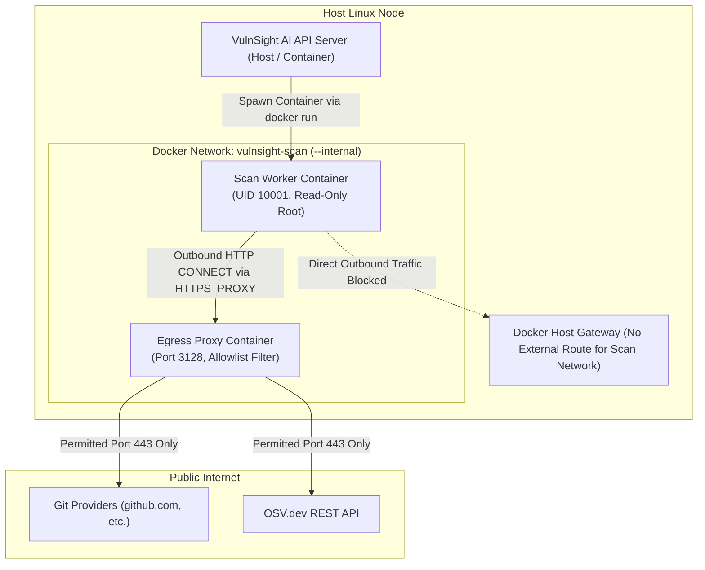

# Docker Sandbox Architecture

> **Document ID:** VS-DOC-23  
> **Status:** Approved Baseline  
> **Version:** 1.0.0  
> **Date:** November 2026  
> **Target Audience:** DevOps Engineers, Security Infrastructure Specialists, SREs  

---

## 1. Sandbox Purpose & Threat Boundary

Scanning untrusted third-party code requires an impermeable security boundary. A repository checked out from the internet may contain malicious build scripts, exploitable lockfile structures, or binaries engineered to compromise host infrastructure.

VulnSight AI provides a dedicated **Docker Sandbox Engine** (`src/platform/sandbox.js` and `deploy/docker/setup-egress.sh`) designed for on-premise, self-hosted, and sovereign cloud deployments where Azure Container Apps is not utilized.

```
+-----------------------------------------------------------------------------------+
|                        Docker Worker Sandbox Enclosure                            |
+-----------------------------------------------------------------------------------+
|  1. Non-Root Execution       | --user 10001:10001 (Zero root privileges)          |
|  2. Immutable Filesystem     | --read-only (Root filesystem cannot be modified)   |
|  3. Linux Capability Drop    | --cap-drop ALL (All kernel capabilities stripped)  |
|  4. Privilege Escalation Deny| --security-opt no-new-privileges                   |
|  5. Process & Memory Limits  | --pids-limit 256, --memory 1g, --cpus 1            |
|  6. Network Isolation        | --network vulnsight-scan (Internal, no gateway)    |
|  7. Fail-Closed Egress       | Refuses to execute without VULNSIGHT_EGRESS_PROXY  |
+-----------------------------------------------------------------------------------+
```

---

## 2. Docker Sandbox Runtime Topology



---

## 3. Network Setup Script (`deploy/docker/setup-egress.sh`)

To guarantee that scan workers cannot access the host network, local services, or unrestricted internet gateways, VulnSight AI automates network provisioning via `setup-egress.sh`:

```bash
#!/usr/bin/env bash
set -euo pipefail

NETWORK_NAME="vulnsight-scan"
PROXY_NAME="vulnsight-egress-proxy"

# 1. Create strictly internal network (No default gateway to internet)
if ! docker network inspect "$NETWORK_NAME" >/dev/null 2>&1; then
  echo "Creating internal Docker network: $NETWORK_NAME"
  docker network create --internal "$NETWORK_NAME"
fi

# 2. Launch Egress Allowlist Proxy on the internal network
# The proxy container has an interface on the default bridge (for internet access)
# and an interface on the internal vulnsight-scan network (to serve workers).
if ! docker inspect "$PROXY_NAME" >/dev/null 2>&1; then
  echo "Starting egress proxy container: $PROXY_NAME"
  docker run -d \
    --name "$PROXY_NAME" \
    --restart unless-stopped \
    --network bridge \
    -e VULNSIGHT_EGRESS_ALLOW="github.com,gitlab.com,bitbucket.org,api.osv.dev,osv.dev,semgrep.dev,ghcr.io" \
    vulnsight-api:latest \
    node src/platform/egress-proxy.js
  
  # Connect proxy to the isolated worker network
  docker network connect "$NETWORK_NAME" "$PROXY_NAME"
fi

PROXY_IP=$(docker inspect -f '{{range .NetworkSettings.Networks}}{{.IPAddress}}{{end}}' "$PROXY_NAME")
echo "Docker Sandbox Ready. Worker HTTPS_PROXY=http://$PROXY_NAME:3128"
```

---

## 4. Container Hardening Flags Audit (`src/platform/sandbox.js`)

When invoking a scan, `sandbox.js` computes the command line using `dockerArgs()`:

```javascript
function dockerArgs({ workspace, request, image, memory = '1g', cpus = '1', pids = 256, network = 'vulnsight-scan', proxy }) {
  return [
    'run', '--rm', '--pull=never',
    '--user', '10001:10001',
    '--read-only',
    '--cap-drop', 'ALL',
    '--security-opt', 'no-new-privileges',
    '--pids-limit', String(pids),
    '--memory', memory, '--memory-swap', memory,
    '--cpus', cpus,
    '--tmpfs', '/tmp:rw,noexec,nosuid,size=256m',
    '--network', network,
    '--mount', `type=bind,source=${workspace},target=/work,readonly`,
    '--workdir', '/work',
    '--env', 'HOME=/tmp',
    ...(proxy ? ['--env', `HTTPS_PROXY=${proxy}`, '--env', 'NODE_USE_ENV_PROXY=1'] : []),
    image, 'node', '/app/src/platform/scan-child.js', JSON.stringify({ ...request, path: '/work' })
  ];
}
```

### 4.1 Fail-Closed Security Policy
Docker sandbox execution explicitly enforces fail-closed behavior:
```javascript
if (!process.env.VULNSIGHT_EGRESS_PROXY && !process.env.VULNSIGHT_ALLOW_NO_PROXY) {
  throw new Error('Docker mode needs VULNSIGHT_EGRESS_PROXY (worker egress must go through the allowlist proxy)');
}
```
If an administrator starts the platform in Docker mode without configuring an allowlist proxy, the platform **refuses to run scans** rather than falling back to an open, unmonitored host network.

---

## 5. Host Socket Protection & Operational Warning

> [!CAUTION]
> **Never mount `/var/run/docker.sock` into the API container.**  
> Exposing the host Docker daemon socket grants root-equivalent control over the host operating system. In production deployments utilizing Docker mode, the API server must communicate with the Docker daemon via mutually authenticated TLS over TCP (`DOCKER_HOST=tcp://...`), or utilize Azure Container Apps Jobs where the Docker daemon is entirely absent.
