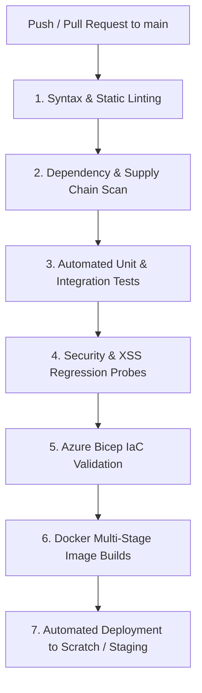

# CI/CD Pipeline

> **Document ID:** VS-DOC-24  
> **Status:** Approved Baseline  
> **Version:** 1.0.0  
> **Date:** November 2026  
> **Target Audience:** DevOps Engineers, Release Managers, Security Quality Assurance  

---

## 1. CI/CD Pipeline Overview

VulnSight AI employs an automated Continuous Integration and Continuous Delivery (CI/CD) workflow implemented via GitHub Actions (`.github/workflows/ci.yml`). The pipeline enforces strict quality gates, automated security regression testing, dependency validation, and multi-architecture Docker image generation.



---

## 2. Pipeline Stages & Verification Gates

### Stage 1: Syntax & Static Linting
- **Node.js Environment:** Matrix testing on Node.js 18.x, 20.x, and 22.x LTS.
- **Verification:** Ensures strict JavaScript syntax compliance (`'use strict'`), ES Module integrity, and absence of syntax errors.

### Stage 2: Dependency & Supply Chain Security
- **Self-Scanning:** The CI pipeline runs VulnSight AI against its own codebase:
  ```bash
  node bin/vulnsight.js test . --severity-threshold=high
  ```
- **External Scanning:** Executes `npm audit` and Trivy filesystem scans to ensure zero vulnerable dependencies exist in development or production trees.

### Stage 3: Automated Test Execution
- **Command:** `npm test` (`node --test "test/**/*.test.js"`)
- **Scope:** Runs 142 automated tests spanning:
  - Ingress and routing (`test/api.test.js`)
  - Multi-tenant RBAC and isolation (`test/platform.test.js`)
  - Cryptography, `scrypt` thread pool concurrency (`test/hashing.test.js`)
  - Single-use grant issuance and replay prevention (`test/grants.test.js`)
  - Egress proxy allowlists, DNS pinning, and socket limits (`test/egress-proxy.test.js`)
  - Lockfile parsers and scanner adapters (`test/parsers.test.js`, `test/scanners.test.js`)
  - Azure Container Apps executor simulation (`test/aca.test.js`)
  - Online database backup and disaster recovery drills (`test/ops.test.js`)
- **Gate Requirement:** 100% pass rate. Any test failure halts the pipeline immediately.

### Stage 4: Automated Security & XSS Regression Probes
- **Security Probe Execution:**
  ```bash
  npm run probe # node scripts/security-probe.js
  ```
  Runs 26 automated attack vectors covering SQLi, prototype pollution, IDOR, brute-force throttling, and CORS headers.
- **XSS Browser Probe Execution:**
  ```bash
  npm run probe:xss # node scripts/xss-probe.js
  ```
  Launches a headless browser instance, injects hostile polyglot payloads across 13 views, and asserts that zero script execution occurs.

### Stage 5: Infrastructure as Code (Bicep) Compilation
- **Tooling:** Azure Bicep CLI (`az bicep build` or `bicep build`).
- **Target Files:** `deploy/azure/subscription.bicep` and `deploy/azure/main.bicep`.
- **Validation:** Verifies that templates compile without syntax errors, type mismatches, or deprecated resource API versions.

### Stage 6: Multi-Stage Container Image Packaging
- **Docker Images Built:**
  1. `vulnsight-api:latest` (`deploy/Dockerfile.api`)
  2. `vulnsight-worker:latest` (`deploy/Dockerfile.worker`)
- **Container Vulnerability Scan:** Images are inspected with Trivy before publishing to the container registry:
  ```bash
  trivy image --exit-code 1 --severity CRITICAL vulnsight-api:latest
  ```

---

## 3. GitHub Actions Workflow Configuration

Excerpts from the continuous integration definition (`.github/workflows/ci.yml`):

```yaml
name: CI/CD Pipeline

on:
  push:
    branches: [ main ]
  pull_request:
    branches: [ main ]

jobs:
  test-and-verify:
    runs-on: ubuntu-latest
    strategy:
      matrix:
        node-version: [18.x, 20.x, 22.x]

    steps:
      - uses: actions/checkout@v4

      - name: Use Node.js ${{ matrix.node-version }}
        uses: actions/setup-node@v4
        with:
          node-version: ${{ matrix.node-version }}

      - name: Run Unit & Integration Test Suites
        run: npm test

      - name: Run Security Self-Assessment Probes
        run: |
          node scripts/security-probe.js
          node scripts/loadtest.js 10 5 50

      - name: Validate Azure Bicep Templates
        run: |
          az bicep build --file deploy/azure/subscription.bicep
          az bicep build --file deploy/azure/main.bicep

  build-containers:
    needs: test-and-verify
    runs-on: ubuntu-latest
    if: github.ref == 'refs/heads/main'

    steps:
      - uses: actions/checkout@v4

      - name: Set up Docker Buildx
        uses: docker/setup-buildx-action@v3

      - name: Build API Container Image
        uses: docker/build-push-action@v5
        with:
          context: .
          file: deploy/Dockerfile.api
          push: false
          tags: vulnsight-api:${{ github.sha }}

      - name: Build Worker Container Image
        uses: docker/build-push-action@v5
        with:
          context: .
          file: deploy/Dockerfile.worker
          push: false
          tags: vulnsight-worker:${{ github.sha }}
```

---

## 4. Release Governance & Deployment Gate

VulnSight AI enforces a strict manual gate prior to any production Azure resource changes:
1. **Interactive `what-if` Execution:** The release engineer must run `./deploy/azure/whatif.sh <region>`.
2. **Resource Audit:** The output must be reviewed to verify expected resource modifications and confirm no unexpected role assignments or networking changes occur.
3. **Approval Sign-Off:** Automated continuous deployment directly to production is explicitly disabled for infrastructure templates, requiring human approval from the Lead Security Architect.
