# Test Strategy & Test Cases

> **Document ID:** VS-DOC-25  
> **Status:** Approved Baseline  
> **Version:** 1.0.0  
> **Date:** November 2026  
> **Target Audience:** QA Engineers, Security Testers, Core Developers  

---

## 1. Testing Philosophy & Tiers of Verification

VulnSight AI rejects the notion that passing unit tests alone equate to production readiness. The platform classifies verification into three explicit evidentiary tiers (defined in `docs/STATUS.md`):

```mermaid
graph TD
    subgraph Tiers ["Verification Tiers"]
        V["1. Verified<br/>Exercised against real systems, live networks, real binaries, or real browsers."]
        PV["2. Partially Verified<br/>Implemented and tested against fakes, mocks, or compiled syntax checks."]
        UV["3. Unverified / Not Done<br/>Written but never executed in live cloud environments."]
    end

    V --> V1["Live OSV.dev Scans (NodeGoat: 91 findings)"]
    V --> V2["Real Scanners (Semgrep, Gitleaks, Trivy, Checkov)"]
    V --> V3["Egress Proxy Real Socket Tunneling & Denials"]
    V --> V4["Security Probes (26 checks) & XSS Headless Edge (13 views)"]
    V --> V5["Async Password Hashing & Thread Pool Queue"]
    V --> V6["Backup & Disaster Recovery Drills"]

    PV --> PV1["Azure Container Apps Jobs Executor (tested against fake ARM & Blob)"]
    PV --> PV2["Docker Sandbox Isolation (unit flags verified; runtime skipped locally)"]
    PV --> PV3["Live Provider OAuth Workflows (tested with fakes)"]

    UV --> UV1["Real Azure Deployment & NSG Egress Rules"]
    UV --> UV2["Independent Third-Party Penetration Test"]
```

---

## 2. Test Suite Organization

The platform provides 21 specialized test files located in `test/`, executable via Node's native test runner (`node --test`):

| Test Suite File | Component Under Test | Scope & Test Count | Primary Invariants Verified |
| :--- | :--- | :---: | :--- |
| `test/aca.test.js` | Azure Container Apps Executor | 10 tests | Job launch, polling, blob reading, credential scrubbing, timeout handling. |
| `test/ai.test.js` | AI Assistant Subsystem | 11 tests | Consent gating, prompt injection detection, code stripping, deterministic SemVer risk. |
| `test/api.test.js` | Ingress Gateway & Router | 12 tests | Rate limiting, authentication, security headers, request body limits, SPA routing. |
| `test/db.test.js` | Storage & Database Layer | 2 tests | In-memory & disk database open, foreign key cascading, schema migrations. |
| `test/docker-sandbox.test.js`| Docker Sandbox Engine | 6 tests (conditional) | Linux capabilities, read-only root, no-new-privileges, UID verification. |
| `test/egress-proxy.test.js` | CONNECT Egress Proxy | 9 tests | Port 443 enforcement, allowlist matching, DNS rebinding defense, tunnel limits. |
| `test/egress-wiring.test.js`| Egress Integration Wiring | 4 tests | Ensuring executors, git, and scanners inherit proxy configuration. |
| `test/env.test.js` | Configuration & Environment | 2 tests | `.env` parsing, comment stripping, `.env.local` override precedence. |
| `test/findings.test.js` | Findings Model & Deduplication | 3 tests | Deterministic fingerprinting, alias deduplication, CVSS calculation. |
| `test/git.test.js` | SSRF Defense & Git Utilities | 4 tests | URL validation, IP literal rejection, branch sanitization, symlink deletion. |
| `test/grants.test.js` | Single-Use Credential Grants | 6 tests | Single-use redemption, replay detection and audit, expiration, identical failure shapes. |
| `test/hashing.test.js` | Async Password Hashing | 4 tests | Thread pool bounding (max 2), event-loop non-blocking, 503 queue saturation. |
| `test/ops.test.js` | Operations & Disaster Recovery | 6 tests | Online backup (`VACUUM INTO`), verify, restore, atomic master key rotation. |
| `test/parsers.test.js` | Native Lockfile Parsers | 6 tests | `package-lock.json` (v1/v2/v3), `requirements.txt`, Poetry, Pipfile, Yarn, Pnpm, Go. |
| `test/phase1.test.js` | Core Scanner Engine | 12 tests | CLI scan flags, threshold filtering, JSON exports, exit code contracts. |
| `test/platform.test.js` | Multi-Tenant Platform Core | 28 tests | Complete scan flow, RBAC, tenant isolation, webhooks, schedules, retention purge. |
| `test/real-tools.test.js` | External Scanning Binaries | 5 tests (conditional) | Live execution of Semgrep, Gitleaks, Trivy, Checkov against insecure fixtures. |
| `test/scanner.test.js` | OSV.dev Integration | 4 tests | Live batch API queries, alias resolution, withdrawn advisory filtering. |
| `test/scanners.test.js` | Scanner Adapters & Deduplication| 9 tests | Adapter execution, error handling, missing tool status, evidence masking. |
| `test/scoring.test.js` | Risk & Posture Scoring | 3 tests | CVSS v3.1 base scoring, severity fallback, Posture Score formula. |
| `test/server.test.js` | Local Web Dashboard | 6 tests | Web dashboard static assets, localhost binding, scan history persistence. |

---

## 3. High-Priority Security Test Cases

### TC-SEC-01: Single-Use Credential Grant Anti-Replay
- **Objective:** Verify that an ephemeral grant secret can only be redeemed once and that replay attempts are refused and logged.
- **Preconditions:** API server active with `VULNSIGHT_MASTER_KEY` loaded.
- **Execution Steps:**
  1. Generate grant for valid Git credential: `issueGrant(auth)`.
  2. Issue `POST /api/v1/internal/scan-grant` with valid secret $\rightarrow$ Expect `HTTP 200` and decrypted token.
  3. Immediately reissue identical `POST` request with same secret.
- **Expected Result:**
  - Second request fails with `HTTP 400 Invalid or expired grant`.
  - An audit record is created capturing the replay attempt and client IP.
  - The secret is permanently marked as spent in `scan_grants`.

### TC-SEC-02: Anti-SSRF & DNS Rebinding Elimination
- **Objective:** Verify that repository URLs pointing to private IPs or resolving to internal addresses are blocked.
- **Execution Steps:**
  1. Submit `validateRepoUrl('http://169.254.169.254/latest/meta-data')`.
  2. Submit `validateRepoUrl('https://127.0.0.1/repo.git')`.
  3. Submit `validateRepoUrl('https://internal.corp/repo.git')` (configured to resolve to `10.0.0.1`).
- **Expected Result:**
  - All three inputs throw `ValidationError`.
  - Authoritative DNS check prevents connection; zero network packets sent to internal hosts.

### TC-SEC-03: Event Loop Non-Blocking Under Password Flood
- **Objective:** Verify that concurrent logins cannot freeze the HTTP server or starve DNS lookups.
- **Execution Steps:**
  1. Fire 10 concurrent requests to `/api/v1/auth/login`.
  2. Simultaneously measure event loop lag and issue concurrent health check requests (`GET /api/v1/health`).
- **Expected Result:**
  - Maximum 2 hashing operations run concurrently on worker threads.
  - Health check responds in $< 5\text{ ms}$.
  - Excess login attempts beyond queue limit are shed with `HTTP 503`.

---

## 4. Disaster Recovery & Operational Drills

### Drill 1: Backup, Destroy, Restore Validation (`test/ops.test.js`)
1. Populate database with organizations, repositories, scans, findings, and encrypted provider tokens.
2. Execute `node scripts/ops.js backup <db> <backup.db>`.
3. Verify backup integrity via `node scripts/ops.js verify <backup.db>`.
4. Overwrite original database with corrupted data.
5. Execute `node scripts/ops.js restore <backup.db> <db>`.
6. Assert that user login succeeds, findings exist, and encrypted tokens decrypt cleanly using the master key.
7. Assert that without the master key, the backup file alone cannot decrypt tokens.

### Drill 2: Atomic Master Key Rotation
1. Define `OLD_KEY` and `NEW_KEY`.
2. Execute `node scripts/ops.js rotate-key <db>`.
3. Verify that all records in `provider_connections`, `repositories`, and `scan_grants` are re-encrypted under `NEW_KEY`.
4. Verify that attempting decryption with `OLD_KEY` fails immediately.
