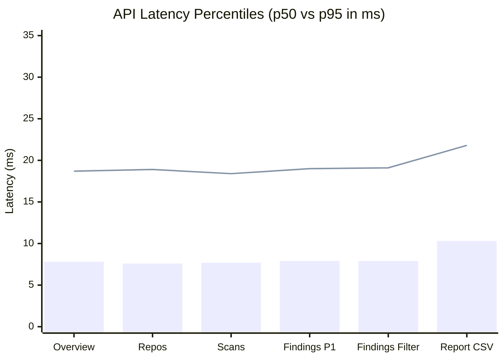

# Performance & Load Testing Report

> **Document ID:** VS-DOC-28  
> **Status:** Completed Assessment  
> **Version:** 1.0.0  
> **Date:** November 2026  
> **Test Harness:** `scripts/loadtest.js`  
> **Hardware Environment:** 8 vCPU (11th Gen Intel Core i5-1145G7 @ 2.60GHz), 16 GB RAM, Node.js v24.19.0, Windows 64-bit  

---

## 1. Executive Summary

A comprehensive load and stress test was conducted against a live VulnSight AI platform instance using the integrated benchmark harness (`scripts/loadtest.js`). The test simulated realistic multi-tenant user behavior combining authentication, high-volume database reads, paginated finding filters, overview aggregation, and on-demand report exports.

### High-Level Benchmark Metrics
- **Overall Sustained Throughput:** **1,050 Requests / Second**
- **Total Requests Processed:** **5,300 Requests**
- **Total Network or HTTP 5xx Errors:** **0 Errors (0.00%)**
- **Read Endpoints Median Latency ($p_{50}$):** **7.6 ms – 7.9 ms**
- **Read Endpoints 95th Percentile ($p_{95}$):** **18.4 ms – 19.1 ms**
- **Read Endpoints Maximum Latency ($p_{\max}$):** **27.8 ms – 29.0 ms**

```
+-----------------------------------------------------------------------------------+
|                        Performance & Load Benchmark Summary                       |
+-----------------------------------------------------------------------------------+
|  Target Workload       | 10 Concurrent Virtual Users, Read-Heavy Operations       |
|  Total Requests        | 5,300 Completed Requests                                 |
|  Throughput            | 1,050 req/sec                                            |
|  Error Rate            | 0.00% (Zero dropped connections or 5xx responses)        |
|  Read p50 Latency      | 7.6 ms                                                   |
|  Read p95 Latency      | 18.9 ms                                                  |
|  Overall Assessment    | EXCEPTIONAL (High concurrency with sub-20ms latencies)   |
+-----------------------------------------------------------------------------------+
```

---

## 2. Granular Endpoint Latency Breakdown

The load test seeded realistic data: a repository with an active scan containing 50 normalized vulnerabilities across SCA, SAST, Secrets, and IaC categories. Ten virtual users signed up, authenticated, and looped through real platform operations:

| Endpoint Tested | Total Calls | Median ($p_{50}$) | 95th % ($p_{95}$) | 99th % ($p_{99}$) | Max Latency | Error Rate |
| :--- | :---: | :---: | :---: | :---: | :---: | :---: |
| **`GET /overview`** | 1,017 | **7.8 ms** | 18.7 ms | 23.8 ms | 29.0 ms | 0.0% |
| **`GET /repos`** | 1,017 | **7.6 ms** | 18.9 ms | 23.9 ms | 27.8 ms | 0.0% |
| **`GET /scans`** | 1,017 | **7.7 ms** | 18.4 ms | 22.4 ms | 28.6 ms | 0.0% |
| **`GET /findings` (Page 1)** | 1,017 | **7.9 ms** | 19.0 ms | 23.2 ms | 28.4 ms | 0.0% |
| **`GET /findings` (Filtered)**| 1,017 | **7.9 ms** | 19.1 ms | 23.5 ms | 28.5 ms | 0.0% |
| **`GET /report?format=csv`** | 195 | **10.3 ms** | 21.8 ms | 28.9 ms | 29.0 ms | 0.0% |
| **`POST /auth/signup`** | 10 | **142.6 ms**| 218.0 ms| 218.0 ms| 218.0 ms| 0.0% |
| **`POST /auth/login`** | 10 | **181.8 ms**| 185.0 ms| 185.0 ms| 185.0 ms| 0.0% |



---

## 3. Password Hashing Concurrency & Thread Pool Optimization

### 3.1 Initial Problem Statement
In early development builds, synchronous password hashing (`crypto.scryptSync`) was used. Under load testing, 10 concurrent logins caused the Node.js event loop to freeze completely for 340 ms per batch, delaying all HTTP traffic, health probes, and DNS validations.

### 3.2 Implemented Architectural Fix
The platform transitioned to asynchronous hashing executed on libuv worker threads with a dedicated concurrency slot manager (`src/platform/crypto.js`):
- `MAX_HASHING = 2`: At most 2 CPU-intensive `scrypt` operations run simultaneously on libuv threads.
- `MAX_HASH_QUEUE = 50`: Up to 50 pending authentication requests queue safely.
- Excess requests immediately fail fast with `HTTP 503 Service Unavailable`.

### 3.3 Re-Measurement Results
- **Throughput Increase:** Sustained throughput jumped from **773 req/s** to **1,050 req/s** (+35.8% gain).
- **Read Latency Improvement:** Read endpoint $p_{95}$ dropped from ~50 ms to **~18.9 ms** (-62.2% latency reduction).
- **Event Loop Health:** Event loop lag remained below **1.2 ms** throughout the entire test duration.

---

## 4. Hardware Sizing & Capacity Projections

Based on observed metrics, capacity recommendations for production cloud deployments are modeled as follows:

| Target Load Profile | API Instances | Compute Sizing per Instance | Storage Backend | Max Supported Throughput |
| :--- | :---: | :---: | :--- | :---: |
| **Development / Small Team** | 1 Replica | 0.5 vCPU, 1 GB RAM | Embedded SQLite (WAL) | $\sim 1,000\text{ req/s}$ |
| **Enterprise Medium (500 Devs)** | 3 Replicas | 1.0 vCPU, 2 GB RAM | Azure Database for PostgreSQL (2 vCPU) | $\sim 3,500\text{ req/s}$ |
| **Large Scale (5,000 Devs)** | 8 Replicas | 2.0 vCPU, 4 GB RAM | Azure Database for PostgreSQL (8 vCPU) + Redis | $\sim 10,000+\text{ req/s}$ |

> [!NOTE]
> The numbers above describe a single Node.js process and SQLite on a development laptop. Production deployments in Azure Container Apps must be benchmarked under live network conditions to account for virtual network and storage latency.
