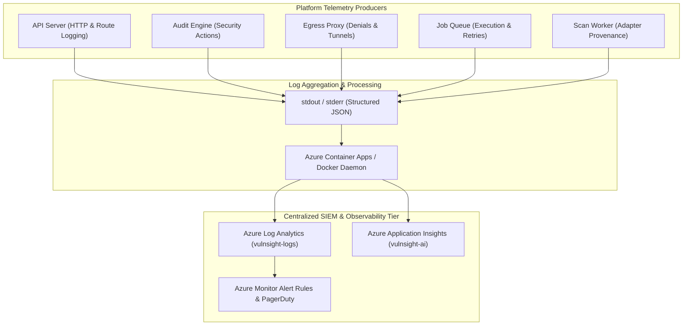

# Monitoring & Logging Architecture

> **Document ID:** VS-DOC-30  
> **Status:** Approved Baseline  
> **Version:** 1.0.0  
> **Date:** November 2026  
> **Target Audience:** SREs, Security Operations Center (SOC) Analysts, Cloud Architects  

---

## 1. Observability Architecture Overview

VulnSight AI implements structured, JSON-formatted telemetry across all operational tiers. Logs and metrics stream directly to standard output (`stdout`/`stderr`), where they are captured by container orchestrators (Azure Container Apps, Docker) and ingested into centralized SIEM and analytics platforms (Azure Log Analytics, Application Insights, Datadog).



---

## 2. Structured Log Event Schemas

All platform logs emit single-line, parseable JSON objects. Key event schemas include:

### 2.1 HTTP Request & Response Log
```json
{
  "timestamp": "2026-11-03T11:00:00.123Z",
  "level": "info",
  "method": "POST",
  "path": "/api/v1/orgs/org_11b2c/repos/repo_55a2/scans",
  "status": 202,
  "ms": 14.2,
  "ip": "203.0.113.195",
  "userId": "usr_94a7e"
}
```

### 2.2 Security Egress Proxy Denial Log (`egress.denied`)
Critical signal indicating potentially compromised repositories attempting exfiltration:
```json
{
  "timestamp": "2026-11-03T11:02:15.891Z",
  "level": "warn",
  "event": "egress.denied",
  "host": "evil-c2-server.net",
  "port": 443,
  "reason": "host is not on the allowlist",
  "clientIp": "10.40.0.12"
}
```

### 2.3 Immutable Audit Trail Log
Ingested from the database `audit_logs` table:
```json
{
  "timestamp": "2026-11-03T11:05:42.000Z",
  "level": "info",
  "event": "audit",
  "action": "user.login_failed",
  "orgId": null,
  "userId": null,
  "target": "alice@example.com",
  "detail": "Invalid password attempt",
  "ip": "198.51.100.42"
}
```

### 2.4 Unhandled System Exception Log
```json
{
  "timestamp": "2026-11-03T11:08:19.412Z",
  "level": "error",
  "errorId": "err_550e8400-e29b-41d4-a716-446655440000",
  "path": "/api/v1/orgs/org_11b2c/scans",
  "message": "Database disk image is malformed",
  "stack": "Error: Database disk image...\n    at openDatabase (/app/src/platform/db.js:95:15)"
}
```

---

## 3. High-Priority Alerting Rules

Operations and SOC teams should configure alerts on the following key metrics and threshold breaches:

| Alert Trigger | Signal Source | Severity | Recommended Threshold | Operational Response |
| :--- | :--- | :---: | :--- | :--- |
| **Egress Policy Denial** | `event == "egress.denied"` | **HIGH** | $> 5$ events in 5 minutes for unlisted domains. | Investigate repository being scanned; may indicate exfiltration attempt or dependency calling unexpected CDN. |
| **Credential Brute Force**| `action == "user.login_failed"` | **MEDIUM** | $> 10$ failures from single IP or user in 15 minutes. | Verify rate limiter activation; consider blocking IP at WAF or Azure Front Door. |
| **Scan Worker Failure Spike**| `status == "failed"` in `scans` table | **HIGH** | $> 10\%$ scan failure rate over 1 hour. | Inspect worker logs for `is not installed` (broken image) or network timeouts to git hosts. |
| **Stranded Job Detection** | `scans.status == "running"` | **MEDIUM** | Scans in `running` status $> 20$ minutes. | Worker container likely crashed without cleanup; queue will reap, but investigate memory exhaustion. |
| **HTTP 5xx Error Rate** | Container HTTP Metrics | **CRITICAL**| HTTP $5\text{xx} > 1\%$ over 5 minutes. | Check database disk space, Key Vault connectivity, and API memory consumption. |
| **Password Hash Queue Drop**| HTTP 503 from `/auth/login` | **MEDIUM** | $> 1$ occurrences in 10 minutes. | Indicates authentication flood; check for distributed password stuffing attack. |

---

## 4. Operational Health Probes

The API server exposes `/api/v1/health` responding with `HTTP 200 { "ok": true }`.
- **Azure Liveness Probe:** Checks `/api/v1/health` every 10 seconds (Timeout: 3s). Reboots container if 3 consecutive checks fail.
- **Azure Readiness Probe:** Checks `/api/v1/health` before routing traffic. Container is removed from the load balancer pool during restarts or database migration runs.
