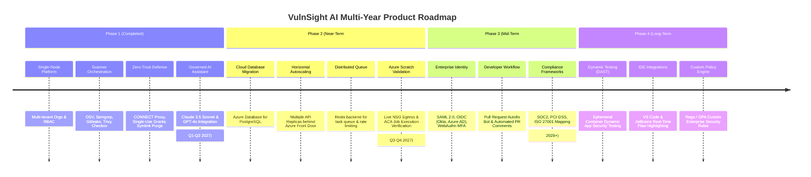

# Project Roadmap

> **Document ID:** VS-DOC-34  
> **Status:** Approved Baseline  
> **Version:** 1.0.0  
> **Date:** November 2026  
> **Target Audience:** Engineering Leadership, Product Managers, Customer Stakeholders  

---

## 1. Roadmap Strategic Vision

The VulnSight AI roadmap transitions the platform from a validated single-node platform into an enterprise-scale, horizontally scalable, and automated DevSecOps platform.

---

## 2. Phase Breakdown & Key Milestones

### Phase 1: Foundational Platform & Verification (COMPLETED)
- [x] **Zero-Dependency Core:** Pure Node.js standard library architecture eliminating supply chain risks.
- [x] **Multi-Tenancy & RBAC:** Complete organization, team, role, and membership isolation.
- [x] **Multi-Vector Scanning:** Integrated SCA, SAST, Secret Scanning, Container, and IaC scanning.
- [x] **Ephemeral Grants Authority:** Single-use token distribution protocol preventing worker credential leaks.
- [x] **CONNECT Egress Proxy:** Outbound allowlist forward proxy blocking private IPs and non-standard ports.
- [x] **Compliance Export Suite:** Automated generation of CycloneDX v1.5 SBOM, CSV, Markdown, and JSON.
- [x] **Automated Regression Suite:** 142 automated tests with 0 failures, 26-check security probe, and 13-view XSS probe.

---

### Phase 2: Enterprise Cloud Hardening & Scalability (Target: Q1–Q2 2027)
- **Milestone 2.1: Live Azure Subscription Validation**
  - Run `deploy/azure/whatif.sh` and deploy to a scratch resource group.
  - Verify NSG egress blocking rules from inside an active Container Apps Job.
  - Validate Container Apps Jobs Operator identity role in live Azure ARM.
- **Milestone 2.2: Managed PostgreSQL Migration**
  - Implement PostgreSQL storage adapter behind `db.js`.
  - Migrate schema and indexes to Azure Database for PostgreSQL Flexible Server.
  - Remove single-replica constraint, enabling multi-pod horizontal autoscaling.
- **Milestone 2.3: Redis Distributed Queue & State**
  - Replace in-memory rate limiter with Redis sliding-window cluster.
  - Back `queue.js` with Redis pub/sub and reliable job streams.

---

### Phase 3: Developer Automation & Enterprise Identity (Target: Q3–Q4 2027)
- **Milestone 3.1: Automated Pull Request Autofix Bot**
  - Bot automatically comments on pull requests discovering new vulnerabilities.
  - Generates verified dependency update pull requests (e.g., automated `package.json` updates) based on deterministic SemVer calculations.
- **Milestone 3.2: Enterprise Identity Federation (SSO & MFA)**
  - SAML 2.0 and OIDC integrations supporting Okta, PingIdentity, and Microsoft Entra ID.
  - Enforced Multi-Factor Authentication (MFA) via TOTP and FIDO2 WebAuthn hardware keys.
- **Milestone 3.3: Slack & Microsoft Teams ChatOps**
  - Real-time webhook notifications for critical vulnerabilities and scan status updates.
  - ChatOps bot allowing developers to triage or snooze alerts directly from Slack.

---

### Phase 4: Advanced Security & IDE Ecosystem (Target: 2028+)
- **Milestone 4.1: Dynamic Application Security Testing (DAST)**
  - Integrate ZAP/Nuclei to execute targeted API fuzzing against ephemeral staging builds.
- **Milestone 4.2: IDE Real-Time Security Plugins**
  - Visual Studio Code and JetBrains extensions highlighting vulnerable dependencies and hardcoded secrets directly in the editor buffer.
- **Milestone 4.3: Custom Open Policy Agent (OPA) Rules**
  - Allow enterprise security teams to author custom Rego policies enforcing organizational dependency licenses, forbidden package versions, and required security gates.
