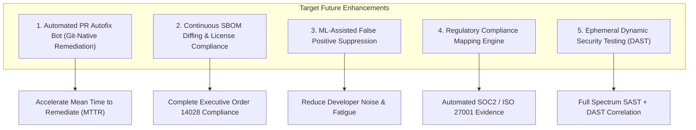
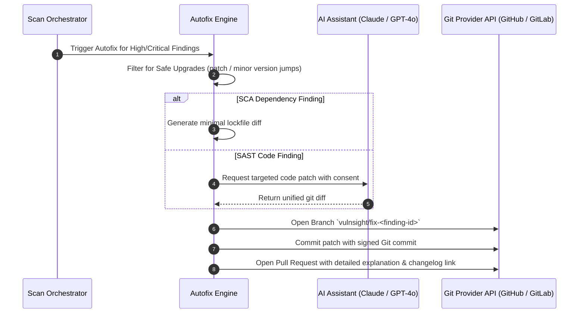

# Future Enhancements

> **Document ID:** VS-DOC-35  
> **Status:** Architecture Blueprint  
> **Version:** 1.0.0  
> **Date:** November 2026  
> **Target Audience:** Product Architects, Security Researchers, Senior Developers  

---

## 1. Overview of Proposed Enhancements

This document outlines detailed architectural and technical specifications for upcoming capabilities designed to extend the core VulnSight AI platform beyond automated detection into automated remediation, deep compliance governance, and developer IDE integration.

---

## 2. Enhancement 1: Automated Pull Request Autofix Bot

### 2.1 Problem & Motivation
Currently, VulnSight AI identifies vulnerabilities and suggests remediation code via the AI Assistant. However, developers must still manually check out a branch, update the lockfile or code, test, and submit a pull request.

### 2.2 Architectural Design
The Autofix Bot subsystem will run as an asynchronous post-scan pipeline:

### 2.3 Safety Controls
- Automatically restricted to patch and minor version upgrades to minimize breaking changes.
- Pull requests carry a disclaimer badge: `[VulnSight Automated Fix]`.
- Enforces branch protection rules; never pushes directly to default branches (`main`/`master`).

---

## 3. Enhancement 2: Continuous SBOM Diffing & License Governance

### 3.1 Motivation
Enterprise compliance requires tracking how the Software Bill of Materials (SBOM) changes between commits and releases, ensuring that prohibited open-source licenses (e.g., AGPL-3.0 in proprietary closed-source binaries) are not introduced.

### 3.2 Key Technical Capabilities
1. **SBOM Diffing:**
   - Compares CycloneDX SBOMs across arbitrary Git commit SHAs.
   - Highlights added, removed, and updated components.
   - Computes vulnerability delta ($\Delta_{\text{vuln}} = \text{New Findings} - \text{Resolved Findings}$).
2. **Open-Source License Compliance:**
   - Extracts SPDX license expressions from package manifests.
   - Enforces customizable license policies (Permitted: MIT, Apache-2.0, BSD; Flagged: GPL-3.0, AGPL-3.0).
   - Generates automated Legal & Compliance attribution notices.

---

## 4. Enhancement 3: Machine Learning-Assisted False Positive Suppression

### 4.1 Motivation
Static analysis tools (SAST) often suffer from high rates of context-dependent false positives (e.g., flagging SQL injection in test scripts or internal CLI utilities). Repeatedly triaging identical false positives across repos induces alert fatigue.

### 4.2 Proposed Model Architecture
- **Local On-Premise Classifier:** Train a lightweight gradient-boosted decision tree (or fine-tuned small language model) on historical triage decisions within an organization.
- **Feature Vector:** Rule ID, file path pattern (e.g., `test/`, `mock/`, `scripts/`), AST call depth, sanitize wrappers present, developer note keywords.
- **Workflow:** When a new finding matches a high-confidence false positive pattern ($> 95\%$), the platform automatically flags it as `suggested_suppression`, allowing developers to accept or reject the suppression with one click.

---

## 5. Enhancement 4: Regulatory Compliance Mapping Engine

Automates compliance audit reporting by mapping findings directly to regulatory controls:

| Compliance Standard | Target Control | VulnSight AI Automated Evidence |
| :--- | :--- | :--- |
| **SOC 2 Type II** | CC7.1 (Vulnerability Management) | Audit trail of continuous weekly repository scanning and SLA triage. |
| **PCI-DSS v4.0** | Req 6.2 (Bespoke Software Flaws) | SAST & Dependency scanning results showing zero unmitigated High/Critical findings. |
| **ISO/IEC 27001:2022**| A.8.8 (Management of Technical Vulnerabilities) | Historical posture scores, remediation timelines, and immutable review logs. |
| **Executive Order 14028**| Section 4 (Enhancing Software Supply Chain) | Automated CycloneDX v1.5 JSON SBOM generation with Package URLs (`purl`). |
