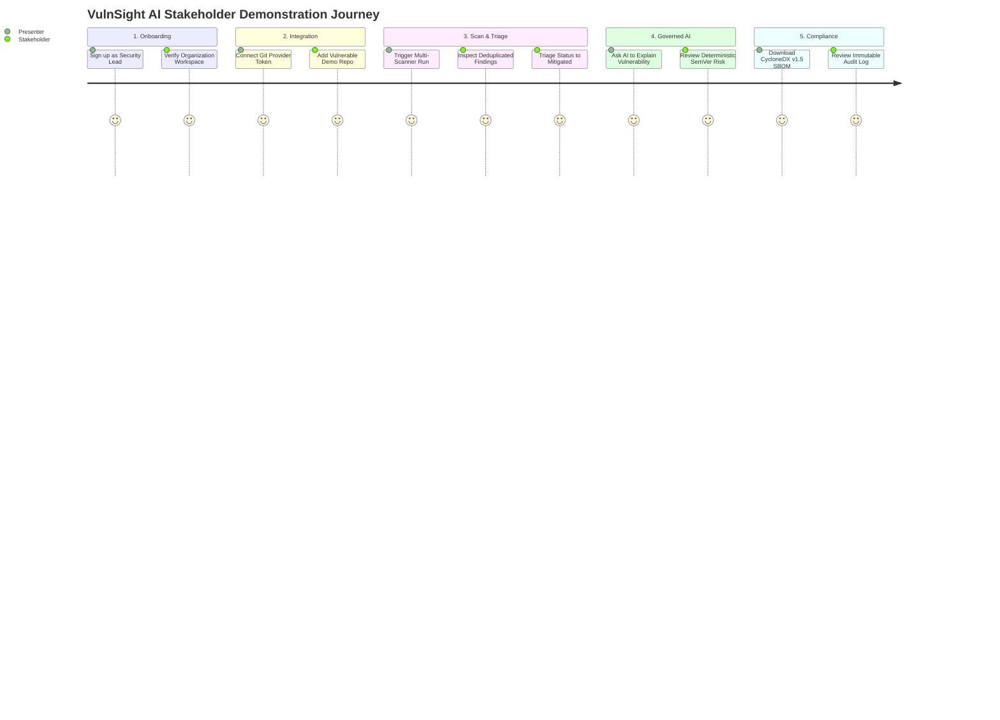

# Live Product Demonstration Script

> **Document ID:** VS-DOC-36  
> **Status:** Approved Baseline  
> **Version:** 1.0.0  
> **Date:** November 2026  
> **Target Audience:** Sales Engineers, Solution Architects, Product Demonstrators, Evaluators  

---

## 1. Demonstration Scenario & Objectives

This runbook provides a complete, step-by-step demonstration script for showcasing VulnSight AI to executive stakeholders, prospective enterprise customers, and engineering teams.

### Demonstration Objectives
1. Showcase multi-tenant onboarding, authentication, and RBAC scoping.
2. Demonstrate connecting an external Git repository with zero persistent worker credentials.
3. Execute an end-to-end multi-scanner scan (SCA, SAST, Secrets, Container, IaC).
4. Review findings, demonstrate cross-scanner deduplication, and inspect finding details.
5. Exercise the governed AI Security Assistant for explanations and deterministic upgrade paths.
6. Export compliance reports (CycloneDX SBOM, CSV, Markdown).
7. Review immutable security audit logs and disaster recovery capabilities.

---

## 2. Pre-Demo Setup & Environment Initialization

1. Open terminal in the `VulnSight AI` directory.
2. Ensure Node.js 18+ is active.
3. Start the platform:
   ```bash
   node bin/vulnsight.js serve
   ```
4. Confirm terminal outputs:
   ```
   VulnSight AI platform listening on http://localhost:4400
   Sandbox mode: process | Database: .vulnsight-data/platform.db
   ```
5. Open Google Chrome or Microsoft Edge and navigate to `http://localhost:4400`.

---

## 3. Step-by-Step Demonstration Walkthrough



### Stage 1: Account Creation & Multi-Tenancy Setup
1. **Presenter Narrative:** *"VulnSight AI is a multi-tenant platform where every data entity is partitioned by organization."*
2. **Action:** Click **"New here? Create an account"**.
3. Fill in the registration form:
   - **Your name:** `Alex Rivera`
   - **Organisation:** `FinTech Solutions Inc`
   - **Email:** `alex@fintech-demo.internal`
   - **Password:** `Correct-Horse-Battery-99`
4. Click **"Create account"**.
5. **Key Observation:** The user is logged in instantly. The navigation sidebar displays the organization selector with `FinTech Solutions Inc (owner)` and the user's email.

---

### Stage 2: Connecting a Git Repository
1. **Presenter Narrative:** *"Now let's add a repository. VulnSight AI supports GitHub, GitLab, and Bitbucket. We can add a public repository URL or integrate a private provider token."*
2. **Action:** In the sidebar, navigate to **Repositories** (`#/repos`).
3. Click **"Add repository"**.
4. Enter repository parameters:
   - **Provider:** `GitHub`
   - **Clone URL:** `https://github.com/vulnsight-demo/sample-node-app.git` (or enter `examples/npm-app` for local testing)
   - **Default Branch:** `main`
   - **Scanners:** Select `SCA`, `Semgrep`, `Gitleaks`, `Trivy`
5. Click **"Add repository"**.
6. **Key Observation:** The repository appears in the catalog with status `Never scanned` and Security Posture Score `100 (A)`.

---

### Stage 3: Executing the Multi-Scanner Pipeline
1. **Presenter Narrative:** *"Let's launch an on-demand scan. Notice that behind the scenes, the orchestrator generates a single-use credential grant and enforces strict egress filtering."*
2. **Action:** Click into the newly added repository, then click the primary action button: **"Scan now"**.
3. **Key Observation:**
   - The UI immediately displays `Status: Queued`, transitioning within seconds to `Status: Running`.
   - The scanner progress bar displays active tools: *OSV.dev SCA, Semgrep SAST, Gitleaks Secret Scanner*.
   - When finished, the status badge turns green: `Status: Completed`.
   - The Security Posture Score drops to reflect findings (e.g., `Score: 68 (D)`), and the severity breakdown displays Critical, High, Medium, and Low counts.

---

### Stage 4: Findings Triage & Cross-Scanner Deduplication
1. **Presenter Narrative:** *"Notice how findings from disparate scanners are normalized into a unified view. Let's filter and triage."*
2. **Action:**
   - Click the **Findings** tab.
   - Use the **Category** dropdown to filter by `SCA` (open-source dependencies), then `Secret` (hardcoded credentials), then `SAST`.
   - Notice that secrets detected by Gitleaks show **masked values** (`ghp_****...****`), proving that raw secrets are never leaked.
   - Click a finding row (e.g., `Prototype Pollution in minimist`).
3. **Action:** The finding detail drawer opens:
   - View primary identifier (`CVE-2020-7598`), alias (`GHSA-vh95-rmgr-6w4m`), and CVSS score (`7.5`).
   - Change Status from `Open` to `Mitigated`.
   - Enter note: `Input is validated at our API gateway layer`.
   - Click **Save**.
4. **Key Observation:** The finding status updates to `Mitigated`, and the repository Posture Score recalculates upwards automatically!

---

### Stage 5: Governed AI Remediation Assistance
1. **Presenter Narrative:** *"Now let's explore VulnSight AI's governed AI assistant. It provides remediation code and upgrade guidance while guaranteeing that findings remain the ground truth."*
2. **Action:** Inside the finding drawer, click **"Explain finding"** or **"Suggest fix"**.
3. **Key Observation:**
   - The AI Assistant generates a concise, 3-part breakdown: (1) Technical vulnerability explanation, (2) Application impact, and (3) Exact safe remediation code.
   - The **Deterministic Upgrade Impact** banner appears:
     - `From: 0.0.8 -> To: 0.2.1`
     - `Classification: Minor version jump`
     - `Breaking Change Risk: Medium (review changelog and run unit tests)`
   - The response carries the official badge: `AI-Generated (Claude 3.5 Sonnet)`.

---

### Stage 6: Compliance Reporting & SBOM Export
1. **Presenter Narrative:** *"To satisfy Executive Order 14028 or external enterprise audits, we can export full compliance reports in multiple standard formats."*
2. **Action:** Click **"Export report"**:
   - Select **CycloneDX v1.5 JSON (SBOM)** $\rightarrow$ File downloads instantly containing Package URLs (`purl`), dependency trees, and vulnerability hashes.
   - Select **CSV Report** $\rightarrow$ File downloads with formula injection protections verified.
   - Select **Markdown Summary** $\rightarrow$ Ready for inclusion in PR comments or audit memos.

---

### Stage 7: Immutable Audit Trail & Platform Governance
1. **Presenter Narrative:** *"Finally, let's inspect the compliance audit log. Every single action taken in this demo has been recorded immutably."*
2. **Action:** Navigate to **Settings > Audit Log** (`#/settings/audit`).
3. **Key Observation:**
   - Displays chronological log:
     - `user.signup` (`alex@fintech-demo.internal`)
     - `repo.added` (`sample-node-app`)
     - `scan.started` (`manual` trigger)
     - `scan.completed` (found X issues)
     - `finding.triage_updated` (`open -> mitigated`)
   - Captures exact UTC timestamps and client IP addresses.
4. **Conclusion:** End demonstration and invite questions from stakeholders.
