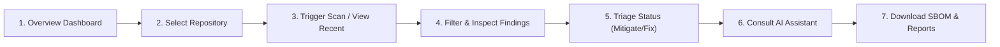

# User Guide

> **Document ID:** VS-DOC-37  
> **Status:** Approved Baseline  
> **Version:** 1.0.0  
> **Date:** November 2026  
> **Target Audience:** Developers, Security Analysts, Team Leads  

---

## 1. Getting Started with VulnSight AI

Welcome to **VulnSight AI**, an automated, multi-scanner security platform that helps you find and fix vulnerabilities across your dependencies, source code, secrets, container definitions, and cloud configurations.

### 1.1 Accessing the Platform
1. Open your browser and navigate to the VulnSight AI URL provided by your administrator (e.g., `https://vulnsight.company.internal` or `http://localhost:4400`).
2. Log in with your corporate email address and password.
3. If you belong to multiple organizations or teams, use the **Organization Selector** dropdown in the bottom left of the sidebar to switch workspaces.

---

## 2. Navigating the Web Dashboard

The platform navigation is divided into five core sections in the sidebar:

```
[VS] VulnSight AI
├── Overview       (#/overview)   -> Aggregate security score, trends, recent scans
├── Repositories   (#/repos)      -> Manage connected repos, branches, and triggers
├── AI Assistant   (#/assistant)  -> Conversational repo Q&A and posture summaries
├── Reports        (#/reports)    -> Compliance exports (CycloneDX SBOM, CSV, Markdown)
└── Settings       (#/settings)   -> Profile, team management, integrations, audit log
```



---

## 3. Managing Repositories

### 3.1 Adding a New Repository
1. Navigate to **Repositories** (`#/repos`).
2. Click the primary button: **"Add repository"**.
3. Choose your configuration:
   - **Provider:** Select `GitHub`, `GitLab`, or `Bitbucket`.
   - **Clone URL:** Enter the HTTPS repository URL (e.g., `https://github.com/my-org/my-project.git`).
   - **Provider Connection:** Select an existing Git provider token configured by your administrator, or leave blank if scanning a public repository.
   - **Default Branch:** Specify your main branch (e.g., `main` or `master`).
   - **Active Scanners:** Check the security engines to include:
     - `SCA`: Dependency vulnerability scanning via OSV.dev.
     - `Semgrep`: Source code static analysis (SAST).
     - `Gitleaks`: Secret and credential scanning.
     - `Trivy`: Container and filesystem vulnerability analysis.
     - `Checkov`: Infrastructure-as-Code (Terraform, K8s, Dockerfile) misconfigurations.
   - **Severity Threshold:** Choose the minimum severity to track (`low`, `medium`, `high`, `critical`).
4. Click **"Save repository"**.

### 3.2 Setting Up Automated Scan Schedules
1. From the repository list, click your repository name to open its detail view.
2. Under the **Schedule** section, select your preferred frequency:
   - `Daily`: Automatically scans every 24 hours.
   - `Weekly`: Scans once every 7 days.
   - `Monthly`: Scans on the 1st of each month.
   - `Disabled`: On-demand and webhook triggers only.
3. Click **"Update schedule"**.

### 3.3 Setting Up Webhook Integration
To automatically scan code on every `git push`:
1. In repository settings, locate the **Webhook Configuration** box.
2. Copy the **Payload URL** (e.g., `https://vulnsight.company.internal/api/v1/webhooks/<repo-id>`).
3. Copy the **Webhook Secret**.
4. In your GitHub/GitLab repository settings:
   - Add a new webhook with Content Type: `application/json`.
   - Paste the Secret and select the `Push events` trigger.
   - Save the webhook.

---

## 4. Understanding Findings & The Triage Workflow

### 4.1 The Security Posture Score
VulnSight AI assigns your repository an intuitive Security Posture Score (0 to 100) and letter grade:
- **Grade A (90–100):** Clean or low-risk posture.
- **Grade B (80–89):** Minor medium-severity issues present.
- **Grade C (70–79):** High-severity issues require attention.
- **Grade D (60–69):** Unmitigated high vulnerabilities.
- **Grade F (< 60):** Critical vulnerabilities require immediate remediation.

### 4.2 Filtering Findings
On the **Findings** tab, use the filter bar to isolate issues:
- **By Severity:** Toggle `Critical`, `High`, `Medium`, or `Low`.
- **By Category:** Filter by `SCA`, `SAST`, `Secret`, `Container`, or `IaC`.
- **By Status:** Filter between `Open`, `In Review`, `Mitigated`, `Confirmed`, and `False Positive`.
- **Search Query:** Search by package name (e.g., `lodash`), CVE ID (e.g., `CVE-2023-`), or file path.

### 4.3 Triage Actions
Click any finding row to expand the detail drawer:
1. **Change Status:**
   - **`Open`:** Default state for newly discovered issues.
   - **`In Review`:** Actively being investigated by a developer.
   - **`Confirmed`:** Validated vulnerability requiring a code patch.
   - **`Mitigated`:** Compounding architectural controls (like WAF rules or network segmentation) make the flaw unreachable.
   - **`False Positive`:** Rule fired incorrectly on safe code.
   - **`Accepted`:** Documented business decision to accept risk.
2. **Assignee:** Assign the finding to a team member for remediation.
3. **Triage Note:** Always provide a brief explanation when changing status (e.g., *"Package used exclusively in build tools; unreachable in runtime deployment"*).
4. Click **"Save triage changes"**.

---

## 5. Using the Governed AI Assistant

The AI Assistant helps developers understand complex vulnerability advisories and provides actionable remediation guidance.

### 5.1 Explain a Finding
1. Open the finding detail drawer.
2. Click **"Explain finding"**.
3. The AI provides:
   - **Root Cause Analysis:** Why the vulnerability occurs.
   - **Exploitability in Context:** Real-world likelihood of exploitation.
   - **Safest Fix:** Exact version upgrade target or code patch.
4. Review the **Deterministic Upgrade Impact** banner:
   - Notice whether the fix is a **Major**, **Minor**, or **Patch** version jump.
   - Follow recommendations regarding changelog reviews and unit testing.

### 5.2 Conversational Repository Security Q&A
1. Navigate to **AI Assistant** (`#/assistant`) in the main sidebar.
2. Select your repository from the dropdown.
3. Ask questions in natural language:
   - *"Which high-severity vulnerabilities affect our authentication modules?"*
   - *"Summarize the security posture of this repository."*
   - *"What is our fastest path to achieve a Grade A posture score?"*
4. The assistant responds with cited finding UUIDs and direct links.

---

## 6. Exporting Compliance Reports & SBOMs

1. Navigate to any completed scan, or visit **Reports** (`#/reports`).
2. Click **"Export report"** and choose your desired format:
   - **CycloneDX v1.5 JSON (SBOM):** Machine-readable Software Bill of Materials complete with Package URLs (`purl`) for compliance with Executive Order 14028.
   - **CSV Spreadsheet:** Formatted table with formula-injection defenses for spreadsheet analysis.
   - **Markdown Document:** Clean summary suitable for copy-pasting into pull requests, tickets, or audit notes.
   - **Raw JSON:** Full platform data payload.
