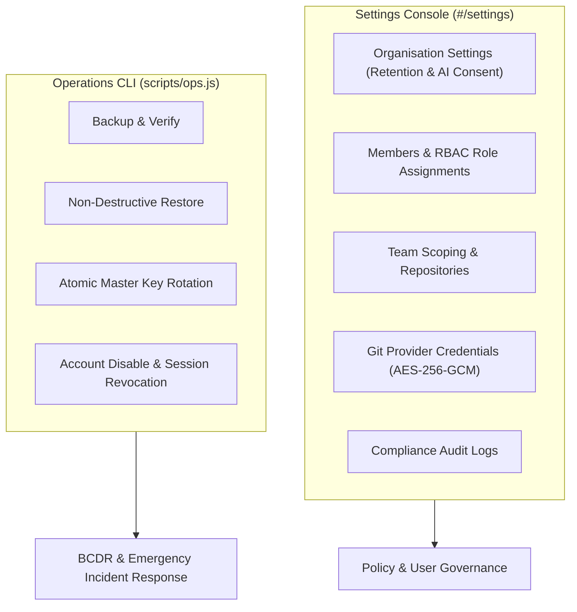

# Administrator Guide

> **Document ID:** VS-DOC-38  
> **Status:** Approved Baseline  
> **Version:** 1.0.0  
> **Date:** November 2026  
> **Target Audience:** System Administrators, Security Officers, DevOps Leads  

---

## 1. Administrative Responsibilities & Scope

As an Administrator or Owner in VulnSight AI, you are responsible for organization governance, user access management, Git provider credentials, AI privacy policies, data retention enforcement, and platform disaster recovery.



---

## 2. Organization Governance & Security Policies

Navigate to **Settings > Organisation** (`#/settings/organisation`) to manage organization-wide settings:

### 2.1 Retention Period Management
- **Setting:** `Retention Period (Days)`
- **Default:** `90 days` (Configurable between `1` and `3650` days).
- **Behavior:** The automated background retention job runs daily:
  - Purges scans, raw scanner dumps, and unreferenced findings older than the retention threshold.
  - Purges expired user sessions, finished job records, old notifications, and historical AI Q&A logs.
  - Deletion events are permanently logged in the audit trail.

### 2.2 Artificial Intelligence Privacy & Consent Controls
VulnSight AI enforces a strict zero-leakage AI policy:
1. **Enable AI Assistant (`aiEnabled`):**
   - Must be explicitly checked to enable AI features for organization members.
   - If disabled, all AI endpoints fail immediately, and no requests are dispatched to Anthropic or OpenAI.
2. **Permit Sending Source Code Snippets (`sendCode`):**
   - Controls whether code snippets from SAST or IaC findings are transmitted to LLM providers.
   - When unchecked, the AI Assistant receives only metadata (package name, version, rule ID, CWE).
   - **Crucial Invariant:** Findings categorized as `secret` **never** transmit code snippets regardless of this setting.

---

## 3. User Management & Role-Based Access Control (RBAC)

Navigate to **Settings > Members** (`#/settings/members`) to manage organization members:

### 3.1 Role Permissions Matrix
VulnSight AI defines four explicit roles:

| Action / Capability | Viewer | Developer | Admin | Owner |
| :--- | :---: | :---: | :---: | :---: |
| **Read Repositories, Scans & Findings** | Yes | Yes | Yes | Yes |
| **Download Compliance Reports & SBOMs** | Yes | Yes | Yes | Yes |
| **Trigger On-Demand Scans (`scans:run`)** | No | Yes | Yes | Yes |
| **Triage Findings (`findings:write`)** | No | Yes | Yes | Yes |
| **Use AI Assistant (`ai:use`)** | No | Yes | Yes | Yes |
| **Add / Edit Repositories (`repos:write`)**| No | No | Yes | Yes |
| **Manage Teams (`teams:manage`)** | No | No | Yes | Yes |
| **Invite & Manage Members (`members:manage`)**| No | No | Yes | Yes |
| **Connect Git Providers (`providers:manage`)**| No | No | Yes | Yes |
| **Inspect Audit Logs (`audit:read`)** | No | No | Yes | Yes |
| **Modify Org Settings (`org:settings`)** | No | No | Yes | Yes |
| **Delete Organisation (`org:delete`)** | No | No | No | **Yes** |

### 3.2 Member Invariants
- **Inviting Members:** Enter the colleague's email address and assign an initial role.
- **Role Elevation / Demotion:** An Admin can modify roles between Viewer, Developer, and Admin. Only an Owner can grant Owner privileges.
- **Last Owner Protection:** The platform strictly prohibits deleting or demoting the last remaining Owner of an organization to prevent orphaned organizations.

---

## 4. Git Provider Integrations

Navigate to **Settings > Integrations** (`#/settings/providers`):
1. **Adding a Git Provider Token:**
   - Click **"Connect Provider"**.
   - Select `GitHub`, `GitLab`, or `Bitbucket`.
   - Provide a descriptive label (e.g., `Production GitHub Enterprise Token`).
   - Enter a Personal Access Token (PAT) with `repo:read` scope.
2. **Storage Security:**
   - The token is encrypted immediately in memory via AES-256-GCM under the master key before writing to `provider_connections`.
   - The plaintext token is **never** displayed in the UI and is **never** returned by any API endpoint.
   - Scan jobs receive the token only via ephemeral, single-use grant secrets.

---

## 5. Operations & Disaster Recovery Runbook (`scripts/ops.js`)

Platform administrators have direct access to offline database management utilities:

### 5.1 Online Backup Creation
```bash
node scripts/ops.js backup /path/to/platform.db /backups/platform-$(date +%Y%m%d%H%M%S).db
```
- Performs a non-blocking SQLite `VACUUM INTO` operation.
- Refuses to overwrite existing files.
- Automatically validates the backup's internal integrity.

### 5.2 Backup Integrity Verification
```bash
node scripts/ops.js verify /backups/platform-20261103.db
```
- Runs `PRAGMA integrity_check` and `PRAGMA foreign_key_check`.
- Outputs counts of users, organizations, repositories, scans, and findings.

### 5.3 Non-Destructive Database Restore
```bash
node scripts/ops.js restore /backups/platform-20261103.db /data/platform.db
```
- Automatically moves the active database to `/data/platform.db.bak.<timestamp>`.
- Restores the backup file and applies any pending newer schema migrations.

### 5.4 Master Encryption Key Rotation
In the event of a suspected key exposure:
```bash
OLD_KEY="<OLD_KEY_BASE64>" NEW_KEY="<NEW_KEY_BASE64>" node scripts/ops.js rotate-key /data/platform.db
```
- Re-encrypts all stored Git tokens, webhook secrets, and pending grants in a single atomic transaction.
- The old master key will immediately fail to decrypt any records.

### 5.5 Emergency Account Quarantine
To immediately disable a compromised user account and revoke all their active sessions:
```bash
node scripts/ops.js disable-user /data/platform.db "compromised-user@example.com"
```
To revoke all active sessions across the entire platform during a major security incident:
```bash
node scripts/ops.js revoke-sessions /data/platform.db
```
