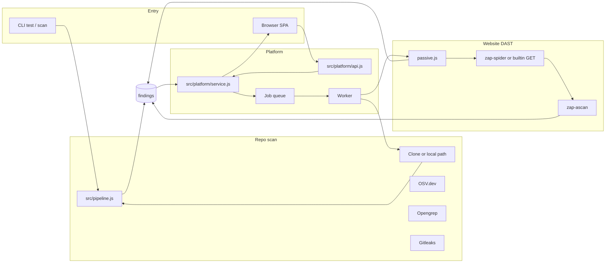

# VulnSight AI — code walkthrough

This document describes **what the current source tree does**, file by file of behaviour. It is written from the code in this repository, not from a single conversation or a single contributor. Older files under `document/` are architecture notes; if they disagree with this file, **the code wins**.

VulnSight AI is a **security scanning product**. It finds:

1. Known-bad **packages** (SCA via OSV.dev).
2. Unsafe **application code** and leaked **secrets** in a local folder or a Git repository (SAST / Gitleaks).
3. **Website configuration and runtime issues** against a URL you add (DAST: headers, TLS, cookies, CORS, optional crawl, optional OWASP ZAP active scan).

Optional AI **explains** findings in plain language. It does not invent scanner facts, and it does not change severity.

---

## 1. What you can run

Entry point: `bin/vulnsight.js` → `src/cli.js`. Environment is loaded from `.env.local` then `.env` (`src/env.js`).

| Command | What the code does |
|---|---|
| `vulnsight test [path\|url]` | Dependency scan only (lockfiles → OSV.dev). Can clone a Git URL first (`src/git.js`). |
| `vulnsight scan [path]` | Full pipeline: SCA + code + secrets (+ optional Trivy/Checkov). |
| `vulnsight serve` / `vulnsight ui` | Enterprise platform: HTTP API, static web UI, SQLite, background worker (`src/platform/app.js`). Default `http://127.0.0.1:4400`. |

Node **22.5+** is required for the platform because storage uses `node:sqlite` (`src/platform/db.js`). The CLI scanner path can run on Node 18+ if you only use `test`/`scan` without `serve`.

Website DAST runs **only** through `serve` (queued job `website_scan`). There is no CLI `vulnsight dast` command.

---

## 2. High-level shape of the repo

```
bin/vulnsight.js          CLI
src/
  cli.js                  commands, flags, exit codes
  detect.js + parsers/    lockfile discovery and parse
  osv.js, scanner.js      OSV.dev SCA
  adapters/               SCA, Opengrep, Gitleaks, Trivy, Checkov, DAST
  adapters/dast/          website passive, crawl, ZAP, scope, plain English
  pipeline.js             runs selected **repo** adapters together
  findings.js, risk.js    unified finding model and posture score
  platform/               multi-tenant API, jobs, git clone, websites, auth
  ai/                     explain / fix / ask / website DAST summary
web/src/                  React SPA (hash routes), bundled to web/app.js
deploy/Dockerfile.dast    unused ZAP+Node image (see §6.8)
examples/                 fixtures (npm-app, python-app, insecure-app)
test/                     node:test suite
```



There are **three paths in one tree**:

1. **Library/CLI scanner** — parse lockfiles, query OSV, print a report (`src/index.js`, `src/report.js`).
2. **Repo platform scans** — users, orgs, repos, queued `scan` jobs, triage, reports, AI (`src/platform/*`, `web/`).
3. **Website DAST** — `websites` + `website_scans` + queued `website_scan` jobs. Does **not** call `runPipeline`. Findings live inside `website_scans.passive_results`, not the repo `findings` table.

The platform **calls the same pipeline** the CLI uses for Git/folder scans (`runPipeline` in `src/pipeline.js`). Website jobs call `runPassiveScan`, then optionally `runWebsiteCrawl` / `runZapActiveScan`.

---

## 3. Dependency scanning (SCA) — packages

This is the original core. It does **not** execute application code. It reads **lockfiles**.

### Discovery (`src/detect.js`)

Walks a directory (skips `node_modules`, `.git`, venvs, etc.) and loads:

| Ecosystem | Files | Parser |
|---|---|---|
| npm | `package-lock.json`, `npm-shrinkwrap.json` | `src/parsers/npm.js` |
| yarn / pnpm | `yarn.lock`, `pnpm-lock.yaml` | `src/parsers/js-lock.js` |
| Go | `go.sum` | `src/parsers/go.js` |
| Python | `requirements*.txt`, `poetry.lock`, `Pipfile.lock` | `src/parsers/python.js` |

`--dev` includes development dependencies where the parser supports it.

### Lookup (`src/osv.js`, `src/scanner.js`)

- Batches `{ name, version, ecosystem }` to `https://api.osv.dev/v1` (`querybatch`, then `vulns/{id}`).
- Overridable with `VULNSIGHT_OSV_API`.
- Merges aliases (CVE / GHSA / PYSEC), picks a **fixed version** above the installed one (`src/versions.js`).
- Severity: advisory rating, else CVSS (`src/severity.js`).

Adapter: `src/adapters/sca.js` wraps this as scanner name `osv`, category `sca`. After findings exist, `src/code-context.js` searches the tree for `require`/`import` of the vulnerable package and attaches **usage** file:line snippets so AI and the UI can talk about application code, not only the lockfile.

### CLI `test` output

`src/report.js` prints text or JSON, including an upgrade plan per project. Exit codes: `0` clean, `1` issues, `2` error, `3` no supported files.

---

## 4. Full scan pipeline — one repo copy, several scanners

`src/pipeline.js` builds adapters and `src/adapters/index.js` `scanTarget()` runs them **in parallel** (`src/adapters/runner.js`). One scanner failing does not cancel the others; each result has `status`: `ok` | `skipped` | `error` | `timeout`.

Default scanners: **`sca`, `semgrep`, `gitleaks`**. Optional: `trivy`, `trivy-image`, `checkov`.

Every adapter implements:

- `name`, `category`
- `version()`, `supports(target)`, `run(target)` → `{ findings, raw? }`

Findings are normalized by `src/findings.js` (`createFinding`) into categories: `sca` | `sast` | `secret` | `container` | `iac` | **`dast`**. Duplicates are merged by fingerprint (same issue, same place). Scanner facts never include AI text (`aiAnalysis` is always `null` on the finding object). Website DAST findings use `category: 'dast'` and location fields `url` / `parameter`.

### 4.1 Code scanning (SAST) — `src/adapters/semgrep.js`

The pipeline id is still `semgrep` (config and API). Behaviour in code today:

1. **Opengrep first.** `ensureOpengrep()` in `src/adapters/tools.js` looks on `PATH` and `~/.vulnsight-tools`. If missing, it **downloads** the official binary (pinned `OPENGREP_VERSION`, Windows `opengrep_windows_x86.exe` → `opengrep.exe`). Same pattern as Gitleaks.
2. Runs `opengrep scan --json --quiet --config <local yaml> .` inside the cloned tree.
3. Rules are **this repo’s** pack: `src/adapters/sast-rules/vulnsight.yml` (XSS via `res.send` + request data, command injection, `eval`, Python `shell=True` / `os.system`). Not the Semgrep Cloud registry (`p/default`).
4. JSON is mapped in `parseSemgrep()` (shared Semgrep/Opengrep output shape). Secret-like rules drop evidence.
5. If Opengrep cannot run, **`src/adapters/builtin-sast.js`** walks `.js`/`.ts`/`.py` and flags the same classes of bugs with call-aware matching (not a 360-character regex window).
6. ESLint path exists (`src/adapters/eslint-sast.js` + `eslint-plugin-vulnsight.js`) when tests or an injected engine select it; the default live path is Opengrep (or builtin).

UI label: **Code (Opengrep)**. Version string on the scan is the engine (e.g. `opengrep …` or `builtin-rules`).

This is **not** a hosted “OSV for source”. Application XSS/injection is found by reading **this** clone.

### 4.2 Secrets — `src/adapters/gitleaks.js`

- `ensureGitleaks()` downloads Gitleaks `8.24.2` into `~/.vulnsight-tools` if needed.
- Runs `detect --no-git --redact` with a report file **outside** the scanned tree (stdout `-` would create a file named `-` in the repo).
- Evidence is always redacted (`[REDACTED]`).
- If the binary still cannot run: `src/adapters/builtin-secrets.js` (token-shaped patterns, also redacted).

### 4.3 Trivy and Checkov (optional)

- `src/adapters/trivy.js` — filesystem vulns + misconfig, or image mode.
- `src/adapters/checkov.js` — IaC (e.g. Terraform).
- These are **not** auto-downloaded. Missing binary → adapter `error` status, rest of the scan continues.

### 4.4 Tool execution

`execTool` in `src/adapters/runner.js` spawns **without a shell**, caps stdout, respects abort/timeout. `src/adapters/which.js` resolves Windows `PATHEXT` (`.exe`, `.cmd`) and `VULNSIGHT_TOOLS_DIR` / `~/.vulnsight-tools`.

---

## 5. How a Git repo is scanned on the platform

This is the path when a user pastes a Git URL or clicks scan on a connected repository.

1. **Record a scan** (`src/platform/service.js` `scans.start` / `quickScan`) with status queued; enqueue job `scan`.
2. **Worker** (`src/platform/queue.js`) picks the job. Scanners **do not** run inside the API request.
3. **Clone** (`src/platform/git.js` / `src/git.js`) into a temp directory, specific branch, optional token via **scan grant** (one-time secret; PAT is not stuffed into the job payload).
4. **Sandbox** (`src/platform/sandbox.js`, `executors.js`):
   - `VULNSIGHT_SANDBOX=process` (default local): child process, scrubbed env (`scan-job.js` / `scan-child.js`). **Not** a security boundary for untrusted code.
   - `docker`: read-only root, dropped caps, network via egress proxy (`src/platform/egress-proxy.js` allowlists e.g. `api.osv.dev`).
   - `aca`: Azure Container Apps job (`src/platform/aca.js`).
5. Child runs `runPipeline({ path: workspace })`.
6. Results written: `scans`, `findings`, `scan_raw`; clone directory **deleted**.
7. UI polls `GET /api/v1/orgs/:org/scans/:scan`.

Local folder scan: if `clone_url` is a filesystem path that exists, the executor uses that directory instead of Git.

Schedules (`automation.tickSchedules`, every 60s) and **webhooks** (`POST /api/v1/webhooks/:repo`, HMAC/token verified) start the same job type.

---

## 6. Website DAST (live URL)

This is the work added after the repo scanner: a second product surface under **Websites** in the SPA. Code lives in `src/adapters/dast/*`, `src/platform/dast-verifier.js`, `platform.websites` in `service.js`, and `web/src/views/WebsitesView.jsx` / `WebsiteScanView.jsx`.

### 6.1 Adding a target

`POST /api/v1/orgs/:org/websites` with a public `http:` or `https:` URL.

`validateTargetUrl` in `src/adapters/dast/passive.js`:

- Parses the URL.
- Rejects credentials in the URL, non-http(s) schemes, and unusual ports (only 80/443).
- Resolves DNS and rejects **private / loopback / link-local / metadata** addresses (`isPrivateIp` from `src/platform/git.js`) so the scanner cannot be pointed at internal networks (SSRF).

A `websites` row stores `target_url`, `hostname`, `verification_token` (`vs-verify-…` from `generateVerificationToken`), `is_verified`, `config` (scope/limits JSON), unique per `(org_id, target_url)`.

Optional Mongo: `src/db.js` collections `websites`, `website_scans`, `crawl_pages`, `crawl_endpoints`, `crawl_forms`, `crawl_links` (names overridable with `MONGODB_*_COLLECTION`). SQLite is still the live system of record.

### 6.2 Ownership verification

Crawl and active scan **require** `is_verified = 1`. Passive scan does not.

`src/platform/dast-verifier.js` `checkOwnership`:

1. DNS TXT on `_vulnsight-challenge.<hostname>` or the apex, value equal to the token.
2. HTTP GET `/.well-known/vulnsight-verify.txt` (200, body equals the token). Uses `validateTargetUrl` before fetch.

The UI (`WebsitesView` verify modal) also offers **self-certify**: `POST .../websites/:site/verify` with `{ manual: true }` sets `verification_method = 'manual_authorization'`. That is an operator attestation in the product, not a cryptographic proof of DNS control.

### 6.3 Scan profiles

`normalizeProfile` in `src/adapters/dast/scope.js`:

| UI / API profile | Normalized | What the worker does |
|---|---|---|
| `passive` | `passive` | Headers, TLS, cookies, CORS, tech hints. No crawl. Allowed unverified. |
| `crawl` or alias `standard` | `crawl` | Passive + GET-only spider (ZAP Traditional if `ZAP_API_URL`, else builtin HTML-link crawler). |
| `crawl_js` or alias `deep` | `crawl_js` | Same, plus ZAP ajax/client spider when ZAP is configured (JS-rendered links). Builtin fallback is still GET-only HTML. |
| `ascan` (aliases `active`, `attack`, `zap-ascan`, `exploit`) | `ascan` | Crawl, then OWASP ZAP **ascan**. Requires `authorizeActiveTesting: true` **and** verified site. |

`startScan` also caps five concurrent queued/running website scans per org.

Limits (`normalizeLimits`): `maxDepth` 1–8 (default 3), `maxPages` 1–200 (default 40), `maxDurationSec` 15–900 (default 180), `maxRps` 1–5 (default 2). Scope: `allowHosts` (always includes the site hostname), `allowPaths` (default `/`), `denyPaths`, `extraHosts`.

`PATCH .../websites/:site` updates that scope JSON.

### 6.4 Job `website_scan` (`handleWebsiteScanJob`)

Worker steps (`src/platform/service.js`):

1. Mark `running`.
2. `runPassiveScan(target_url)` — always.
3. If profile is crawl / crawl_js / ascan: require verified; `setScanEgressHosts(allowHosts + extraHosts)`; `dastCrawl(...)`; persist inventory; merge crawl findings.
4. If profile is `ascan`: `dastAscan(...)` (fails if `ZAP_API_URL` is missing); merge ZAP alerts.
5. `postureScore(findings)` + `summarize`.
6. Optional `ai.summarizeWebsiteDast` when org AI is on and `GROQ_API_KEY` is set.
7. Store everything in `website_scans.passive_results` (the name is historical: it holds **all** DAST findings for that run, including ZAP ascan).
8. Notify owners if any critical/high findings.

Pause / cancel / resume: status on the row; crawl/ascan `shouldStop` reads cancelled/paused. Progress JSON and `engine` columns are updated while ZAP or the builtin spider runs.

### 6.5 Passive checks (`src/adapters/dast/passive.js`)

One GET of the target. Findings for missing or weak:

- `Strict-Transport-Security` (medium)
- `Content-Security-Policy` (medium)
- `X-Frame-Options`, `X-Content-Type-Options`, `Referrer-Policy`, `Permissions-Policy` (low)
- Cookie flags (Secure / HttpOnly / SameSite) when cookies exist
- CORS `Access-Control-Allow-Origin: *` with credentials, or wildcard on non-public data
- TLS: expired cert, soon-to-expire, deprecated protocol, plain HTTP

TLS object written by the scanner includes both `valid` and `authorized` (same boolean) plus `authError` / `authorizationError` and `daysLeft` / `daysRemaining`, so the UI badge is not stuck on a missing field.

Scanner name on these findings: `vulnsight-passive`, with rule ids such as `header-strict-transport-security`.

### 6.6 Crawl (`src/adapters/dast/zap-spider.js`, `crawler.js`, `safe-fetch.js`)

`runWebsiteCrawl`:

- If `ZAP_API_URL` is set: ZAP Traditional Spider (`/JSON/spider/...`). Form POST processing is turned **off**. Optional ajax spider for `crawl_js`. Results mapped into pages / endpoints / forms / links. Forms are **recorded, never submitted**.
- If ZAP is down and `requireZap` is not set: **builtin GET crawler**. Follows `<a href>` in HTML only. SPAs that render routes only in JavaScript typically yield **one page**.
- `safeGet` refuses POST/PUT/PATCH/DELETE, re-validates each URL, stays in scope, follows at most five redirects.

Sensitive-path probes in `crawler.js` (`.env`, `/.git/HEAD`, `robots.txt`, `security.txt`) are GET checks with body heuristics — not exploit payloads.

Inventory tables: `crawl_pages`, `crawl_endpoints`, `crawl_forms` (`submitted` always stored/shown as false for GET-only), `crawl_links`.

### 6.7 Active scan (`src/adapters/dast/zap-ascan.js`)

`runZapActiveScan` **requires** `ZAP_API_URL` (optional `ZAP_API_KEY`). It does not fall back to the GET crawler. The error if ZAP is missing is: active exploit scanning needs OWASP ZAP.

It calls ZAP `/JSON/ascan/action/scan/`, polls status, maps `/JSON/core/view/alerts/` through `mapZapAlert` → `createFinding` with `scanner.name = 'owasp-zap-ascan'`, `ruleId` = plugin id, evidence truncated and redacted (`redactEvidence`).

This path is **not** wrapped in the repo Docker sandbox today. `deploy/Dockerfile.dast` exists as a ZAP + Node image **but the comments in that file say it is not used until ZAP_API_URL, live Docker, and per-scan egress are verified**. Local development typically runs ZAP 2.x as a daemon on `http://127.0.0.1:8080` and points `ZAP_API_URL` at it. Do not treat that as production isolation.

### 6.8 Egress during website jobs

`src/platform/egress-proxy.js`: CONNECT-only, port 443, default allowlist (GitHub, OSV, Semgrep, GHCR, …). `setScanEgressHosts` adds the **current website hostname(s)** for the duration of crawl/ascan, then `clearScanEgressHosts`. Private DNS answers are still denied. This only applies when the sandbox actually uses the proxy (`VULNSIGHT_SANDBOX=docker`). Default `process` sandbox talks to the target directly from the Node worker.

### 6.9 Posture score on website scans

Same function as repo scans: `src/risk.js` `postureScore`.

```
score = max(0, round(100 − Σ COST[severity] × √count))
COST = { critical: 25, high: 10, medium: 3, low: 1 }
grade: A ≥ 90, B ≥ 75, C ≥ 60, D ≥ 40, else F
```

One medium finding → 100 − 3 = **97, grade A**. Many ZAP lows/mediums (typical ascan on a marketing site) drop the score into C/D quickly. The UI cards on `WebsiteScanView` show score/grade, critical count, high count, medium+low, endpoints inspected.

### 6.10 Plain English explanations

After **Details**, the findings table has a **Description** column (Explain button).

- UI: `WebsiteScanView` `POST .../websites/:site/scans/:scan/findings/:id/explain` (finding id is a 16-hex fingerprint from `createFinding`).
- Service: load finding from `passive_results.findings`; always compute a local paragraph via `plainEnglishForFinding` (`src/adapters/dast/plain-english.js`).
- If org `aiEnabled` and an AI provider exist: `ai.explainWebsiteFinding` (short, no-jargon prompt; no attack instructions). Stored in `ai_history` as kind `website_explain`. On AI failure, return the rule text (`source: 'rules'`).
- Rule map covers VulnSight header rule ids and common ZAP plugin ids (HSTS, CSP, XFO, cache-control, server banner, cookie flags). Unknown rules fall back to the scanner description + severity phrase + remediation advice.

The expanded row shows “In plain English” **above** Description / Technical Evidence / Remediation. AI answers are still not written into the finding object.

Website reports: `GET .../scans/:scan/report?format=json|markdown|csv` (same idea as repo export; CSV formula-escaped).

### 6.11 UI

| Hash | View |
|---|---|
| `#/websites` | Add URL, verify modal (DNS / well-known / self-certify), Passive / Crawl / Exploit scan buttons |
| `#/websites/:id/scans/:scan` | Score cards, tabs: Vulnerabilities, Security Headers & CORS, Cookies, TLS, Endpoints & Forms, Pages, Technologies. Filter by severity. Export JSON / Markdown / CSV. View + Explain. |

Exploit scan button sends `{ profile: 'ascan', authorizeActiveTesting: true }` after the operator confirms in the UI.

---

## 7. Unified findings, risk, reports

| Piece | Role |
|---|---|
| `src/findings.js` | Fingerprint, categories including `dast`, statuses `open` / `acknowledged` / `suppressed` / `fixed` |
| `src/risk.js` | Extra 0–10 risk number (does **not** overwrite scanner severity); org **posture** 0–100 and letter grade (see §6.9) |
| `src/reports/export.js` | JSON, CSV (formula-injection escaped), Markdown, CycloneDX SBOM for **repo** scans |
| Platform | `GET .../scans/:scan/report?format=` (repos) and `GET .../websites/:site/scans/:scan/report` (websites) |

Repo triage: `PATCH .../repos/:repo/findings/:fp` with note; history in `finding_reviews` / `finding_states` (org-scoped, not per scan only). Website DAST findings are not in that table; they are JSON inside the website scan row.

---

## 8. Enterprise platform (multi-tenant)

Started by `src/platform/app.js` `startPlatform()`:

- SQLite file `.vulnsight-data/vulnsight.db` (or `VULNSIGHT_DB`)
- Master key `VULNSIGHT_MASTER_KEY` or generated `dev-master.key` (encrypts Git tokens, webhook secrets)
- HTTP server + static files from `web/`
- Worker + 60s scheduler + daily retention purge (includes old `website_scans`)

### Auth and tenancy (`service.js`, `rbac.js`)

- Signup / login / session token (`POST /api/v1/auth/...`, `GET /api/v1/me`)
- Organisations, memberships, teams
- Roles: **viewer**, **developer**, **admin**, **owner** with explicit permissions (`scans:run`, `ai:use`, `org:settings`, …). Checked in the **service layer**, not only in the UI.

Website list/get uses `repos:read` / `scans:read`; create/verify/remove uses `repos:write`; start/cancel uses `scans:run`.

### Git providers (`src/platform/providers/index.js`)

GitHub, GitLab, Bitbucket. Tokens validated; GitHub expiration header and OAuth scopes stored. List remote repos/branches. Hosts are **fixed** in code (users cannot point the client at an arbitrary URL to SSRF internal APIs).

### Limits and hygiene

- Rate limiter on the API (`api.js`)
- Security headers + CSP `script-src 'self'` (no CDN React; the bundle is `web/app.js`)
- Audit log, in-app notifications
- Retention (`orgs` settings `retentionDays`) deletes old scans, AI history, notifications
- Request body size caps; webhook body larger cap

### Optional MongoDB (`src/db.js`)

If `MONGODB_URI` is set: upsert scan documents, **organisation settings**, Git connections, **websites and website scans**, crawl inventory. SQLite remains the system of record for the live app. Overview can **sync** history from Mongo (`POST .../mongo/sync`). Connection failure is non-fatal (logs a warning). Settings persist-then-apply so deleted teams are not resurrected from stale Mongo on every save.

---

## 9. Web UI (`web/src`)

React 19, built with esbuild to `web/app.js` (`npm run build:web`). Hash router in `web/src/App.jsx`.

| Hash | View | What it does in code |
|---|---|---|
| `#/overview` | `OverviewView.jsx` | Org totals, severity mix, trend, recent scans, website snapshot, optional Mongo sync |
| `#/new-scan` | `NewScanView.jsx` | `POST .../quick-scan` with folder path or Git URL + branch + threshold; link to Websites |
| `#/repos` | `ReposView.jsx` | Add/list repos, scanner checkboxes, schedule, webhook URL, PAT-backed connections |
| `#/repos/:id` | repo detail | Branches, config, start scan |
| `#/websites` | `WebsitesView.jsx` | Add URL, verify, passive / crawl / ascan |
| `#/websites/:id/scans/:scan` | `WebsiteScanView.jsx` | DAST results, inventory tabs, export, Explain |
| `#/scans/:id` | `ScanView.jsx` | Poll **repo** scan; scanner table; findings list; triage; Explain / Suggest fix; AI briefing; usages |
| `#/assistant` | `AssistantView.jsx` | Repo-scoped ask + summary + history |
| `#/reports` | `ReportsView.jsx` | Completed repo scans, download formats (export preview modal) |
| `#/settings` | `SettingsView.jsx` | Profile/theme, org name, AI on/off, send-code consent, retention, members, teams, Git providers (live PAT check), notifications, audit |

Auth screens: `AuthView.jsx`. Shared widgets: `Common.jsx` (markdown-safe `AiAnswer`, tables, badges, skeleton loaders). Theme: light / dark / auto (`api.js` `themeStore`).

The UI **never** treats AI text as a scanner finding. Explain/fix call separate endpoints.

---

## 10. AI (`src/ai/`, `src/ai.js`)

Layers:

1. **Assistant** (`src/ai/assistant.js`) for the platform:
   - Repo: explain finding, suggest fix, ask a question, summarize latest scan.
   - Website: `summarizeWebsiteDast` after a DAST job; `explainWebsiteFinding` per finding (plain English, four sentences, no payloads).
   - Providers: Groq, OpenAI, Claude (`src/ai/providers.js`), selected by `VULNSIGHT_AI_PROVIDER` / keys.
   - Org flags `aiEnabled` and `aiSendCode`. Secrets **never** send evidence. Untrusted text is wrapped in `<untrusted>` and injection phrases are stripped. AI output is stored in `ai_history`, **not** merged into `findings.data` as truth.
2. **CLI-style briefing** (`src/ai.js`) — Groq JSON executive summary of an SCA report (package-oriented).

AI cannot change severity or finding status in code. Those fields only change via triage APIs (repo findings). Website findings have no separate triage table yet.

---

## 11. HTTP API surface (`src/platform/api.js`)

Prefix `/api/v1`. Org-scoped routes use `/api/v1/orgs/:org/...`. Route params match `[\w.-]+` (website finding ids are 16-char hex, so they fit).

**Public:** health, signup, login, webhook, internal scan-grant redeem.

**Session:** logout, me, create org.

**Org:** overview, settings, rename/delete, members, teams, audit, notifications.

**Git:** connections CRUD, live token check, list remote repos/branches.

**Repos:** CRUD, schedule, webhook secret, branches.

**Scans (repo):** start, quick-scan, list, get, cancel, findings, report download, Mongo sync.

**Findings (repo):** patch status/note, history.

**Websites:**

- `GET/POST /websites`, `GET/DELETE /websites/:site`, `PATCH /websites/:site` (scope)
- `POST /websites/:site/verify`
- `POST /websites/:site/scans` body `{ profile, limits?, authorizeActiveTesting? }`
- `GET` scans, `GET` one scan, pause / resume / cancel
- `GET .../pages`, `.../endpoints`, `.../forms`
- `POST .../findings/:finding/explain`
- `GET .../report?format=`

**AI (repo):** `POST /findings/:finding/explain`, `/fix`, ask, summary, history.

Static: only basename files from `web/` (no path traversal). Unknown GET paths serve `index.html` for the SPA.

---

## 12. Data stored (`src/platform/db.js`)

SQLite migrations (in-file):

- v1–3: `users`, `sessions`, `orgs`, `memberships`, `teams`, `team_members`, `provider_connections`, `repositories`, `scans`, `scan_raw`, `findings`, `finding_states`, `finding_reviews`, `ai_history`, `audit_logs`, `notifications`, `jobs`, `scan_grants` (+ provider scope columns).
- **v4:** `websites`, `website_scans`.
- **v5:** `website_scans.progress`, `.limits`, `.engine`; `crawl_pages`, `crawl_endpoints`, `crawl_forms`, `crawl_links`.

Every customer-data query in the service layer filters `org_id`. Tokens at rest are encrypted (`src/platform/crypto.js`).

---

## 13. Security-relevant behaviour in code (not a pentest)

- No shell for repo scanners; output cap; timeouts
- Secrets redacted before storage / AI
- CSP without `unsafe-inline` scripts on the **platform** UI
- Git provider hosts allowlisted
- Egress allowlist in docker/proxy mode; per-website extra hosts during DAST jobs
- Website URL SSRF checks (public IPs only, 80/443)
- Crawl is GET-only; forms are not submitted by VulnSight crawlers
- Active ZAP scan gated on verification + `authorizeActiveTesting`
- Webhook signatures
- Scan grants instead of putting PATs on the job JSON
- CSV export prefixes `=` `+` `-` `@` so spreadsheet formula injection is harder
- Password hashing and session expiry (`test/hashing.test.js`, sessions table)

`docs/SECURITY.md` and `docs/STATUS.md` discuss intent vs verified status. Treat those as ops notes; re-read the adapters if you need current scanner behaviour.

**Not claimed:** production-ready Docker isolation for ZAP ascan; `Dockerfile.dast` is unused until that is wired and proven.

---

## 14. Tests and fixtures

`npm test` → `node --test` on `test/*.test.js` (on Windows the quoted glob in `package.json` may need explicit files). Platform tests need Node 22 for `node:sqlite`.

Coverage includes parsers, OSV client mocks, adapters JSON mapping, platform RBAC, API, git URL rules, AI injection sanitization, builtin SAST/secrets, Opengrep command lines, docker sandbox args, grants, egress proxy, **and DAST**:

| File | What it asserts |
|---|---|
| `test/dast-passive.test.js` | Header/TLS findings from a fixture server |
| `test/dast-crawler.test.js` | GET crawl inventory |
| `test/dast-scope.test.js` | Scope, limits, profile aliases, ascan gate |
| `test/dast-verifier.test.js` | DNS/HTTP ownership checks |
| `test/dast-ascan.test.js` | ZAP alert mapping / missing ZAP error |
| `test/dast-plain-english.test.js` | Everyday-language HSTS paragraph |
| `test/platform-websites.test.js` | Create, verify, passive scan, explain, reports, HTTP API, crawl vs ascan reject |

`examples/insecure-app` is a **deliberate** XSS / command injection / eval / secrets fixture. `examples/npm-app` / `python-app` are lockfile fixtures.

`test/real-tools.test.js` is skipped unless `VULNSIGHT_TOOLS_DIR` is set (live binaries).

---

## 15. Configuration people actually use

Loaded by `src/env.js` (process env wins over files).

| Variable | Used for |
|---|---|
| `GROQ_API_KEY` / `OPENAI_API_KEY` / `ANTHROPIC_API_KEY` | AI |
| `VULNSIGHT_AI_PROVIDER`, `VULNSIGHT_AI_MODEL`, `GROQ_MODEL` | which model |
| `MONGODB_URI`, `MONGODB_DB_NAME`, `MONGODB_COLLECTION` | optional scan history |
| `MONGODB_WEBSITES_COLLECTION`, `MONGODB_WEBSITE_SCANS_COLLECTION`, `MONGODB_CRAWL_*_COLLECTION` | optional website DAST docs |
| `VULNSIGHT_MASTER_KEY` | encrypt secrets (required in production) |
| `VULNSIGHT_DB`, `VULNSIGHT_SANDBOX` | sqlite path; `process` / `docker` / `aca` |
| `VULNSIGHT_TOOLS_DIR` | where Gitleaks/Opengrep binaries live |
| `VULNSIGHT_OSV_API` | OSV base URL |
| `VULNSIGHT_TRUST_PROXY`, `VULNSIGHT_HSTS` | reverse-proxy / TLS headers |
| `ZAP_API_URL` | OWASP ZAP daemon (e.g. `http://127.0.0.1:8080`) for spider + ascan |
| `ZAP_API_KEY` | optional ZAP API key |

Do not commit `.env` / `.env.local`. `.vulnsight-data/` and `.vulnsight-tools/` are local runtime, gitignored.

Local ZAP (Windows example used in development): ZAP 2.17 daemon needs a JDK (`JAVA_HOME`), then `ZAP_API_URL=http://127.0.0.1:8080`. Confirm with ZAP’s JSON version endpoint before an ascan.

---

## 16. End-to-end: one user action → code

**New scan → GitHub URL**

1. `NewScanView` POST `/quick-scan`
2. Service creates/finds `repositories` row, `scans` row, job
3. Worker clones, runs `sca` + `semgrep` (Opengrep) + `gitleaks`
4. OSV returns package CVEs; Opengrep returns SAST hits; Gitleaks returns redacted secrets
5. Findings stored; UI `ScanView` lists them
6. Developer clicks Explain → `assistant.js` + Groq/OpenAI/Claude, answer in `ai_history` and on screen as AI-generated, not as a new CVE

**CLI `vulnsight test examples/npm-app`**

Only SCA. No clone, no Opengrep, no web session. Prints lockfile vulns from OSV.

**Websites → add URL → Passive scan**

1. `WebsitesView` POST `/websites`
2. POST `/websites/:id/scans` `{ profile: 'passive' }` (no verify)
3. Job `website_scan` → `runPassiveScan`
4. UI `WebsiteScanView` shows headers/TLS/cookies and findings
5. Explain → rules and/or `explainWebsiteFinding`

**Websites → verify → Crawl / Exploit scan**

1. DNS TXT, well-known file, or self-certify (`manual: true`)
2. Crawl: GET spider (ZAP Traditional if configured, else HTML links only)
3. Exploit / ascan: same plus ZAP ascan; fails loudly without `ZAP_API_URL`
4. Findings include `vulnsight-passive` and `owasp-zap-ascan`; posture uses √n costs
5. Pages / endpoints / forms tabs read crawl inventory APIs

---

## 17. What this codebase is not

- Not a functional test runner (it does not check that login “works”).
- Not a public API that scores a GitHub URL without cloning (except OSV for **packages**).
- Not Semgrep Cloud / GitHub Advanced Security. Opengrep runs **locally** (or in the worker sandbox).
- Not a full browser pentest studio. Builtin crawl does not execute page JavaScript. ZAP client spider only runs when ZAP is up.
- Not an authorization to attack third-party sites. Crawl/ascan are gated on verification + (for ascan) `authorizeActiveTesting`. The product does not ship SQL injection tutorials or exploit PoCs in the UI.
- README still describes an older “install Semgrep yourself” world; **current adapters auto-install Opengrep and Gitleaks**. Trivy/Checkov still need a manual install.
- `Dockerfile.dast` is **not** the live ascan runtime yet.

---

## 18. Where to read next in the tree

| If you need | Open |
|---|---|
| CLI flags and exit codes | `src/cli.js` |
| Lockfile → OSV | `src/detect.js`, `src/osv.js`, `src/scanner.js` |
| Running all **repo** scanners | `src/pipeline.js`, `src/adapters/` |
| Code scan engine | `src/adapters/semgrep.js`, `src/adapters/tools.js` (`ensureOpengrep`) |
| Builtin SAST fallback | `src/adapters/builtin-sast.js` |
| Website passive / TLS / headers | `src/adapters/dast/passive.js` |
| Scope, profiles, limits | `src/adapters/dast/scope.js` |
| GET crawl / ZAP spider | `src/adapters/dast/zap-spider.js`, `crawler.js`, `safe-fetch.js` |
| ZAP ascan | `src/adapters/dast/zap-ascan.js` |
| Plain English copy | `src/adapters/dast/plain-english.js` |
| Ownership verify | `src/platform/dast-verifier.js` |
| Website job + APIs | `src/platform/service.js` (`websites`, `handleWebsiteScanJob`), `src/platform/api.js` |
| HTTP routes | `src/platform/api.js` |
| Business logic | `src/platform/service.js` |
| Schema | `src/platform/db.js` |
| UI routes | `web/src/App.jsx` |
| Website UI | `web/src/views/WebsitesView.jsx`, `WebsiteScanView.jsx` |
| Finding explain/fix prompts | `src/ai/assistant.js` |

That is the product as implemented in this repository today.
